# 光姫 10秒間中間静止画制作仕様書 Ver0.1

## 1. 制作概要

2026年10月28日。開始と終了の2枚を固定し、1〜9秒の静止画9枚を生成した実験版。全11枚を収録する。主要3秒・5秒・7秒を先に生成し、次に1秒・2秒・4秒・6秒・8秒・9秒を生成した。合計9回、取得9枚、再生成0回。動画生成、外部有料動画サービス、Instagram投稿は行っていない。

画像生成成功と連続動画としての合格は別。今回の列には2→3秒、4→5秒、5→6秒など明確な不連続があり、滑らかな10秒動画としては未成立。NG画像も検証記録として収録し、正式採用しない。

## 2. 入力画像

- 入力A：１(1).png。0秒。images/HIK_00_Start.pngへ無変更コピー。
- 入力B：２－１(1).png。10秒。images/HIK_10_End.pngへ無変更コピー。
- 全9回で入力Aと入力Bの両方を参照。生成済み中間画像は人物入力へ使っていない。他のキャラクターや過去の人物成果物を参照していない。
- 今回の両端は直接のIdentity・Geometry・Rendering基準。兄絵は未添付で一致未検証。

参照した制作規則：00_運用規約_Ver1.9(1).docxの正本・設定マスターとドラフト区別、竜宮六姫_MIXXIA_ビジュアル制作仕様書_Ver0.5.docxのIdentityとGeometry継承、絵画的リアリズム仕様書MarkDown転記モード_ver2.2.mdの構造とRenderingの分離。SNS動画制作標準仕様書_Ver0.7.docxの「承認済みStart Frame／End Frame方式」も両端の状態を人間が定義する考え方として参照した。今回は静止画実験への応用であり動画生成をしたとは扱わない。

MIXXIAのファイル名Ver0.5と本文管理表Ver1.0には表記不一致が残る。独自修正しない。両端の腰飾りや背景の差も独自に正本へ統合せず、本実験の連続性の制約として記録する。

## 3. 開始画像と終了画像の差分分析

|項目|0秒原本|10秒原本|
|---|---|---|
| 顔と視線 | うつむき、目は胸元。髪が頬へ落ちる | 顎を上げ画面左上の生物を見る |
| 右手 | 人差し指が胸元ルミアへ接触、肘は低い | 肘を曲げ前腕を立て、顔の左下で指を開く 頭上伸展ではない |
| 左腕 | 画面右端側で一部見切れる | 身体横に下げたまま見える |
| 人物とカメラ | 人物右側の近景、下半身の一部が見切れる | 人物を小さく収め下半身と左上空を広く映す |
| ルミア | 胸中央の紫の円形アイテム、指先付近が発光 | 胸中央に残り左上へ紫の線が伸びる |
| 光の生物 | 未出現 | 角状突起・大きな翼・細長い身体・長い尾を持つ光の姿 |
| 衣装と髪飾り | 黒い星刺繍、鎖、星と垂れ宝石。腰の星群が複数見える | 同系衣装だが腰の星・鎖の見え方や髪のなびきが異なる |
| 背景 | 青金の尖頭アーチと吊り灯、反射床 | 同系空間を広く見せるが柱と灯りの一対一対応は未確認 |

両画像は同じ人物・同じ空間として制作するが、単一の立体モデルや同じ背景モデルから投影されたことは確認できない。画角差で隠れた部位とデザイン再解釈を画像だけで完全に区別できない。

## 4. 10秒間の動作設計

以下は生成前に設定した制作仮説。画像取得後に都合よく合格条件を変更せず、実画像の逸脱は第9節に記録する。終了像の肘が曲がっていることに合わせ、右腕は頭上へ直線的に伸ばさず、胸元から顔の左下へ開く動作とした。

|時点|動作|カメラ|光の演出|
|---|---|---|---|
| 0秒 | 原本。右指がルミアに接触、うつむく | 近景原本 | ルミア発光 |
| 1秒 | 接触維持、顎をわずかに上げる | ごく小さく後退 | 胸元の小粒子 |
| 2秒 | 人差し指をルミアから少し離す | 少し後退 | 短い上向き粒子 |
| 3秒 | 指を胸から離し右手を胸前で少し開く、視線を左上へ上げ始める | 近景と中景の間 | 胸から左上への細い光跡、まだ生物なし |
| 4秒 | 右肘を保ち前腕を上げ、指を緩める | 中景へ | 左上に光が集まる |
| 5秒 | 右手を肩付近まで上げ、掌を左上へ向ける | 中景、人物と上空を収める | 画面左上に薄い翼と身体の輪郭だけが出現 |
| 6秒 | 右手首を伸ばし、指先を光へ向ける | さらに後退 | 頭部・翼・尾が半透明に形成 |
| 7秒 | 右手が顎近くの高さ、顔を上げ光を見つめる | 終了よりやや近い広めの構図 | 終了像と同形の生物がほぼ形成、尾と翼は薄い |
| 8秒 | 右腕と指先を終了位置に近づける | 終了画角に接近 | 翼と尾を明瞭に、周囲の光跡が広がる |
| 9秒 | 終了姿勢へほぼ到達、光の生物を見上げる | 終了画角直前 | 完成に近い光と胸元からの細い光線 |
| 10秒 | 終了原本 | 終了原本 | 終了原本 |

## 5. カメラワーク設計

0秒の近景から10秒の広い画角まで、人物を画面右に保ちながら徐々に後退する計画。0〜3秒は小さく引き、4〜6秒で左上の形成空間を開き、7〜9秒で終了画角に近づける。カメラの回転や急な再構図は計画していない。単純な画像リサイズで中間画像を作る方法は使用しなかった。

生成プロンプトの一部では頭頂の画面高さ21〜22%付近などを指示したが、これは構図目安であり実測結果ではない。生成結果は5秒で引き過ぎ、6秒で人物が大きく戻っており、滑らかな後退は実現できていない。背景様式は近いが、柱と吊り灯の位置が同じ3D空間として連続するか未検証。

## 6. 光の生物の形成過程

終了像に見える角状突起・透ける大きな翼・細長い身体・長い尾を最終基準とする。生物の正式名称や種、ルミアの能力を新たに確定しない。青・紫・ピンク・白・金の色調を参照する。

計画は0〜2秒で胸元粒子、3〜4秒で光跡と集積、5秒で薄い輪郭、6秒で未完成の翼身体、7〜9秒で完成へ接近。実際は5秒に完成体が早出しされ、6秒で未完成へ戻った。したがって形成過程はNG。ルミアは全体を通じ胸中央に見えるが、枠・鎖・大きさの厳密な固定は未計測。光の演出は今回だけの仮案。

## 7. 0〜10秒の画像一覧

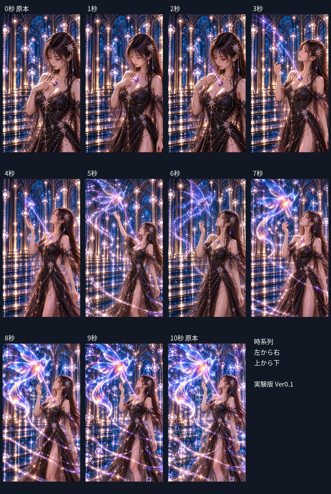

コンタクトシートは左から右、上から下の時系列。比較用サムネイルのみ縮小し、元ファイルは加工していない。

### 0秒

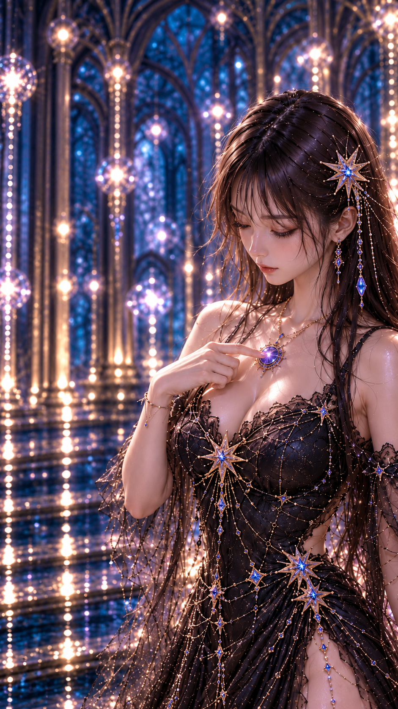

状態：原本を無変更で採用。開始原本を無変更で複製。全項目OKは提供された基準そのものとしての扱い。原画一致や正確な照明、動画接続の独立検証ではない。

### 1秒

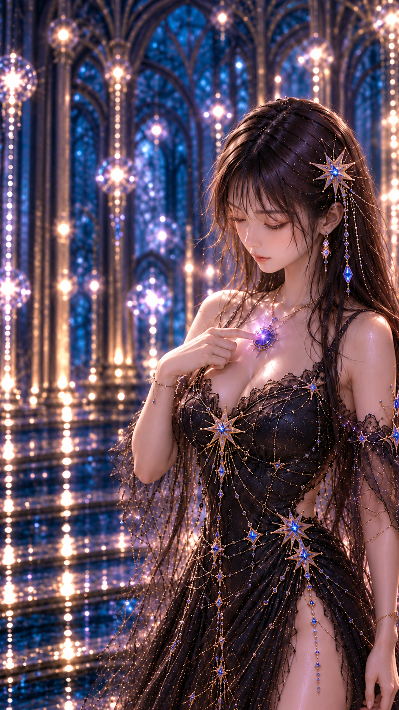

状態：要確認・未承認。右指は胸元へ接触し、生物は未出現。顔の上げ始めは明瞭でなく、0秒よりうつむきが残る。衣装の星と鎖、ルミア枠の細部は再構成の疑い。指は重なっており全本数を確証できない。

### 2秒


状態：要確認・未承認。右指が胸元から離れ、短い上方粒子が現れる。ルミアは胸中央を維持。カメラは1秒から連続的に引いたというより開始構図寄りに戻る。次の3秒への視線と手の飛躍が大きい。

### 3秒

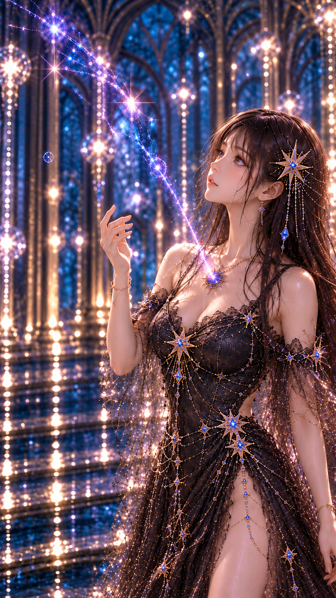

状態：NGを含む試験候補・未承認。指示は右手を胸前・肩より低く、視線を上げ始める段階。しかし画像は手が顔近くまで上がり、顔も強く上向き。2→3秒で動作が大きく飛ぶためMotion NG。生物なしの光跡という段階は概ね成立。

### 4秒

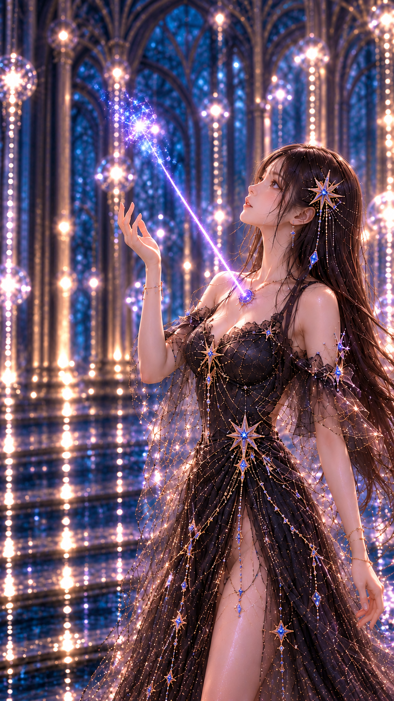

状態：NGを含む試験候補・未承認。右手は口より低くという指示に対し、指先は顔近くに見える。3秒から手がさらに上がり、初期計画の中間姿勢より先行しているためMotion NG。輪郭を持たない光集積は成立。

### 5秒

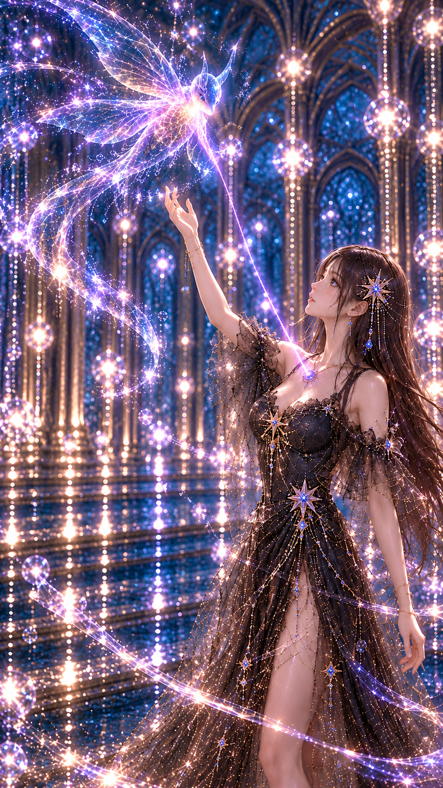

状態：NGを含む試験候補・未承認。右手を肩付近に置き薄い生物輪郭を出す指示に対し、腕が頭上へ伸び、光生物もほぼ完成。人物と建築が急に小さくなり、アーチ・吊り灯も再配置。Motion・Camera・Background・Light Creature NG。

### 6秒

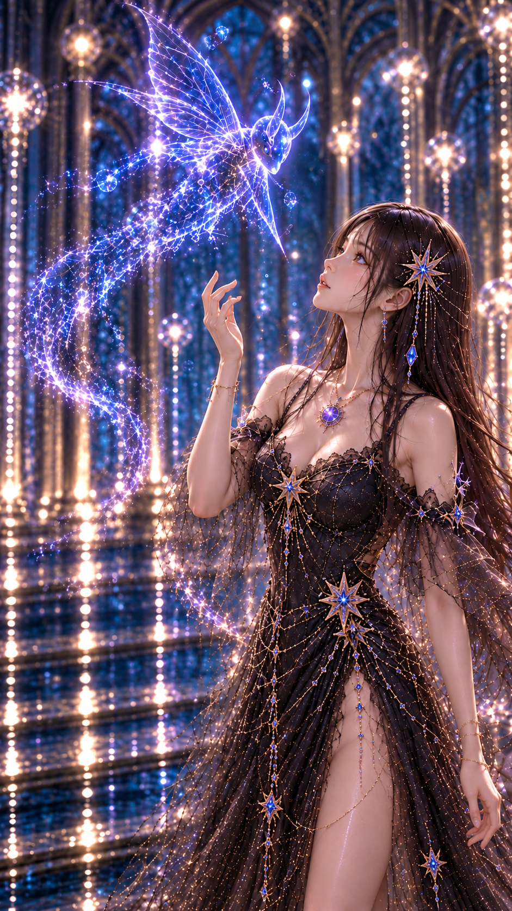

状態：NGを含む試験候補・未承認。腕は5秒の頭上伸展から顔近くへ戻る。人物が再び大きくなり、光の生物も5秒の完成状態から粒子状へ戻る。Motion・Camera・Background・Light Creature NG。意図した形成途中の単体表現は見えるが時系列が逆行。

### 7秒

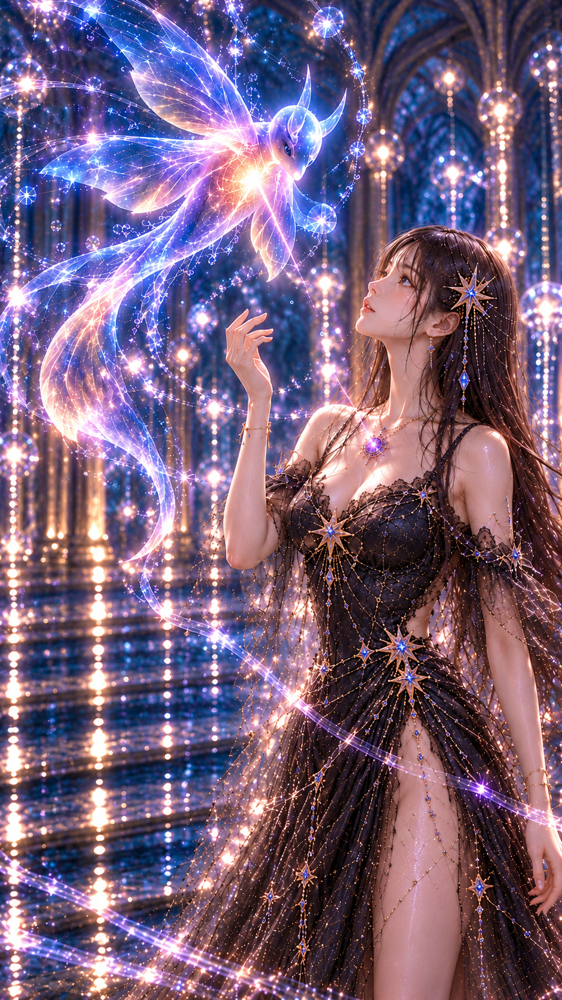

状態：要確認・未承認。右手は顔左下で終了姿勢に近づく。光の生物も同じモチーフだが、ほぼ完成状態で輪郭段階の漸進性は要確認。6秒からの光量・尾形状が変化し、腰の星と鎖も揺らぐ。

### 8秒

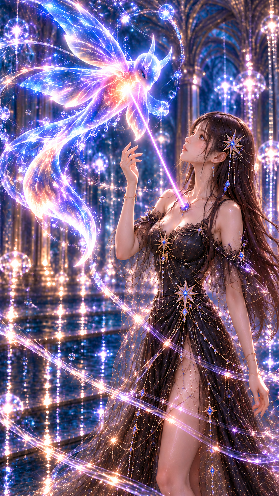

状態：要確認・未承認。終了に近い姿勢と画角。胸元から生物への紫線が明瞭になる。7→8秒で光量が急に増え、生物と尾の曲線・髪の広がり・腰飾りの配置が変化するため連続性は要確認。

### 9秒

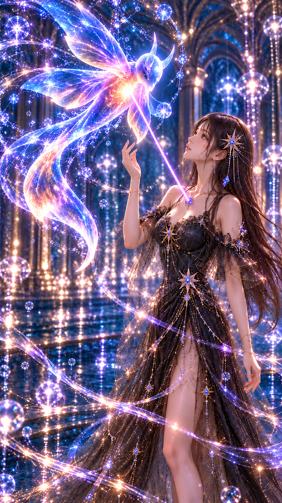

状態：要確認・未承認。終了原本に近い手・視線・構図を得た。9→10秒では髪のなびき、手指の曲げ、翼と尾の輪郭、腰の星・鎖と光跡の細部に差が残る。完全一致や滑らかな遷移を保証しない。

### 10秒

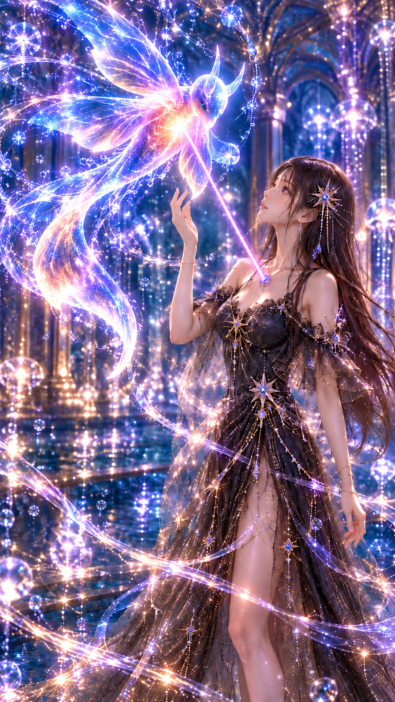

状態：原本を無変更で採用。終了原本を無変更で複製。全項目OKは提供基準としての扱いで、9秒との接続合格を意味しない。

## 8. 各画像の生成プロンプト

0秒・10秒は無生成・プロンプトなし。全中間画像は両端画像A・Bを入力した。以下は実送信した全文。座標や指示と実現結果を混同しない。

### 3秒用プロンプト

```text
Use case: identity-preserve. 2枚の入力は同じ光姫の連続シーンの両端。画像1が0秒開始、画像2が10秒終了。今回作るのは指定した中間時点の単独1枚、縦9:16、文字・枠・比較パネルなし。両端の顔骨格、暗茶の長髪と細い前髪、人物自身の左の大きな星髪飾りと垂れ宝石、黒い星刺繍と金属鎖と半透明袖の衣装、胸中央に固定した紫の円形理想鏡ルミアを継承。元の絵画的リアリズム、肌髪布と宝飾の質感。青い奥行きと金の尖頭アーチ、金色の吊り灯、反射する床は同じ空間。カメラは右側にいる人物を捉えたまま徐々に後退。動くのは人物自身の右腕（画面左の腕）で、左腕は自然に下げる。手指と腕の長さを自然に保ち、ルミアを胸から動かさない。別人物や別建物にしない。光の生物は画像2の角状突起・大きな透ける翼・細長い身体と長い尾の同じ姿で形成し、別種を追加しない。画像2を早い時点から完成形として丸ごと複製しない。
時点は3秒。指を胸から離し右手を胸前で少し開く、視線を左上へ上げ始める。近景と中景の間。胸から左上への細い光跡、まだ生物なし。右手はまだ胸元近くで肩より低い。0秒より少しだけ人物が小さく、頭の位置と背景は連続して変わる。
```

### 5秒用プロンプト

```text
Use case: identity-preserve. 2枚の入力は同じ光姫の連続シーンの両端。画像1が0秒開始、画像2が10秒終了。今回作るのは指定した中間時点の単独1枚、縦9:16、文字・枠・比較パネルなし。両端の顔骨格、暗茶の長髪と細い前髪、人物自身の左の大きな星髪飾りと垂れ宝石、黒い星刺繍と金属鎖と半透明袖の衣装、胸中央に固定した紫の円形理想鏡ルミアを継承。元の絵画的リアリズム、肌髪布と宝飾の質感。青い奥行きと金の尖頭アーチ、金色の吊り灯、反射する床は同じ空間。カメラは右側にいる人物を捉えたまま徐々に後退。動くのは人物自身の右腕（画面左の腕）で、左腕は自然に下げる。手指と腕の長さを自然に保ち、ルミアを胸から動かさない。別人物や別建物にしない。光の生物は画像2の角状突起・大きな透ける翼・細長い身体と長い尾の同じ姿で形成し、別種を追加しない。画像2を早い時点から完成形として丸ごと複製しない。
時点は5秒。右手を肩の高さまで上げ、掌を左上の光へ向ける。顔は左上を見始め、終了画像ほど反り上げない。カメラは両端のほぼ中間まで後退し、人物を画面右、形成中の光を画面左上に収める。光の生物は終了画像の同じ姿の非常に淡い輪郭だけ。翼・細い胴体・長い尾はまだ透けて未完成。密な光の帯や完成生物を早出しせず、胸元から左上へ細い軌跡だけをつなぐ。
```

### 7秒用プロンプト

```text
Use case: identity-preserve. 2枚の入力は同じ光姫の連続シーンの両端。画像1が0秒開始、画像2が10秒終了。今回作るのは指定した中間時点の単独1枚、縦9:16、文字・枠・比較パネルなし。両端の顔骨格、暗茶の長髪と細い前髪、人物自身の左の大きな星髪飾りと垂れ宝石、黒い星刺繍と金属鎖と半透明袖の衣装、胸中央に固定した紫の円形理想鏡ルミアを継承。元の絵画的リアリズム、肌髪布と宝飾の質感。青い奥行きと金の尖頭アーチ、金色の吊り灯、反射する床は同じ空間。カメラは右側にいる人物を捉えたまま徐々に後退。動くのは人物自身の右腕（画面左の腕）で、左腕は自然に下げる。手指と腕の長さを自然に保ち、ルミアを胸から動かさない。別人物や別建物にしない。光の生物は画像2の角状突起・大きな透ける翼・細長い身体と長い尾の同じ姿で形成し、別種を追加しない。画像2を早い時点から完成形として丸ごと複製しない。
7秒の静止画。ポーズの最重要条件：右肘は胸より下、右前腕はほぼ垂直、指先の上端は目の高さより下。手は顔の左下にあり、腕を頭上へ伸ばさない。10秒の終端画像に近い小さな手の構えで、まだ指先が少し低い。人物の頭頂位置は画面高さ22%付近、人物は右側。終了像よりわずかに近いカメラ。光生物は同形が左上にほぼ形成されるが翼と長い尾は淡く、光量は終端より少ない。生物との距離は終了像に近い。
```

### 1秒用プロンプト

```text
Use case: identity-preserve. 2枚の入力は同じ光姫の連続シーンの両端。画像1が0秒開始、画像2が10秒終了。今回作るのは指定した中間時点の単独1枚、縦9:16、文字・枠・比較パネルなし。両端の顔骨格、暗茶の長髪と細い前髪、人物自身の左の大きな星髪飾りと垂れ宝石、黒い星刺繍と金属鎖と半透明袖の衣装、胸中央に固定した紫の円形理想鏡ルミアを継承。元の絵画的リアリズム、肌髪布と宝飾の質感。青い奥行きと金の尖頭アーチ、金色の吊り灯、反射する床は同じ空間。カメラは右側にいる人物を捉えたまま徐々に後退。動くのは人物自身の右腕（画面左の腕）で、左腕は自然に下げる。手指と腕の長さを自然に保ち、ルミアを胸から動かさない。別人物や別建物にしない。光の生物は画像2の角状突起・大きな透ける翼・細長い身体と長い尾の同じ姿で形成し、別種を追加しない。画像2を早い時点から完成形として丸ごと複製しない。
1秒時点。開始画像1の状態を強く維持。右手の人差し指は紫ルミアにまだ接触し、右手は胸元、右肘は下。顎は開始からほんの少しだけ上がるが視線はまだルミアに向く。カメラの後退はごくわずか、人物の頭頂位置は開始像に近い。光の生物も翼の輪郭もまだ存在しない。胸元の紫光の周囲に少数の小粒子だけ。
```

### 2秒用プロンプト

```text
Use case: identity-preserve. 2枚の入力は同じ光姫の連続シーンの両端。画像1が0秒開始、画像2が10秒終了。今回作るのは指定した中間時点の単独1枚、縦9:16、文字・枠・比較パネルなし。両端の顔骨格、暗茶の長髪と細い前髪、人物自身の左の大きな星髪飾りと垂れ宝石、黒い星刺繍と金属鎖と半透明袖の衣装、胸中央に固定した紫の円形理想鏡ルミアを継承。元の絵画的リアリズム、肌髪布と宝飾の質感。青い奥行きと金の尖頭アーチ、金色の吊り灯、反射する床は同じ空間。カメラは右側にいる人物を捉えたまま徐々に後退。動くのは人物自身の右腕（画面左の腕）で、左腕は自然に下げる。手指と腕の長さを自然に保ち、ルミアを胸から動かさない。別人物や別建物にしない。光の生物は画像2の角状突起・大きな透ける翼・細長い身体と長い尾の同じ姿で形成し、別種を追加しない。画像2を早い時点から完成形として丸ごと複製しない。
2秒。右人差し指がルミアからごく短い距離だけ離れた瞬間。右手は胸元の前、右肘は低く、手を肩より上へ上げない。顎はまだ下向きだが少し緩み、目は胸から上方の粒子へ移り始める。開始より少し引いた近景。生物はまだ存在しない。ルミアから短い淡い粒子が上へ漂うだけ、長い光線や翼は出さない。
```

### 4秒用プロンプト

```text
Use case: identity-preserve. 2枚の入力は同じ光姫の連続シーンの両端。画像1が0秒開始、画像2が10秒終了。今回作るのは指定した中間時点の単独1枚、縦9:16、文字・枠・比較パネルなし。両端の顔骨格、暗茶の長髪と細い前髪、人物自身の左の大きな星髪飾りと垂れ宝石、黒い星刺繍と金属鎖と半透明袖の衣装、胸中央に固定した紫の円形理想鏡ルミアを継承。元の絵画的リアリズム、肌髪布と宝飾の質感。青い奥行きと金の尖頭アーチ、金色の吊り灯、反射する床は同じ空間。カメラは右側にいる人物を捉えたまま徐々に後退。動くのは人物自身の右腕（画面左の腕）で、左腕は自然に下げる。手指と腕の長さを自然に保ち、ルミアを胸から動かさない。別人物や別建物にしない。光の生物は画像2の角状突起・大きな透ける翼・細長い身体と長い尾の同じ姿で形成し、別種を追加しない。画像2を早い時点から完成形として丸ごと複製しない。
4秒。顔は左上へ少し上がる。右手は胸と顎の中間の高さで掌を開き、指先は口より低い。右肘を体の横の低い位置に保ち、腕を頭上へ伸ばさない。カメラは3秒より少し後退した中景手前。光の生物はまだ描かない。胸から左上へ伸びた細い紫青の光跡の先端に、輪郭を持たない小さな光の集まりだけ。背景のアーチと吊り灯を開始像から継承。
```

### 6秒用プロンプト

```text
Use case: identity-preserve. 2枚の入力は同じ光姫の連続シーンの両端。画像1が0秒開始、画像2が10秒終了。今回作るのは指定した中間時点の単独1枚、縦9:16、文字・枠・比較パネルなし。両端の顔骨格、暗茶の長髪と細い前髪、人物自身の左の大きな星髪飾りと垂れ宝石、黒い星刺繍と金属鎖と半透明袖の衣装、胸中央に固定した紫の円形理想鏡ルミアを継承。元の絵画的リアリズム、肌髪布と宝飾の質感。青い奥行きと金の尖頭アーチ、金色の吊り灯、反射する床は同じ空間。カメラは右側にいる人物を捉えたまま徐々に後退。動くのは人物自身の右腕（画面左の腕）で、左腕は自然に下げる。手指と腕の長さを自然に保ち、ルミアを胸から動かさない。別人物や別建物にしない。光の生物は画像2の角状突起・大きな透ける翼・細長い身体と長い尾の同じ姿で形成し、別種を追加しない。画像2を早い時点から完成形として丸ごと複製しない。
6秒の段階。右肘は胴体の横の低い位置、前腕を立て、指先の高さは口元付近で目より下。腕を頭上へ伸ばさない。顔は左上を見上げる。カメラは終了より少し近い中景で頭頂は画面高さ21%付近。光の生物は終了画像と同じ姿の形成途中。輪郭と一部の翼脈だけが淡い青紫、胴体内部と長い尾は欠けた粒子で透明。完成体の強い白光や大量の軌跡はまだ見せない。
```

### 8秒用プロンプト

```text
Use case: identity-preserve. 2枚の入力は同じ光姫の連続シーンの両端。画像1が0秒開始、画像2が10秒終了。今回作るのは指定した中間時点の単独1枚、縦9:16、文字・枠・比較パネルなし。両端の顔骨格、暗茶の長髪と細い前髪、人物自身の左の大きな星髪飾りと垂れ宝石、黒い星刺繍と金属鎖と半透明袖の衣装、胸中央に固定した紫の円形理想鏡ルミアを継承。元の絵画的リアリズム、肌髪布と宝飾の質感。青い奥行きと金の尖頭アーチ、金色の吊り灯、反射する床は同じ空間。カメラは右側にいる人物を捉えたまま徐々に後退。動くのは人物自身の右腕（画面左の腕）で、左腕は自然に下げる。手指と腕の長さを自然に保ち、ルミアを胸から動かさない。別人物や別建物にしない。光の生物は画像2の角状突起・大きな透ける翼・細長い身体と長い尾の同じ姿で形成し、別種を追加しない。画像2を早い時点から完成形として丸ごと複製しない。
8秒。人物とカメラは終了画像2にかなり近づく。右肘は胸より下で右前腕はほぼ垂直、手は顔の左下。指先は顔の高さを超えず、終了の手よりわずかに低い。腕を頭上に伸ばさない。人物の頭頂は画面高さ22%付近。光の生物は画像2と同形・同位置に近く、翼と長い尾がはっきりしてくる。周囲の光跡は終了よりやや少なく、青紫ピンク白金の色調。
```

### 9秒用プロンプト

```text
Use case: identity-preserve. 2枚の入力は同じ光姫の連続シーンの両端。画像1が0秒開始、画像2が10秒終了。今回作るのは指定した中間時点の単独1枚、縦9:16、文字・枠・比較パネルなし。両端の顔骨格、暗茶の長髪と細い前髪、人物自身の左の大きな星髪飾りと垂れ宝石、黒い星刺繍と金属鎖と半透明袖の衣装、胸中央に固定した紫の円形理想鏡ルミアを継承。元の絵画的リアリズム、肌髪布と宝飾の質感。青い奥行きと金の尖頭アーチ、金色の吊り灯、反射する床は同じ空間。カメラは右側にいる人物を捉えたまま徐々に後退。動くのは人物自身の右腕（画面左の腕）で、左腕は自然に下げる。手指と腕の長さを自然に保ち、ルミアを胸から動かさない。別人物や別建物にしない。光の生物は画像2の角状突起・大きな透ける翼・細長い身体と長い尾の同じ姿で形成し、別種を追加しない。画像2を早い時点から完成形として丸ごと複製しない。
9秒。10秒終了画像2の直前。人物の顔向き・右腕の肘と手首・開いた指、体の向きと表示倍率は画像2に非常に近いが、右手指先はほんの少し低く、髪のなびきも少し控えめ。右手は顔の左下で、腕を頭上へ伸ばさない。人物は画面右、同形の光生物は画面左上。画像2と同じ光の翼・角状突起・長い尾・色彩を保持し、光の拡散は10秒よりほんの少し弱い。胸元ルミアから生物への細い紫光線を保つ。背景と床反射を終了画角に近づける。
```

## 9. 品質検査結果

OK＝目視上大きな不一致なし、NG＝明確な不一致あり、要確認＝判断困難。原本行のOKは提供基準そのものであることを示し、接続の合格ではない。以下はWorkの暫定評価。

|時点|Identity|Facial Geometry|Body Geometry|Hand Geometry|Motion|Camera|Background|Costume|Lumia|Light Creature|Rendering|
|---|---|---|---|---|---|---|---|---|---|---|---|
|0秒|OK|OK|OK|OK|OK|OK|OK|OK|OK|OK|OK|
|1秒|OK|要確認|要確認|要確認|要確認|要確認|OK|要確認|OK|OK|OK|
|2秒|OK|要確認|要確認|要確認|要確認|要確認|OK|要確認|OK|OK|OK|
|3秒|OK|要確認|要確認|要確認|NG|要確認|要確認|要確認|OK|OK|OK|
|4秒|OK|要確認|要確認|要確認|NG|要確認|要確認|要確認|OK|OK|OK|
|5秒|OK|要確認|要確認|要確認|NG|NG|NG|要確認|OK|NG|OK|
|6秒|OK|要確認|要確認|要確認|NG|NG|NG|要確認|OK|NG|OK|
|7秒|OK|要確認|要確認|要確認|要確認|要確認|要確認|要確認|OK|要確認|OK|
|8秒|OK|要確認|要確認|要確認|要確認|要確認|要確認|要確認|OK|要確認|OK|
|9秒|OK|要確認|要確認|要確認|要確認|要確認|要確認|要確認|OK|要確認|OK|
|10秒|OK|OK|OK|OK|OK|OK|OK|OK|OK|OK|OK|


明瞭な別人化や新しい身体部位の増加は目視では見つからなかったが、顔骨格・腕長・手の寸法・指の全本数は測定していない。特に曲げた指の遮蔽と光の重なりは要確認。衣装の星と鎖の数・位置は時点間で変化して見え、厳密な同一性は認定しない。背景の同じ建築様式と、同じ建物の空間連続性を区別する。

主要な不連続：0→1秒は顔を上げ始める動作が弱い。1→2秒はカメラ後退が一方向でない疑い。2→3秒は顎・視線・手が急に上がる。4→5秒は腕が頭上まで上がり画角も急変。5→6秒は手が下がり人物が大きく戻り、生物が未完成へ逆行。7→10秒は比較的近い構図だが尾と光跡、髪と装飾に揺らぎが残る。

## 10. 未確定事項

人物の正確な3D構造、両端間のカメラ軌道と焦点距離、アーチと吊り灯の配置図、衣装装飾の固定座標、光の生物の立体形状と形成マスクは未確定。開始・終了間の衣装差を正式設定変更として扱わない。光生物や粒子をルミアの正式能力として確定しない。

## 11. 使用モデル・制作履歴

ChatGPT組み込みimage_genで制作。内部モデル名・版・シード・実カメラ値は非開示。2026年10月28日、3→5→7→1→2→4→6→8→9秒の順。各1回、合計9回成功。再生成は実施していない。5秒の段階で先行動作を確認し、7秒以降は肘と手の高さを具体化したが、取得済み画像を合格へ読み替えてはいない。

動画生成、動画補間、動画編集、Instagram投稿、外部有料動画サービスは未実行。コンタクトシートは取得画像の配置と時点ラベルのみ。両端のSHA-256一致、11画像読込、相対リンク、ZIP CRCを確認。

## 12. 今後の改善点

最優先は3秒の手と視線を低く戻すこと、5秒の腕・画角・光生物を形成初期へ修正すること。次に固定した背景と構図を各時点に用意し、肩・肘・手首の目標位置、カメラの画角推移、生物の輪郭マスクを先に作る。画像生成だけに時間進行の解釈を委ねない。NG画像の終端を次工程へ継承しない。

11枚は動作設計の検証資料として使えるが、そのまま連結して滑らかな10秒動画が成立すると判断していない。正式採用と動画生成は別途判断する。
