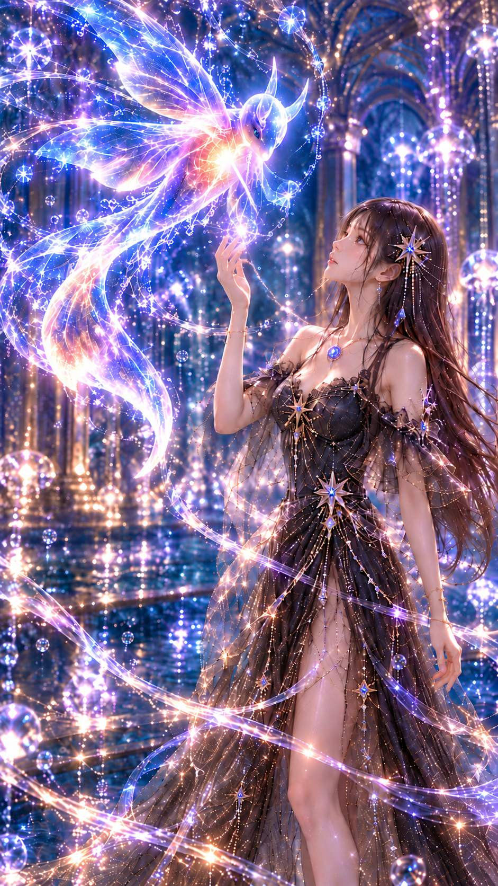
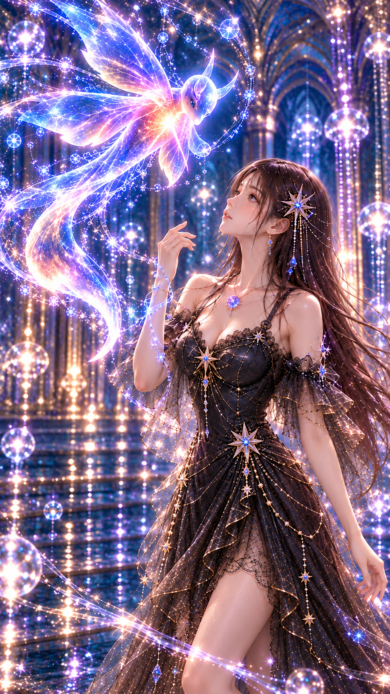
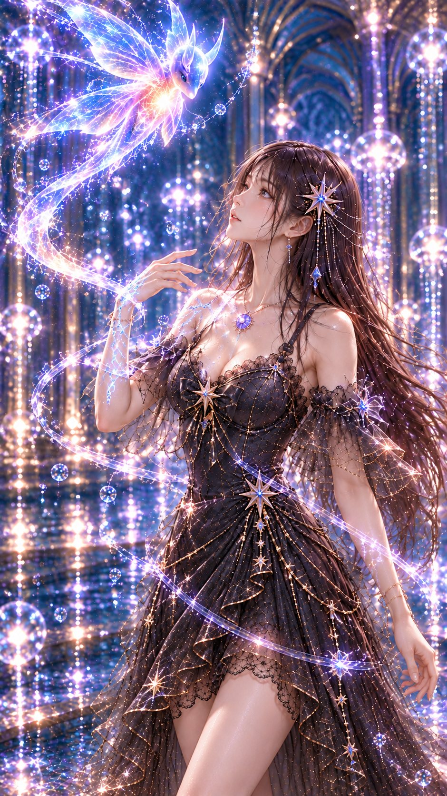
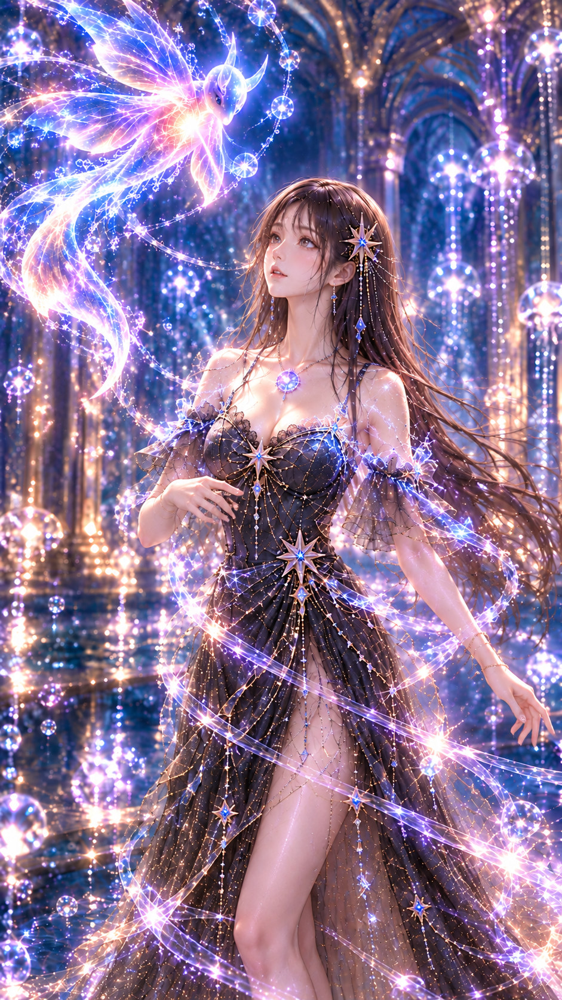
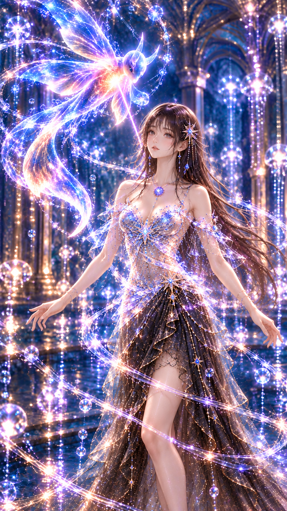
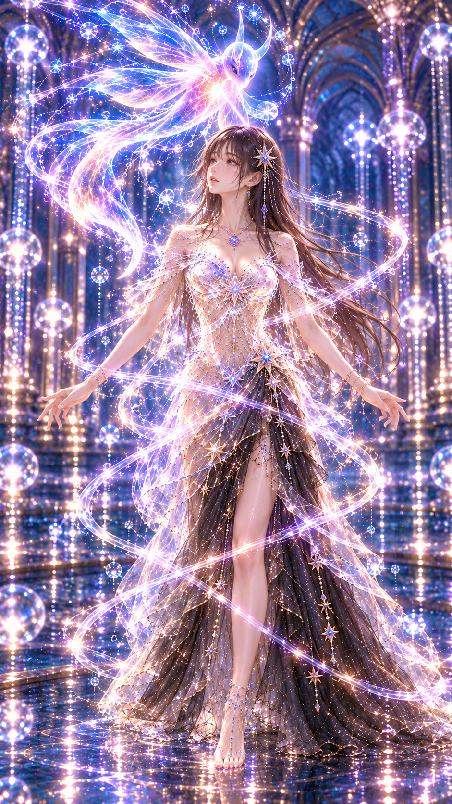
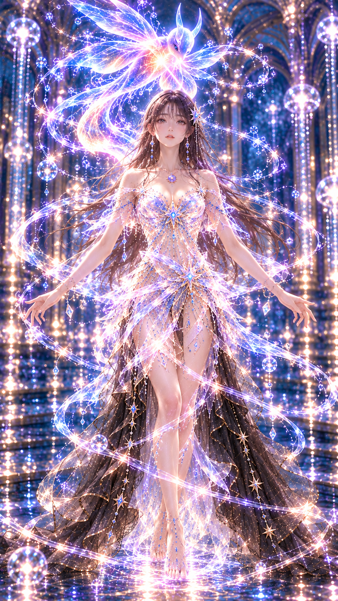
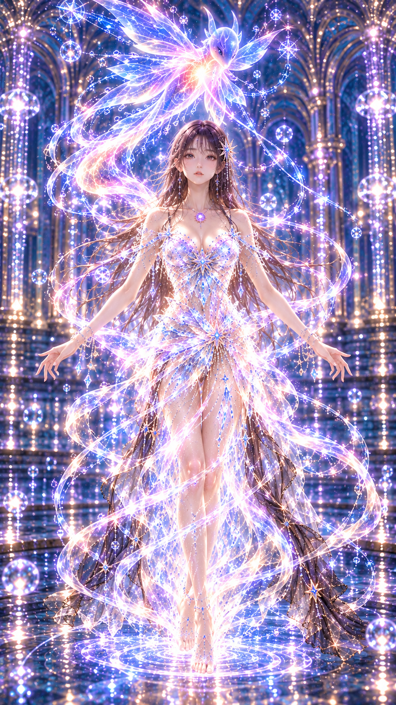
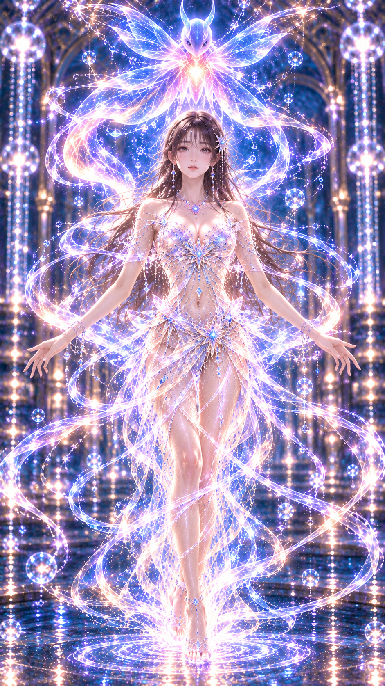
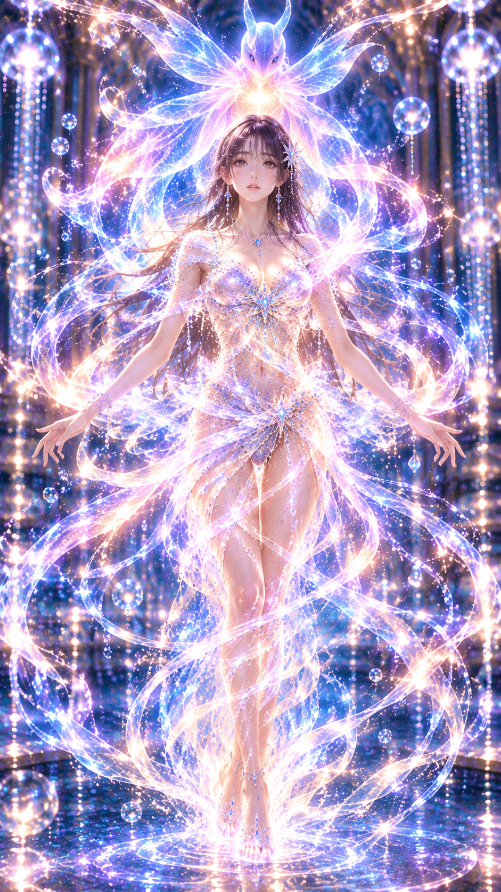

# 光姫・光のドレスアップ 10秒間中間静止画制作仕様書 Ver0.1

## 1. 制作概要

依頼文Ver1.1による試験制作。10秒間を1秒間隔で11枚に再構成し、新規9枚を生成。開始・終了は無変更。全画像は未承認の実験資料。動画生成・Instagram投稿・外部有料動画サービス使用・GitHub既存ファイル変更は行っていない。他の六姫の画像・成果物・プロンプトは使用していない。

## 2. 入力画像

添付1：２－１(3).png → images/HIK_00_Start.png。添付2：３(1).png → images/HIK_10_End.png。両端を毎回の直接シーン参照に使用。原本複製のSHA-256は以下。

- 0秒：`f38e36a9617cf334a0594d52fd5b83bfd67a9770061db5113e4e08fba9d6f873`
- 10秒：`1ba67d46cdcf9e9577c5d89a3a449a105ae891838acd313e3e1fc714068c1b31`

## 3. GitHub参照先

[光姫MIXXIA仕様書・参照スナップショット](https://github.com/JINBOX-GIT/-PROJECT/blob/08720092570d3ffcad7d16b654a8af06279c62e0/ビジュアル仕様書/HIKARIHIME_MIXXIA_8DIRECTION_Ver0.1/光姫_MIXXIA_多方向基準画制作仕様書_Ver0.1.md)

リポジトリ：JINBOX-GIT/-PROJECT。全文取得、相対画像参照を解決。参照コミット：`08720092570d3ffcad7d16b654a8af06279c62e0`。仕様書blob：`1af3bf6d98c83f8f1a087bb036fc6d3ddc6eefd5`。

仕様書第3節のIdentity／Geometry継承・第4節の固定外観・第13節の目視検査・第14節の未確定事項・第17節の承認管理を参照。第3節が記録するMIXXIAの10.5.6、10.5.7「右90°」、10.5.7「右45°」の番号重複は維持する。第8章の剛体Y軸回転は多方向基準画用であり、今回の腕の動作を禁止する規則として転用しない。白背景・静止衣装・85mm固定を本シーンに強制しない。

その他の確認資料：00_運用規約_Ver1.9(1).docx（抽出テキスト）、竜宮六姫_MIXXIA_ビジュアル制作仕様書_Ver0.5.docx（抽出テキスト）、絵画的リアリズム仕様書MarkDown転記モード_ver2.2.md。設定の正式優先順位は維持し、今回の演出で正式能力を追加しない。MIXXIAはファイル名Ver0.5と本文管理表Ver1.0の表記差があり、勝手に統合しない。原画（兄絵）との厳密一致は未検証。

## 4. GitHubから取得した基準画像一覧

全8枚を取得し個別に視覚確認。画像データのGit blob SHAもリポジトリ記録と照合。左右は人物自身を基準とし、右方向は鼻が画面左へ向く。角度の実測は行っていない。

|ファイル|取得・目視|方向の観察|採用状態・留保|
|---|---|---|---|
|HIK_00_Front.png|取得済み・確認済み|正面|ユーザー指定の正面原本。独立した正式認定ではない。|
|HIK_180_Back.png|取得済み・確認済み|背面|未承認の生成候補。総合要確認。背面構造は暫定。|
|HIK_L15.png|取得済み・確認済み|画面右向き|未承認の生成候補。総合要確認。指定より回転が深い可能性。|
|HIK_L45.png|取得済み・確認済み|画面右向き|未承認の生成候補。総合要確認。|
|HIK_L90.png|取得済み・確認済み|画面右向き|未承認の生成候補。総合要確認。|
|HIK_R15.png|取得済み・確認済み|画面左向き|未承認の生成候補。総合要確認。指定より回転が深い可能性。|
|HIK_R45.png|取得済み・確認済み|画面左向き|未承認の生成候補。総合要確認。|
|HIK_R90.png|取得済み・確認済み|画面左向き|未承認の生成候補。総合要確認。|

取得した8枚に不足なし。候補の方向は概ねラベルと整合するが、15°と45°の差や顔胴体の同角度を検証済みとはしない。参照画像は本成果物の生成画像とは別であり、ZIPに重複収録していない。

|ファイル|参照画像Git blob SHA|
|---|---|
|HIK_00_Front.png|`28d6a774ef6c6b72f5b26b073c24285c24dde488`|
|HIK_180_Back.png|`ff712cf2163a2937d31764dab23c002b19a04564`|
|HIK_L15.png|`5c266ced4c99533eb707f07afd603e761ff4cd9e`|
|HIK_L45.png|`a74fcbb5cfb37841f174c70e04574647d8343a93`|
|HIK_L90.png|`9a1b4dd30fdbd85627887f078c48003015680f59`|
|HIK_R15.png|`6791e05936f42251ba56f9d3c53b13e658194ba4`|
|HIK_R45.png|`3b73b3815f65da9504a8a8cfa9bfab1869598f0a`|
|HIK_R90.png|`f2c8d1402cbb883a3faff56b9135b887994ca018`|

## 5. 開始画像と終了画像の差分分析

|要素|開始0秒|終了10秒|
|---|---|---|
|顔・身体|画面左上を見る斜め横向き、人物右寄り|正面、中央|
|視線|左上の生物|ほぼ正面|
|右腕|肘を曲げ顔前に手|斜め下外へ開く|
|左腕|身体横へ下ろす|斜め下外へ開く|
|衣装|黒地、星・鎖、薄い袖|青白ピンクの結晶・蝶星状の光衣装|
|髪飾り|人物左の大きな発光星と垂れ装飾|同側の星、光による形の見え方に差|
|ルミア|胸上部の紫の円形|胸元の強い青白い光で形の比較が難しい|
|生物|画面左上、横向き|頭上中央、正面に近い|
|カメラ|膝より下が画面外|足先まで入る全身|
|背景|青金の尖頭アーチ、反射床|同様の様式、柱・光の詳細配置に差|

「腕を左右へ広げる」を水平なT字と解釈せず、終了原本の斜め下に開く姿勢へ調整した。端点とGitHub候補は長髪・顔の基本形・星飾り位置を共有するが、髪飾りの大きさ・垂れ装飾・顔の眼の印象・首周辺宝飾が同一ではない。両端を修正せず差を留保する。

## 6. 10秒間の動作設計

以下は制作上の目標であり、実測結果や正式設定ではない。角度・画面位置の数値はプロンプト上の設計値に限る。

|秒|設計|
|---|---|
|0|開始原本。右手を上げ生物を見上げる。|
|1|1秒：0秒とほぼ同じ右寄り人物配置。顔胴体は画面左上を見る斜め横向き、右手は顔の前に上げたまま、左腕は自然に下ろす。黒ドレスのまま。光が右手の指先に小さく集まる。生物は左上の開始位置ほぼ維持。カメラは開始からごく少しだけ引き、膝上が画面下端。|
|2|2秒：人物中心x=65%、開始からわずかに引いた膝上。身体顔は画面左向き約45度、視線は左上の生物。右手が顔の前から顎下の高さへ少し下がる、右肘曲げたまま。左腕は下ろす。衣装はまだ黒、右手首前腕にだけ細い青白い光が流れ、胸元は小さな発光。生物は左上、薄い光の軌跡。|
|3|3秒：開始から少し引いた膝上構図。人物中心x=62%。顔と胴体は画面左向きの約35度の斜め、正面へ回り始める。右肘は曲げ、右手が鎖骨の高さまで下がった途中。左腕は下げたまま。まだ黒ドレスが大半、右腕から胸元へ細い青白い模様だけが走り、腰以下は黒。生物は左上から少し中央へ、頭より左。螺旋は細い1本。|
|4|4秒：人物中心x=59%、膝下まで。顔と胴体が画面左へ約25度、視線も正面へ移行中。右肘の曲げをほどき、右手は胸より下の肋骨付近、左手は腰横からわずかに離れる。黒ドレスを大半残し、上半身の星と縁の一部が青白く光り始める。生物は上方へ移り始めまだ左上。腰に細い螺旋。|
|5|5秒：人物中心x=56%、すね付近までの構図。顔と胴体は画面左へ約15度で正面近く。右手を胸元から外側の腰高さへ下ろし、左腕も少し外へ開き始める。両手は肩よりずっと下。胸元と上半身の模様のみ青白い光衣装へ移行、腰下スカートは黒いパネルが大きく残る。生物は人物の上方でまだ少し左、同じ翼・角・長尾。細い螺旋が腰まで回る。|
|6|6秒：人物中心x=53%、足首まで映る引きの構図。顔胴体は正面から画面左へ約10度。両腕を斜め下外へ、手は腰より低く両脇へ開く。上半身と腰の結晶模様は光のドレスへ移行、スカート下半分の黒布を残す。紫円形ルミアを胸に固定。生物は頭の少し左上から頭上へ、同じ角と翼と尾。螺旋は肩腰膝の3箇所を緩やかにつなぐ。|
|7|7秒：人物中央、頭頂から足先直前までほぼ全身。顔と胴体は正面、両腕は斜め下外へ開き、手は腰より低い位置。終了の腕角度へほぼ到達。上半身と腰は青白ピンクの結晶状光ドレスへ、スカート裾に黒パネルが残る。胸元の円形ルミアの位置維持。生物は頭上へほぼ到達、同じ翼・角・長尾。螺旋は肩腰膝へつながるが終了画像より疎ら。|
|8|8秒：中央の正面全身、足先まで。終了よりわずかに人物が大きい。両腕は終了と同じ斜め下外へ。ドレスはほぼ青白ピンク結晶状に発光、下部側面に細い黒の残片だけ残る。胸元のルミアは円形、紫が青白く照らされる。同じ生物が頭上、少し斜め向きから正面へ旋回途中。螺旋が肩から腰膝足元へほぼ完成。|
|9|9秒：10秒の画像に極めて近い中央正面全身の構図・人物表示倍率・斜め下外へ開く両腕、足の置き方。光のドレスは青白ピンクの結晶と蝶星の形、黒布はほぼ光に変化。胸元ルミアの円形は維持し強い光で青く照る。同じ生物が頭上中央でほぼ正面、角翼と長い尾の連続性。螺旋は全身を包み最終画像よりほんの少し弱い。背景は終了画像のアーチ配置へ整合。|
|10|終了原本。正面全身、両腕は斜め下へ、光衣装完成。|

## 7. 各時点で参照した基準方向

全9回に開始・終了の両方を入力。補助入力は各回以下の1枚。生成済み中間画像は入力していない。

|秒|補助画像|役割|
|---|---|---|
|1|HIK_R45.png|顔・髪・首肩と身体比率。衣装・背景を転用しない。|
|2|HIK_R45.png|顔・髪・首肩と身体比率。衣装・背景を転用しない。|
|3|HIK_R45.png|顔・髪・首肩と身体比率。衣装・背景を転用しない。|
|4|HIK_R45.png|顔・髪・首肩と身体比率。衣装・背景を転用しない。|
|5|HIK_R15.png|顔・髪・首肩と身体比率。衣装・背景を転用しない。|
|6|HIK_R15.png|顔・髪・首肩と身体比率。衣装・背景を転用しない。|
|7|HIK_00_Front.png|顔・髪・首肩と身体比率。衣装・背景を転用しない。|
|8|HIK_00_Front.png|顔・髪・首肩と身体比率。衣装・背景を転用しない。|
|9|HIK_00_Front.png|顔・髪・首肩と身体比率。衣装・背景を転用しない。|

## 8. カメラワーク設計

開始の右寄り近景から後退して中央全身へ。1〜3秒は軽い後退、4〜6秒は膝下から足先へ、7〜9秒は終了倍率へ近づく。生成結果は2秒の顔の大きさ、5→6秒の全身化、9→10秒の頭部位置に揺れがあり、均一な後退を達成したとは判定しない。背景の3D位置と焦点距離は確定していない。

## 9. 光の生物の移動

0〜2秒は左上、3〜5秒に上方中央へ、6〜8秒に頭上へ、9〜10秒に正面へ。生成結果では左上から頭上への大きな経路は成立。ただし中盤の位置変化が少なく、終盤の翼形と正面化が急。羽脈・尾・個別粒子は固定できていない。クリオネなどの生物種を今回新たに確定しない。

## 10. 光のドレスアップ演出

右手→腕→胸→腰→裾へ光模様が広がり、黒地を残しながら結晶状へ変化する仮案。結果は1〜4秒の黒衣装、5〜8秒の光上半身と黒裾、9秒以降の光衣装という段階。4→5秒と8→9秒の切替が大きい。螺旋は最初から存在する原本に合わせ、無から出現させず密度・範囲を増す設計とした。ルミアの正式能力を追加・変更したものではない。

## 11. 0〜10秒の画像一覧

### 0秒


開始原本。人物右寄り、右手を上げ、左上の生物を見上げる。

### 1秒



開始に近い姿勢を維持。指先に光。ルミアの縁と色が変化。

### 2秒



右手は顎下へ。人物が前後画像より大きめで、一定の後退に不整合。

### 3秒



右手は鎖骨付近。指定より横向き・上向きが残る。黒衣装は維持。

### 4秒



右手を胸下へ。ほぼ正面に近づく。黒の上半身に発光線。

### 5秒



両腕が開き上半身は結晶状へ。4秒からの衣装変化と右腕の移動が大きい。

### 6秒



全身が入る。5秒より顔が左上へ戻り、視線と顔向きの流れに逆行。

### 7秒



正面全身。光の上半身と黒い裾が併存。両腕は斜め下へ。

### 8秒



正面全身。黒の裾が細く残る。生物は上方やや右、正面化は未完。

### 9秒



正面全身。黒の裾が消え完成に近い。8秒から生物の正面化と翼の幅が変化。

### 10秒



終了原本。前フレームより頭の位置・衣装形・ルミア形状が変わる。

## 12. 各画像の生成プロンプト

以下は実際に入力した全文。各回の画像順は開始、終了、当該GitHub補助画像。0秒・10秒は生成なし。

### P-01／1秒

```text
用途：identity-preserve。光姫の10秒ドレスアップ実験の中間静止画を1枚だけ描く。縦9:16、文字なし、絵画的リアリズム。
入力1は0秒の直接基準、入力2は10秒の直接基準。入力3はGitHubの光姫角度候補で顔骨格・長い茶黒髪・首肩比率のみの補助参照。入力3の白背景・衣装・静止ポーズを転用しない。光姫は成人女性。同一人物、顔の美化や体型変更なし。人物左の星髪飾り、胸元の円形理想鏡ルミアを維持。両端の同じ青金の尖頭アーチ空間と反射床。翼と角状突起と長尾を持つ同じ青紫ピンク白金の光の生物は1体のみ。開始から終了へカメラがゆっくり引き、人物が画面右から中央へ移る。終了姿勢は両腕を斜め下へ開く。光の衣装変化は仮の映像演出。
1秒：0秒とほぼ同じ右寄り人物配置。顔胴体は画面左上を見る斜め横向き、右手は顔の前に上げたまま、左腕は自然に下ろす。黒ドレスのまま。光が右手の指先に小さく集まる。生物は左上の開始位置ほぼ維持。カメラは開始からごく少しだけ引き、膝上が画面下端。
```

### P-02／2秒

```text
用途：identity-preserve。光姫の10秒ドレスアップ実験の中間静止画を1枚だけ描く。縦9:16、文字なし、絵画的リアリズム。
入力1は0秒の直接基準、入力2は10秒の直接基準。入力3はGitHubの光姫角度候補で顔骨格・長い茶黒髪・首肩比率のみの補助参照。入力3の白背景・衣装・静止ポーズを転用しない。光姫は成人女性。同一人物、顔の美化や体型変更なし。人物左の星髪飾り、胸元の円形理想鏡ルミアを維持。両端の同じ青金の尖頭アーチ空間と反射床。翼と角状突起と長尾を持つ同じ青紫ピンク白金の光の生物は1体のみ。開始から終了へカメラがゆっくり引き、人物が画面右から中央へ移る。終了姿勢は両腕を斜め下へ開く。光の衣装変化は仮の映像演出。
2秒：人物中心x=65%、開始からわずかに引いた膝上。身体顔は画面左向き約45度、視線は左上の生物。右手が顔の前から顎下の高さへ少し下がる、右肘曲げたまま。左腕は下ろす。衣装はまだ黒、右手首前腕にだけ細い青白い光が流れ、胸元は小さな発光。生物は左上、薄い光の軌跡。
```

### P-03／3秒

```text
用途：identity-preserve。光姫の10秒ドレスアップ実験の中間静止画を1枚だけ描く。縦9:16、文字なし、絵画的リアリズム。
入力1は0秒の直接基準、入力2は10秒の直接基準。入力3はGitHubの光姫角度候補で顔骨格・長い茶黒髪・首肩比率のみの補助参照。入力3の白背景・衣装・静止ポーズを転用しない。光姫は成人女性。同一人物、顔の美化や体型変更なし。人物左の星髪飾り、胸元の円形理想鏡ルミアを維持。両端の同じ青金の尖頭アーチ空間と反射床。翼と角状突起と長尾を持つ同じ青紫ピンク白金の光の生物は1体のみ。開始から終了へカメラがゆっくり引き、人物が画面右から中央へ移る。終了姿勢は両腕を斜め下へ開く。光の衣装変化は仮の映像演出。
3秒：開始から少し引いた膝上構図。人物中心x=62%。顔と胴体は画面左向きの約35度の斜め、正面へ回り始める。右肘は曲げ、右手が鎖骨の高さまで下がった途中。左腕は下げたまま。まだ黒ドレスが大半、右腕から胸元へ細い青白い模様だけが走り、腰以下は黒。生物は左上から少し中央へ、頭より左。螺旋は細い1本。
```

### P-04／4秒

```text
用途：identity-preserve。光姫の10秒ドレスアップ実験の中間静止画を1枚だけ描く。縦9:16、文字なし、絵画的リアリズム。
入力1は0秒の直接基準、入力2は10秒の直接基準。入力3はGitHubの光姫角度候補で顔骨格・長い茶黒髪・首肩比率のみの補助参照。入力3の白背景・衣装・静止ポーズを転用しない。光姫は成人女性。同一人物、顔の美化や体型変更なし。人物左の星髪飾り、胸元の円形理想鏡ルミアを維持。両端の同じ青金の尖頭アーチ空間と反射床。翼と角状突起と長尾を持つ同じ青紫ピンク白金の光の生物は1体のみ。開始から終了へカメラがゆっくり引き、人物が画面右から中央へ移る。終了姿勢は両腕を斜め下へ開く。光の衣装変化は仮の映像演出。
4秒：人物中心x=59%、膝下まで。顔と胴体が画面左へ約25度、視線も正面へ移行中。右肘の曲げをほどき、右手は胸より下の肋骨付近、左手は腰横からわずかに離れる。黒ドレスを大半残し、上半身の星と縁の一部が青白く光り始める。生物は上方へ移り始めまだ左上。腰に細い螺旋。
```

### P-05／5秒

```text
用途：identity-preserve。光姫の10秒ドレスアップ実験の中間静止画を1枚だけ描く。縦9:16、文字なし、絵画的リアリズム。
入力1は0秒の直接基準、入力2は10秒の直接基準。入力3はGitHubの光姫角度候補で顔骨格・長い茶黒髪・首肩比率のみの補助参照。入力3の白背景・衣装・静止ポーズを転用しない。光姫は成人女性。同一人物、顔の美化や体型変更なし。人物左の星髪飾り、胸元の円形理想鏡ルミアを維持。両端の同じ青金の尖頭アーチ空間と反射床。翼と角状突起と長尾を持つ同じ青紫ピンク白金の光の生物は1体のみ。開始から終了へカメラがゆっくり引き、人物が画面右から中央へ移る。終了姿勢は両腕を斜め下へ開く。光の衣装変化は仮の映像演出。
5秒：人物中心x=56%、すね付近までの構図。顔と胴体は画面左へ約15度で正面近く。右手を胸元から外側の腰高さへ下ろし、左腕も少し外へ開き始める。両手は肩よりずっと下。胸元と上半身の模様のみ青白い光衣装へ移行、腰下スカートは黒いパネルが大きく残る。生物は人物の上方でまだ少し左、同じ翼・角・長尾。細い螺旋が腰まで回る。
```

### P-06／6秒

```text
用途：identity-preserve。光姫の10秒ドレスアップ実験の中間静止画を1枚だけ描く。縦9:16、文字なし、絵画的リアリズム。
入力1は0秒の直接基準、入力2は10秒の直接基準。入力3はGitHubの光姫角度候補で顔骨格・長い茶黒髪・首肩比率のみの補助参照。入力3の白背景・衣装・静止ポーズを転用しない。光姫は成人女性。同一人物、顔の美化や体型変更なし。人物左の星髪飾り、胸元の円形理想鏡ルミアを維持。両端の同じ青金の尖頭アーチ空間と反射床。翼と角状突起と長尾を持つ同じ青紫ピンク白金の光の生物は1体のみ。開始から終了へカメラがゆっくり引き、人物が画面右から中央へ移る。終了姿勢は両腕を斜め下へ開く。光の衣装変化は仮の映像演出。
6秒：人物中心x=53%、足首まで映る引きの構図。顔胴体は正面から画面左へ約10度。両腕を斜め下外へ、手は腰より低く両脇へ開く。上半身と腰の結晶模様は光のドレスへ移行、スカート下半分の黒布を残す。紫円形ルミアを胸に固定。生物は頭の少し左上から頭上へ、同じ角と翼と尾。螺旋は肩腰膝の3箇所を緩やかにつなぐ。
```

### P-07／7秒

```text
用途：identity-preserve。光姫の10秒ドレスアップ実験の中間静止画を1枚だけ描く。縦9:16、文字なし、絵画的リアリズム。
入力1は0秒の直接基準、入力2は10秒の直接基準。入力3はGitHubの光姫角度候補で顔骨格・長い茶黒髪・首肩比率のみの補助参照。入力3の白背景・衣装・静止ポーズを転用しない。光姫は成人女性。同一人物、顔の美化や体型変更なし。人物左の星髪飾り、胸元の円形理想鏡ルミアを維持。両端の同じ青金の尖頭アーチ空間と反射床。翼と角状突起と長尾を持つ同じ青紫ピンク白金の光の生物は1体のみ。開始から終了へカメラがゆっくり引き、人物が画面右から中央へ移る。終了姿勢は両腕を斜め下へ開く。光の衣装変化は仮の映像演出。
7秒：人物中央、頭頂から足先直前までほぼ全身。顔と胴体は正面、両腕は斜め下外へ開き、手は腰より低い位置。終了の腕角度へほぼ到達。上半身と腰は青白ピンクの結晶状光ドレスへ、スカート裾に黒パネルが残る。胸元の円形ルミアの位置維持。生物は頭上へほぼ到達、同じ翼・角・長尾。螺旋は肩腰膝へつながるが終了画像より疎ら。
```

### P-08／8秒

```text
用途：identity-preserve。光姫の10秒ドレスアップ実験の中間静止画を1枚だけ描く。縦9:16、文字なし、絵画的リアリズム。
入力1は0秒の直接基準、入力2は10秒の直接基準。入力3はGitHubの光姫角度候補で顔骨格・長い茶黒髪・首肩比率のみの補助参照。入力3の白背景・衣装・静止ポーズを転用しない。光姫は成人女性。同一人物、顔の美化や体型変更なし。人物左の星髪飾り、胸元の円形理想鏡ルミアを維持。両端の同じ青金の尖頭アーチ空間と反射床。翼と角状突起と長尾を持つ同じ青紫ピンク白金の光の生物は1体のみ。開始から終了へカメラがゆっくり引き、人物が画面右から中央へ移る。終了姿勢は両腕を斜め下へ開く。光の衣装変化は仮の映像演出。
8秒：中央の正面全身、足先まで。終了よりわずかに人物が大きい。両腕は終了と同じ斜め下外へ。ドレスはほぼ青白ピンク結晶状に発光、下部側面に細い黒の残片だけ残る。胸元のルミアは円形、紫が青白く照らされる。同じ生物が頭上、少し斜め向きから正面へ旋回途中。螺旋が肩から腰膝足元へほぼ完成。
```

### P-09／9秒

```text
用途：identity-preserve。光姫の10秒ドレスアップ実験の中間静止画を1枚だけ描く。縦9:16、文字なし、絵画的リアリズム。
入力1は0秒の直接基準、入力2は10秒の直接基準。入力3はGitHubの光姫角度候補で顔骨格・長い茶黒髪・首肩比率のみの補助参照。入力3の白背景・衣装・静止ポーズを転用しない。光姫は成人女性。同一人物、顔の美化や体型変更なし。人物左の星髪飾り、胸元の円形理想鏡ルミアを維持。両端の同じ青金の尖頭アーチ空間と反射床。翼と角状突起と長尾を持つ同じ青紫ピンク白金の光の生物は1体のみ。開始から終了へカメラがゆっくり引き、人物が画面右から中央へ移る。終了姿勢は両腕を斜め下へ開く。光の衣装変化は仮の映像演出。
9秒：10秒の画像に極めて近い中央正面全身の構図・人物表示倍率・斜め下外へ開く両腕、足の置き方。光のドレスは青白ピンクの結晶と蝶星の形、黒布はほぼ光に変化。胸元ルミアの円形は維持し強い光で青く照る。同じ生物が頭上中央でほぼ正面、角翼と長い尾の連続性。螺旋は全身を包み最終画像よりほんの少し弱い。背景は終了画像のアーチ配置へ整合。
```

## 13. 品質検査結果

[詳細検査報告](QA_Report.md)に13項目×11時点および全10隣接区間の判定を記載。

|秒|Identity|Facial Geometry|Body Geometry|Hand Geometry|Motion|Costume|Camera|Background|Lumia|Light Creature|Light Spiral|Rendering|Reference Match|
|---|---|---|---|---|---|---|---|---|---|---|---|---|---|
|0|要確認|要確認|要確認|要確認|要確認|要確認|要確認|要確認|要確認|要確認|要確認|要確認|要確認|
|1|OK|要確認|要確認|要確認|OK|OK|OK|要確認|要確認|要確認|要確認|OK|要確認|
|2|OK|要確認|要確認|要確認|要確認|要確認|NG|要確認|要確認|要確認|要確認|OK|要確認|
|3|OK|要確認|要確認|要確認|要確認|要確認|要確認|要確認|要確認|要確認|要確認|OK|要確認|
|4|OK|要確認|要確認|要確認|OK|要確認|要確認|要確認|要確認|要確認|要確認|OK|要確認|
|5|OK|要確認|要確認|要確認|NG|NG|要確認|要確認|要確認|要確認|要確認|OK|要確認|
|6|OK|要確認|要確認|要確認|NG|要確認|要確認|要確認|要確認|要確認|要確認|OK|要確認|
|7|OK|要確認|要確認|要確認|OK|要確認|要確認|要確認|要確認|要確認|要確認|OK|要確認|
|8|OK|要確認|要確認|要確認|要確認|要確認|要確認|要確認|要確認|要確認|要確認|OK|要確認|
|9|OK|要確認|要確認|要確認|要確認|NG|要確認|要確認|要確認|要確認|要確認|OK|要確認|
|10|要確認|要確認|要確認|要確認|要確認|要確認|要確認|要確認|要確認|要確認|要確認|要確認|要確認|


## 14. GitHub基準画像との不一致

顔の輪郭と長髪の大筋は似るが、目の開き・顎・鼻の投影の同一性は未計測。右45°補助を使った3秒でも指定より上向きが強い。右15°候補自体に角度留保があり、5・6秒の向きも一定ではない。正面補助を使った7〜9秒は正面を維持するが、顔部位の厳密一致は保証しない。肩・首の見え方は姿勢と画角に影響される。基準画は上半身なので脚の比率を検証する材料には不十分。

大きな星と垂れ飾りは端点優先でありGitHubの小さな星と異なる。GitHubの黒い服を光衣装へ強制適用していない。補助参照は実際に実行したが、参照なしの対照実験がないため改善量・因果効果は不明。Formal採用の地位を引き上げていない。

## 15. 未確定事項

- 光姫の原画との厳密一致、目・鼻・顎の寸法、脚を含む全身Geometry。
- シーンとGitHubの髪飾り・宝飾の差の正式な扱い。
- ルミアの円形金具と終了画像の青い胸元装飾との構造的一致。
- 生物の羽脈・翼枚数の見え方・尾の立体構造。
- カメラ軌道、背景の固定3D配置、螺旋と粒子の時間的対応。
- 今回のドレスアップと生物による発光演出は制作仮案。正式設定の能力ではない。
- GitHub8枚と仕様書は取得済みで不足なし。兄絵は未確認。最終採用はユーザー判断。

## 16. 使用モデル・制作履歴

ChatGPT組み込み画像生成ツールを使用。内部モデル名・バージョンは実行結果から確認できず非特定。FlovaAI等の外部動画サービスは使用していない。

生成順：3→5→7（主要画像の目視確認）→1→2→4→6→8→9。各1回、計9回、成功9枚、再生成0回。全9回で両端とGitHub角度候補を入力。最初の主要画像の確認後、残り6枚には手の高さと衣装の段階を具体的に指定した。各回の実際のプロンプトは第12節に記録。新規画像を補正・トリミングしていない。コンタクトシートのみ縮小配置と日本語ラベルを追加した派生一覧。

|生成順|秒|回数|状態|
|---|---|---|---|
|1|3|1|成功・試験候補・未承認|
|2|5|1|成功・試験候補・未承認|
|3|7|1|成功・試験候補・未承認|
|4|1|1|成功・試験候補・未承認|
|5|2|1|成功・試験候補・未承認|
|6|4|1|成功・試験候補・未承認|
|7|6|1|成功・試験候補・未承認|
|8|8|1|成功・試験候補・未承認|
|9|9|1|成功・試験候補・未承認|

## 17. 今後の改善点

優先修正は2秒の倍率、4→5秒の胸元変化、5→6秒の顔向き、8→9秒の裾消失。ルミアと髪飾りの拡大資料、承認済みの全身Geometry、背景レイアウトが必要。次回は両端の入力を続けながら隣接候補を補助に加え、ポーズやカメラを固定しやすい制作方式を検討する。1秒ごとの静止画が揃ったことは、滑らかな動画成立の証明ではない。

承認状態：未承認。ユーザー最終承認欄：＿＿＿＿。正式設定・正式MIXXIA基準画としての自動採用はしない。
