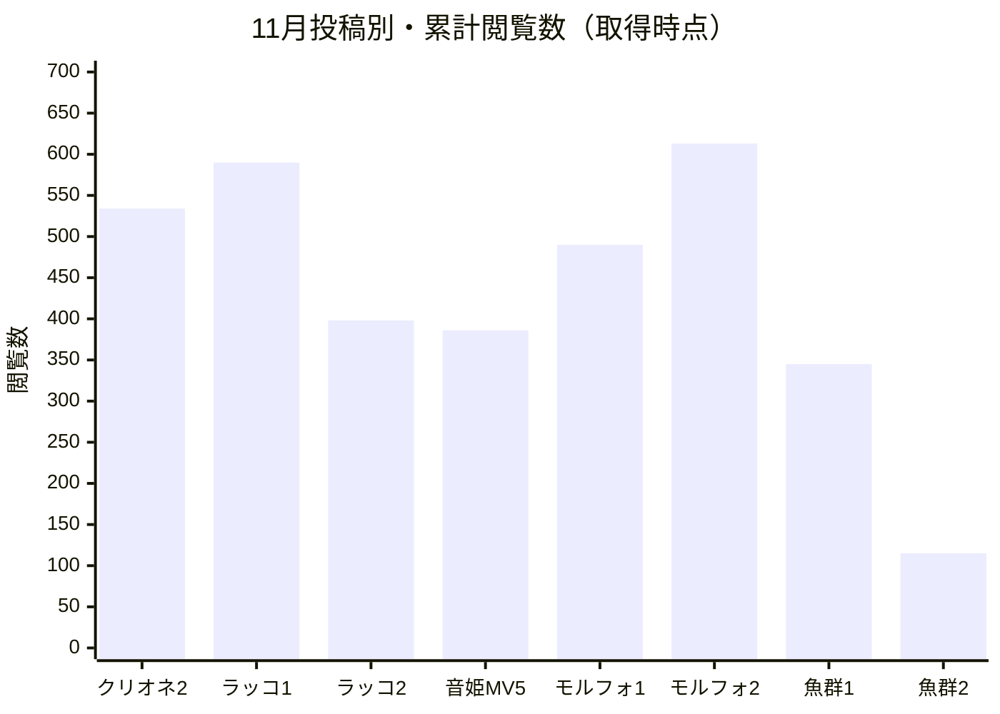
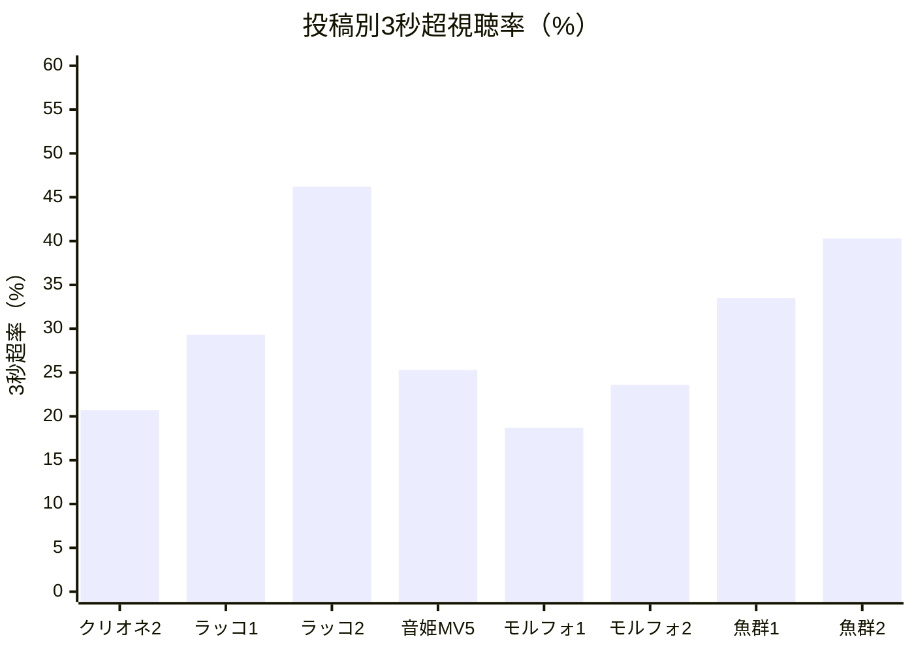
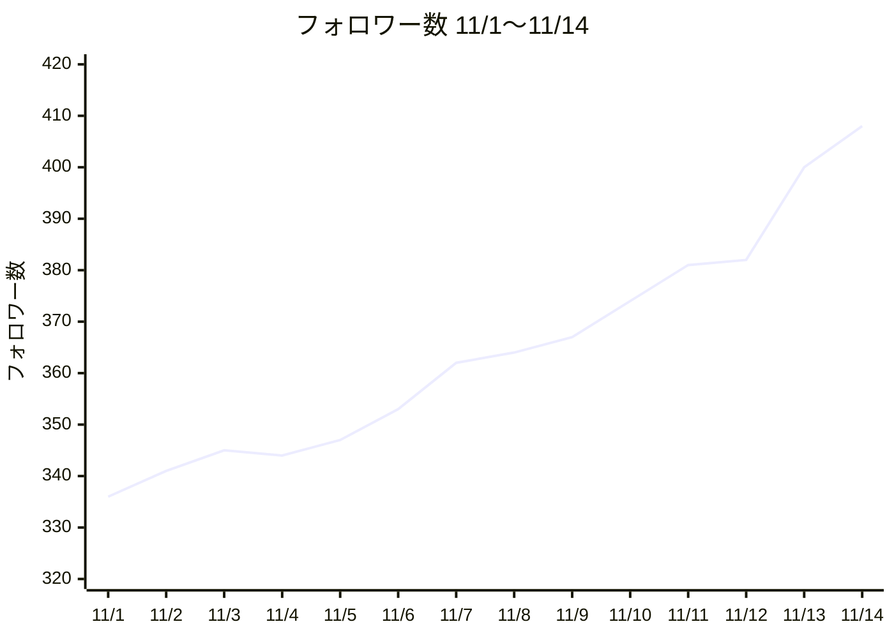
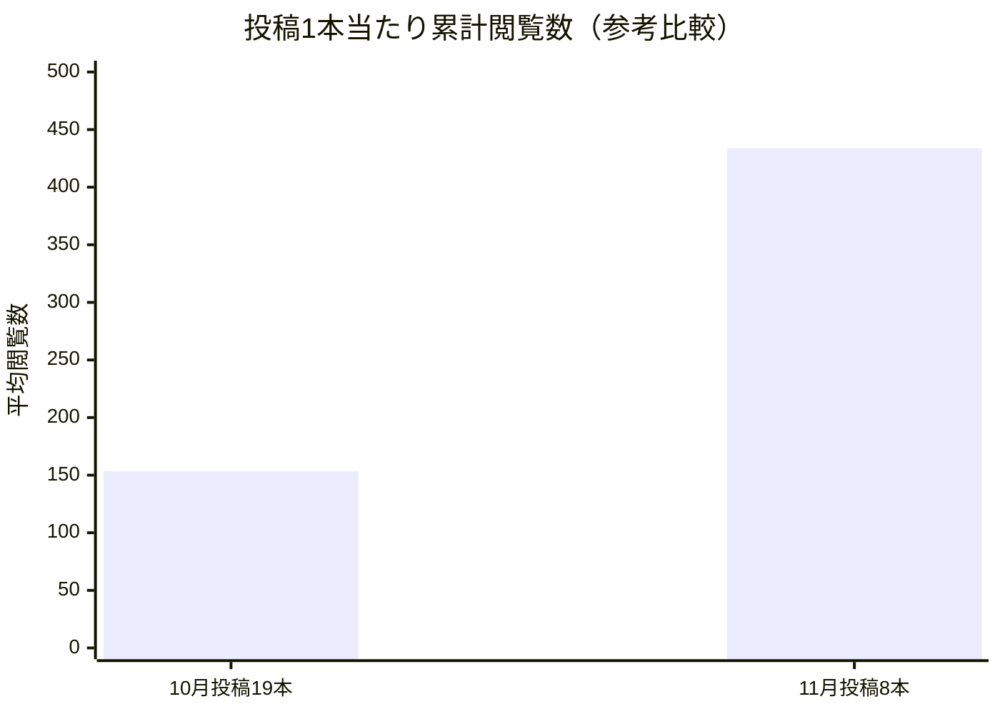
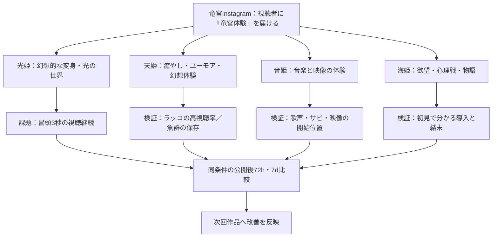

# 竜宮Instagram Reels分析｜2026年11月1日〜11月16日

> [!important] データの範囲
> 対象は2026年11月1日〜16日に公開されたリール。Metricoolが返却した投稿は11月15日公開分までの8本。各投稿の数値は**取得時点の累計実績**であり、11月1日〜16日の間だけに発生した閲覧数ではない。11月16日終了時点の確定値でもない。フォロワー残高の最新取得日は11月14日。
>
> 分析では、**実測値／仮説／制作提案**を区別する。動画本編や視聴者の秒別離脱曲線は確認していない。

## 1. エグゼクティブサマリー

| 指標 | 11月投稿8本の取得時点累計 |
|---|---:|
| 投稿数 | 8 |
| 閲覧数合計 | **3,471** |
| 平均閲覧数／本 | **433.9** |
| リーチ合計（投稿間重複あり） | 2,297 |
| いいね合計 | 566 |
| コメント合計 | 121 |
| 保存合計 | **10** |
| シェア合計 | **6** |
| 3秒超視聴率（投稿別単純平均） | **29.7%** |
| フォロワー残高（11/1 → 11/14） | **336 → 408（+72、+21.4%）** |

- **閲覧数トップ：光姫・モルフォチョウ②（613回）**。リーチも444で8本中最大。
- **3秒超視聴率トップ：天姫・ラッコ②（46.2%）**。
- **保存数トップ：天姫・魚群プラネタリウム①（4件）**。
- 11月投稿の平均閲覧数433.9回は、10月31日取得の10月投稿19本の平均153.5回を上回る。ただし取得日と投稿経過日数が異なり、厳密な同条件比較ではない。
- 3秒超視聴率は10月29.6%、11月29.7%とほぼ横ばい。**閲覧規模の拡大と冒頭視聴継続の改善は別問題**。

## 2. 投稿別実績（URLを一意キーとして管理）

| 公開日 | 作品 | 閲覧 | リーチ | 3秒超率 | 平均視聴秒 | いいね | コメント | 保存 | シェア |
|---|---|---:|---:|---:|---:|---:|---:|---:|---:|
| 11/1 | [光姫・クリオネ②](https://www.instagram.com/reel/DfL3B6JxX3Q/) | 534 | 372 | 20.7% | 5.777 | 85 | 16 | 3 | 1 |
| 11/3 | [天姫・ラッコ①](https://www.instagram.com/reel/DfQrsBOx5lB/) | 590 | 408 | 29.3% | 5.148 | 77 | 10 | 0 | 1 |
| 11/4 | [天姫・ラッコ②](https://www.instagram.com/reel/DfUGMjwx5lY/) | 398 | 222 | **46.2%** | 7.923 | 68 | 12 | 0 | 1 |
| 11/6 | [音姫・MV第5弾](https://www.instagram.com/reel/DfZITolxZb6/) | 386 | 221 | 25.3% | 27.626 | 73 | 20 | 0 | 1 |
| 11/8 | [光姫・モルフォ①](https://www.instagram.com/reel/Dfd7jUFRyX_/) | 490 | 338 | 18.7% | 6.959 | 80 | 14 | 1 | 1 |
| 11/11 | [光姫・モルフォ②](https://www.instagram.com/reel/DfnsKsSRBhB/) | **613** | **444** | 23.6% | 8.294 | 88 | 26 | 2 | 1 |
| 11/14 | [天姫・魚群①](https://www.instagram.com/reel/DftIXSLxqJA/) | 345 | 227 | 33.5% | 10.813 | 65 | 16 | **4** | 0 |
| 11/15 | [天姫・魚群②](https://www.instagram.com/reel/DfwKP4gxmfQ/) | 115 | 65 | 40.3% | 13.430 | 30 | 7 | 0 | 0 |

※ 保存・シェアの「0」はMetricool返却値。動画の尺・完視聴率・投稿別フォロワー獲得数は未取得。3秒超率は完視聴率ではない。

## 3. グラフ

### 3.1 11月投稿別・累計閲覧数

**読み方：** 作品ごとの公開日が異なるため、閲覧数の順位は同じ公開後経過時間における順位ではない。特に11月14日・15日公開の魚群①②は不利な条件にある。

### 3.2 投稿別・3秒超視聴率

### 3.3 フォロワー残高の推移

※ 11月15日・16日のフォロワー残高は取得できていない。

### 3.4 10月基準と11月投稿の平均閲覧数

**注意：** 10月値は2026年10月31日00:24 JSTのスナップショット。11月値は今回取得時点。投稿日・公開後日数・取得時点が一致しないため、因果関係や成長倍率の厳密な証明には使わない。

## 4. シリーズ別分析

### 4.1 光姫｜理想鏡ルミア・イルミネーション

**実測：** 3本計1,637閲覧、平均545.7閲覧／本、保存6、シェア3。11月投稿の閲覧数では最も大きいシリーズ。

| 比較 | モルフォ① | モルフォ② | 差（②−①） |
|---|---:|---:|---:|
| 閲覧数 | 490 | 613 | **+123** |
| リーチ | 338 | 444 | **+106** |
| 3秒超視聴率 | 18.7% | 23.6% | **+4.9pt** |
| 平均視聴時間 | 6.959秒 | 8.294秒 | +1.335秒 |
| 保存 | 1 | 2 | +1 |

**解釈：** ②は閲覧規模・リーチ・冒頭視聴継続のすべてで①を上回る。ただし公開後経過日数や視聴者層が異なり、作品内容だけが差の原因とは断定できない。

**仮説：** ②の「愛の木」「光の花」など完成世界の提示が初見視聴者に伝わりやすかった可能性。ただし映像本編を確認していない。

**制作提案：** ①の光の骨格生成と②の完成世界を比較し、次作では「完成形先出し型」と「生成過程先行型」の冒頭0〜3秒を検証する。幻想性を削ることを改善の前提にしない。

### 4.2 天姫｜極上の竜宮・リラクゼーション

**実測：** 4本計1,448閲覧、平均362閲覧／本、保存4、シェア2。

| 比較 | ラッコ① | ラッコ② |
|---|---:|---:|
| 閲覧数 | 590 | 398 |
| リーチ | 408 | 222 |
| 3秒超視聴率 | 29.3% | **46.2%** |
| 保存 | 0 | 0 |

**実測：** ラッコ①は閲覧規模、ラッコ②は3秒超視聴率に強みがある。

**新しい観測：** 魚群プラネタリウム①は公開直後の短い経過時間でも保存4件を記録し、11月の8本で保存数最多。魚群②は3秒超視聴率40.3%だが、公開から間もなく閲覧115回。評価を急がない。

**仮説：** ラッコの「コミカルな癒やし」と魚群の「幻想的な没入体験」は、異なる視聴動機を喚起している可能性。保存4件は少数なので再現性の検証が必要。

**制作提案：** 天姫は「ユーモア型」と「幻想体験型」の二軸で比較。魚群①②は公開後7日・14日を追跡し、保存数の増分と視聴率を確認する。

### 4.3 音姫｜ミュージックビデオ

**実測：** 11/6『HOW LOW HOW HIGH』は386閲覧、221リーチ、3秒超視聴率25.3%、平均視聴時間27.626秒、保存0、シェア1。

10月の過去MV『愛のうた』（前回レポート214閲覧）と『この夜が終わるまで』（217閲覧）の当時の累計値を上回る。ただし測定日と公開後経過時間が異なる。

**仮説：** 四姫共演、理想鏡ルミア、楽曲テンポなどの構成が視聴行動に影響した可能性。動画本編を確認していないため要因未確定。

**制作提案：** 音楽作品としての完成度とSNS上の初動を別々に評価し、「歌声から始める」「サビから始める」「強い映像から始める」構成を検証。平均視聴時間を動画尺の異なる短尺リールと直接比較しない。

### 4.4 海姫｜欲望を暴く事件シリーズ

11月1日〜16日に公開された対象リールは**今回の取得結果にない**。そのため11月投稿実績を作り出さない。

参考として11月11日版の過去レポートでは、10/26の「ヤギの結末」が433閲覧、3秒超視聴率40.4%で、10/23の「ゲーム開幕」153閲覧・20.6%を上回っていた。次作では単独でも理解できる導入と結末の意外性を検証する。

## 5. フォロワー分析

| 日付 | 残高 | 前日比 |
|---|---:|---:|
| 11/1 | 336 | — |
| 11/2 | 341 | +5 |
| 11/3 | 345 | +4 |
| 11/4 | 344 | -1 |
| 11/5 | 347 | +3 |
| 11/6 | 353 | +6 |
| 11/7 | 362 | +9 |
| 11/8 | 364 | +2 |
| 11/9 | 367 | +3 |
| 11/10 | 374 | +7 |
| 11/11 | 381 | +7 |
| 11/12 | 382 | +1 |
| 11/13 | 400 | +18 |
| 11/14 | 408 | +8 |

11/1→11/14は+72人、残高比+21.4%。11/12→11/13は+18人と増加が大きいが、11/13に新規リールがないため、特定の新規投稿の効果と断定できない。既存投稿、プロフィール経由、外部流入等の可能性がある。

## 6. 制作戦略のイメージ図

### 優先順位

1. **光姫モルフォ②**：閲覧数613・リーチ444。①との映像構成差と7日／14日推移を追跡。
2. **天姫魚群①**：保存4。保存が増えた理由を映像内容・構図から検証。
3. **天姫ラッコ②**：3秒超率46.2%。冒頭0〜3秒を実映像で検査。
4. **音姫MV第5弾**：MVの作品性を維持したまま導入の再現性を確認。
5. **海姫**：次回投稿時に10月事件シリーズの開幕回・結末回を比較基準とする。

## 7. 次回データ取得と品質管理

- 投稿URLを一意キーにし、同一投稿の過去スナップショットとの差分を記録する。
- 公開後24h・72h・7d・14d・30dの値は、実際にその時点で取得できた場合のみ「当該時点の値」と記す。
- 累計閲覧数と期間増分を混同しない。
- 投稿別リーチの合計をユニークアカウント数と呼ばない。
- 3秒超視聴率を完視聴率と呼ばない。
- 平均視聴時間は動画尺が異なる場合、単純な優劣比較に用いない。
- 視聴者心理・冒頭演出の原因は動画本編を確認するまで仮説扱い。
- 11/15・16のフォロワー残高、投稿別フォロワー獲得数、流入経路、秒別離脱曲線は未取得。

## 8. 総合結論

11月前半の竜宮Instagramは、**投稿別の累計閲覧規模が10月の基準スナップショットより大きく、フォロワー残高も11/1〜11/14で+72人**。一方、3秒超視聴率の投稿別平均は約29.7%で、10月の29.6%とほぼ同じ。

現時点の重点は一律の短尺化ではない。**光姫＝冒頭の理解しやすさ、天姫＝視聴継続と保存の異なる成功要因、音姫＝音楽的完成度と初動の両立、海姫＝物語の入口と結末**という、シリーズごとの検証設計である。

## 9. データソース・履歴

- Metricool Instagram Analytics（対象：@otohime_ryugujou、2026-11-01〜2026-11-16）
- `インスタ分析用/竜宮Instagram_2026年10月リール分析_Obsidian.md`（2026-10-31 00:24 JST取得）
- `インスタ分析用/竜宮Instagram_Reels分析_2026-11-02_2026-11-11.md`
- グラフ：Mermaid `xychart-beta`。ObsidianまたはGitHubの表示環境・バージョンによってはグラフが表示されない場合がある。数値は表にもすべて記載。
- 本ファイルは分析記録であり、Instagramへの投稿・予約操作は行っていない。
