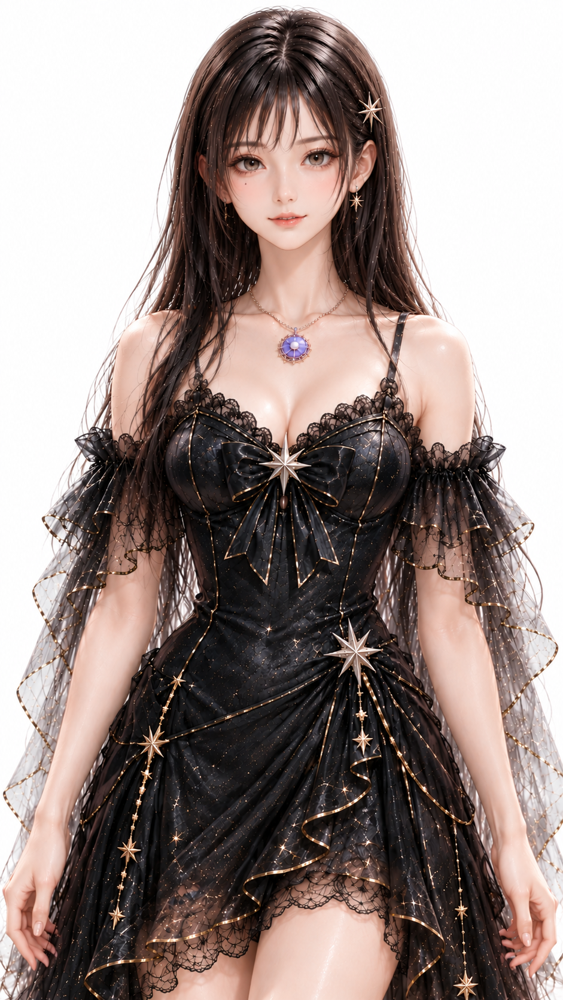
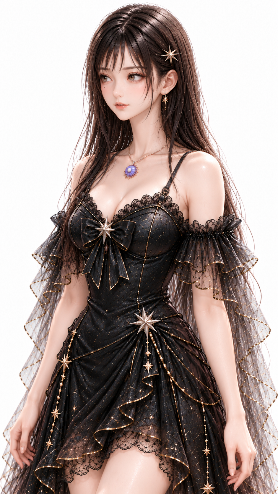
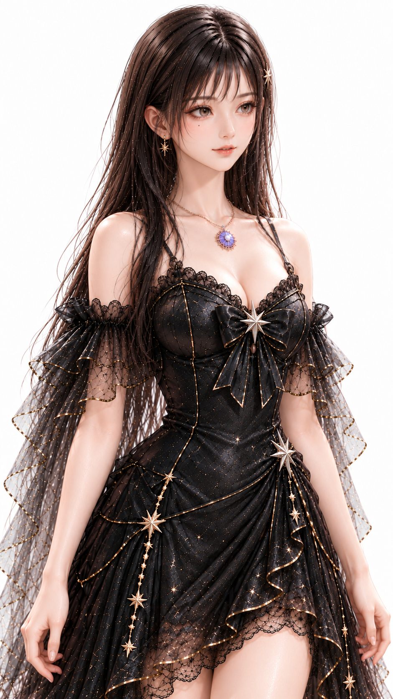
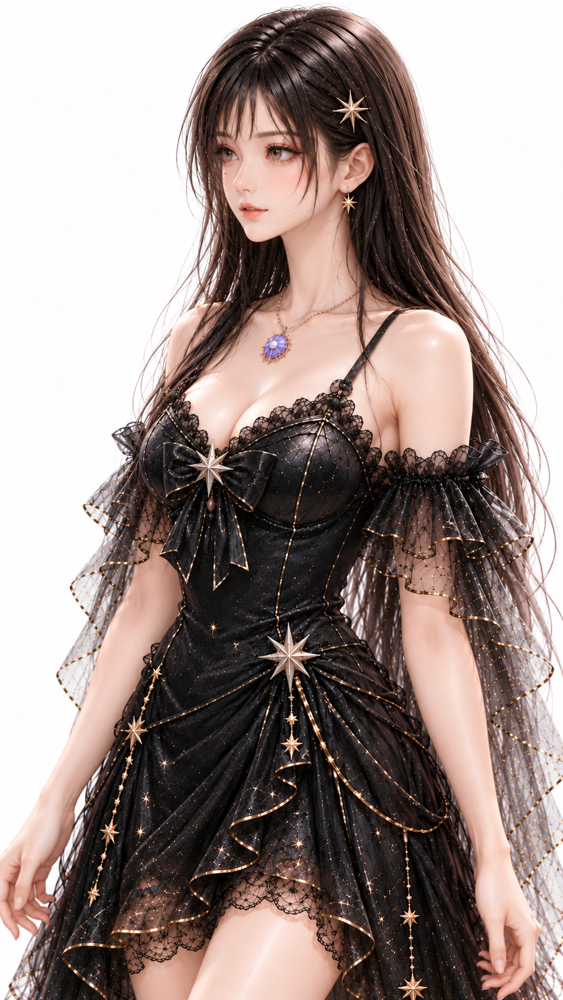
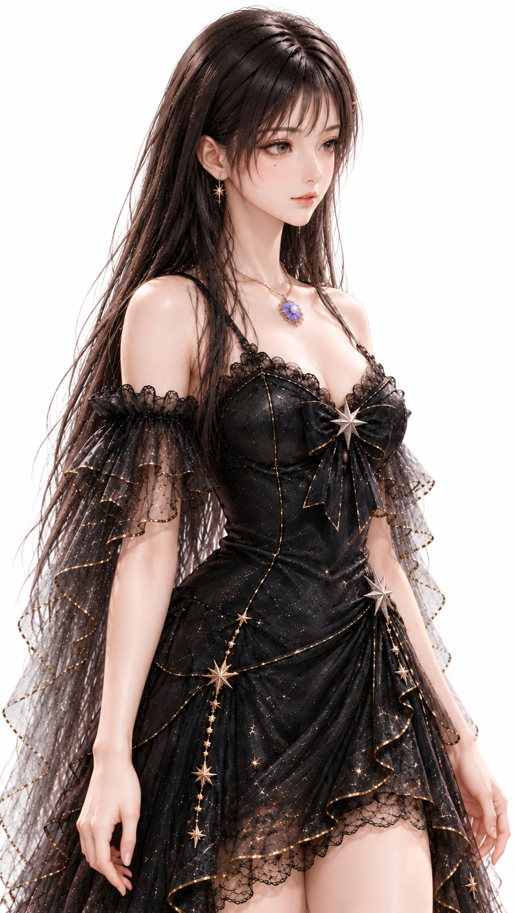
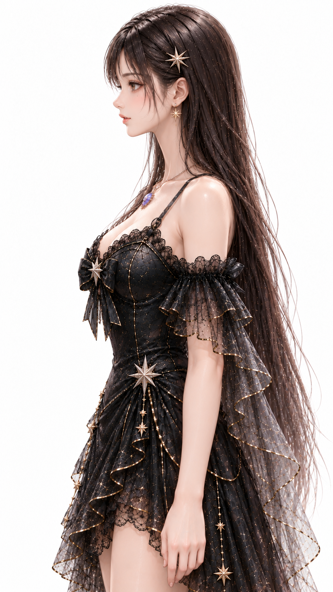
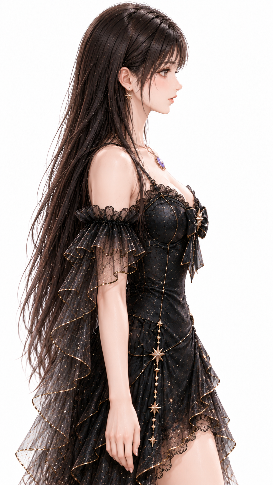
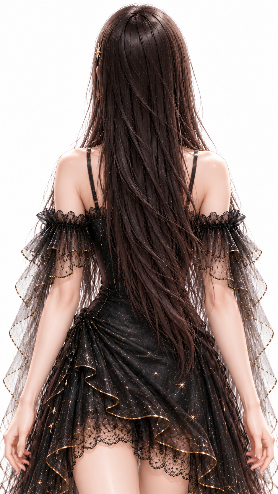

# 光姫 MIXXIA 多方向基準画制作仕様書 Ver0.1

## 1. 制作概要

2026年10月28日。依頼文Ver1.1に基づく試験制作版Ver0.1。正面画像は無変更で収録し、7方向の新規候補を制作。左右15°は各1回再生成し、生成呼出しは計9回、収録する生成画像は7枚。画像生成成功と品質合格は別であり、正式採用した生成画像は0枚。

画像入力は全9回とも添付された光姫の正面基準画像1枚のみ。他の六姫の画像・プロンプト・制作成果物を検索・取得・参照していない。生成済み別角度も入力していない。MIXXIAの一般規則と指定の海姫実例の文章だけを技法として参照した。

右は人物自身の右、鼻先が画面左へ向く方向。左は画面右へ向く方向。符号は依頼指定に従い、3Dソフト固有の座標系を保証しない。

## 2. 参照資料

- 00_運用規約_Ver1.9(1).docx。正本保存媒体・設定マスター・ドラフトの扱いに従い、既存正式資料は変更しない。
- 01_竜宮プロトコル創世記_正式設定_Ⅰ章_Ver2.8_正式Word版(1).docx。7.7.4の光姫は理想・成長を司るという設定を確認。画像制作に新能力を追加しない。
- 02_竜宮プロトコル創世記_世界設定_Ver1.83.docx。六姫の役割における光姫の理想・成長を確認。
- 04_竜宮プロトコル創世記_創世カノンΩΩΩ_Ver1.2.docx。C001の作品思想を参照。衣装外観の新たな根拠には使わない。本文先頭の表題は「創生カノンΩ Ω Ω」となっており、ファイル名との表記差を留保。
- 竜宮六姫_MIXXIA_ビジュアル制作仕様書_Ver0.5.docx。10.5.6、10.5.7「右90°」、10.5.7「右45°」、関連する第4・6・7・8章の文章を参照。番号重複は修正しない。
- 絵画的リアリズム仕様書MarkDown転記モード_ver2.2.md。GeometryとRenderingの分離、Loop Lighting定義を参照。
- 入力画像A：821680d3-e34c-472e-8a05-b11129efe40a.png。直接のIdentity・Geometry・Rendering基準。原画（兄絵）は未添付であり、原画一致は検証していない。

MIXXIAのファイル名はVer0.5、本文管理表にはVer1.0とテンプレートの状態表記が残る。勝手に版を統合せず、今回添付されたファイルを参照元として特定した。

依頼文章にはシルバー装飾・シルバーリボンとあるが、画像は黒リボン、金〜淡い金属色の星金具・縁取りに見える。制作前に報告し、今回の直接基準である画像の色を維持した。金属色の正式名称や材料を確定したわけではない。

## 3. 海姫3方向制作仕様からの適用規則

|抽出規則|参照元|内容|
|---|---|---|
| 正面Geometry Reference | 10.5.7 右90°基準画の制作仕様／第7章 正面基準画 | 美化ポートレートではなく、回転・横向き・全身・映像へIdentityとGeometryを継承する基準。 |
| IdentityとGeometry | 第4章 入力 Identity Source／第7章 | 兄絵がIdentityの起点。正面は後工程のGeometry Reference。今回の直接入力指定は兄絵の地位を変えない。 |
| Lighting Rendering | 10.5.6／第6章 Lighting Rendering制作工程 | 人物・構図・表情・ポーズ・衣装・背景・カメラ等を固定し、光を表現層として扱う。85mm F1.4。 |
| Loop Lighting | 10.5.6／第6章／絵画的リアリズムver2.2 ② Loop Lighting | 鼻横に小さなループシャドウを作り自然な立体感を得る。灯体の角度数値や配置数は実例本文にない。 |
| 右90°制作 | 10.5.7 右90°基準画の制作仕様／8.2.1 標準角度 | 正面を基に上半身の右90°を制作。実例本文は依頼記録が中心で、完全な生成文は収録されていない。 |
| 右45°制作 | 10.5.7 右45°基準画の制作仕様／第8章 | 同じ上半身正面から右45°へ展開。項番重複は原文どおり保持。 |
| 剛体Y軸回転 | 第8章 回転原則 Rigid Body Y-Axis Rotation | 頭蓋・顔・首・両肩・胸郭・胴体・骨盤を同方向同角度に回す。顔と視線だけを正面へ戻さない。 |
| 顔骨格 | 第7章 Geometry Lock／第8章 Identity Geometry継承・Facial Construction | 頭蓋、顔高、頬・顎、眼鼻口の位置と比率を維持。一般的な横顔・美少女比率に置換しない。 |
| 身体Geometry | 第8章 Identity Geometry継承 | 首長、肩幅、胸郭、骨盤、腕長、頭身と比率を維持。自然な投影だけを変える。 |
| 髪・衣装・装飾 | 第8章 衣装 髪型 装飾 三次元構造としての継承 | 三次元的に継承し、見えない部位は遮蔽。不明構造を独自の正式デザインにしない。 |
| 品質検査 | 第8章 多方向基準画の判定 Geometry確認 | 単体の美しさより角度間の顔高・部位位置・後頭部・首接続・身体・髪衣装装飾の連続性を優先。 |

上表は参照文書で確認できた規則。指定3項目だけにすべての詳細があるとは扱わず、剛体回転と検査の詳細は第8章から補った。Lightingだけを変える第6章の比較条件と、第8章の回転工程は分けて適用する。

今回の応用条件は、添付光姫画像を直接入力として回転工程に入ること、右左の符号と生成順、白背景、頭頂から腰下の構図、8項目の暫定判定、背面180°と未観測構造の暫定案である。兄絵→Pencil→COPIC→Lightingを今回再実行したとは報告しない。照明の物理位置・焦点距離は実測していない。

## 4. 光姫Identity・Geometry固定仕様

顔は柔らかな卵形から細い顎へつながる輪郭、灰褐色に見える大きな瞳、細い眉、小ぶりな鼻、わずかに開いた口。人物自身の右頬に小さなほくろが見える。若い年齢印象と基本表情を維持する。色や年齢の観察は画像描写であり正式設定の追加ではない。

暗い茶黒色の長髪、細く分かれた前髪、後ろへ流れる毛束、人物自身の左側の星髪留め、星形ピアス、紫の円形ペンダントを継承する。衣装は黒の細い肩紐、胸元の黒いリボンと星金具、レース、透ける黒いフリル袖、星屑柄、金属色の縁取り・鎖。左腰の大きな星と左右非対称な鎖・裾の構成を人体左右に固定する。

顔高と幅、目鼻口の相対配置、頭と肩幅、首長、肩の傾斜、胸郭と腰、腕長と太さを固定対象とした。数値のランドマーク計測は行っていない。鼻の突出量、頭蓋・胸郭の奥行き、後頭部や衣装背面は正面1枚から測れず推定。

85mm F1.4相当、Loop Lighting、白背景、元の肌・髪・生地と金属反射をプロンプトに指定。実カメラや照明の計測結果ではない。正面原本は照明補正・トリミング・リサイズ・再解釈しない。

## 5. 正面0°基準画



- 方向・角度：正面0°
- 基準画像：images/HIK_00_Front.pngのみ
- 使用モデル：なし 元画像複製
- プロンプト：なし
- 生成回数：0
- 参照仕様：10.5.6／10.5.7 右90°／10.5.7 右45°／第7・8章。背面は今回追加の応用。
- 検査：Identity OK／Facial Geometry OK／Body Geometry OK／Hair OK／Costume OK／Rotation OK／Rendering OK／Composition OK
- 不一致・未確定事項：原本をバイト一致で複製。OKは無変更の基準そのものという意味。実際の0°、Loop Lighting、原画一致を独立検証した意味ではない。
- 採用状態：ユーザー指定により正面原本を採用。

## 6. 右15° +15°基準画候補



- 方向・角度：右15° +15°
- 基準画像：images/HIK_00_Front.pngのみ
- 使用モデル：ChatGPT組み込みimage_gen 内部モデル名・版は非開示
- プロンプト：第15節 P-R15_retry 初回文も同節に収録
- 生成回数：2
- 参照仕様：10.5.6／10.5.7 右90°／10.5.7 右45°／第7・8章。背面は今回追加の応用。
- 検査：Identity OK／Facial Geometry 要確認／Body Geometry 要確認／Hair OK／Costume 要確認／Rotation 要確認／Rendering 要確認／Composition OK
- 不一致・未確定事項：初回は顔が画面左、胴体は反対側を向く捻りがありRotation NG。再生成で方向は改善したが浅い15°より回転が大きい可能性がある。顔と肩の角度一致、眼・顎の印象、リボンと星鎖の細部は要確認。
- 採用状態：試験候補として保存。正式採用は未承認。

## 7. 左15° -15°基準画候補



- 方向・角度：左15° -15°
- 基準画像：images/HIK_00_Front.pngのみ
- 使用モデル：ChatGPT組み込みimage_gen 内部モデル名・版は非開示
- プロンプト：第15節 P-L15_retry 初回文も同節に収録
- 生成回数：2
- 参照仕様：10.5.6／10.5.7 右90°／10.5.7 右45°／第7・8章。背面は今回追加の応用。
- 検査：Identity OK／Facial Geometry 要確認／Body Geometry 要確認／Hair OK／Costume 要確認／Rotation 要確認／Rendering 要確認／Composition OK
- 不一致・未確定事項：初回は視線がカメラへ戻る傾向がありRotation NG。背面生成後の最終検査で再生成を1回実施。視線は改善したが15°の厳密さ、頭胴の一致は未計測。眼の開き・顔幅の印象、装飾配置を要確認。
- 採用状態：試験候補として保存。正式採用は未承認。

## 8. 右45° +45°基準画候補



- 方向・角度：右45° +45°
- 基準画像：images/HIK_00_Front.pngのみ
- 使用モデル：ChatGPT組み込みimage_gen 内部モデル名・版は非開示
- プロンプト：第15節 P-R45 初回文も同節に収録
- 生成回数：1
- 参照仕様：10.5.6／10.5.7 右90°／10.5.7 右45°／第7・8章。背面は今回追加の応用。
- 検査：Identity 要確認／Facial Geometry 要確認／Body Geometry 要確認／Hair OK／Costume 要確認／Rotation 要確認／Rendering 要確認／Composition OK
- 不一致・未確定事項：顔と胴体は画面左への3/4方向。厳密45°と頭胴角度は未計測。顔高・鼻顎の立体化、胸元リボンの折れ、腰の鎖や星柄の再構成が疑われる。
- 採用状態：試験候補として保存。正式採用は未承認。

## 9. 左45° -45°基準画候補



- 方向・角度：左45° -45°
- 基準画像：images/HIK_00_Front.pngのみ
- 使用モデル：ChatGPT組み込みimage_gen 内部モデル名・版は非開示
- プロンプト：第15節 P-L45 初回文も同節に収録
- 生成回数：1
- 参照仕様：10.5.6／10.5.7 右90°／10.5.7 右45°／第7・8章。背面は今回追加の応用。
- 検査：Identity 要確認／Facial Geometry 要確認／Body Geometry 要確認／Hair OK／Costume 要確認／Rotation 要確認／Rendering 要確認／Composition OK
- 不一致・未確定事項：顔と胴体は画面右への3/4方向。髪留めの奥側遮蔽は自然。顔部位と首・肩の比率は要確認。鎖・フリル・星柄の細部を厳密継承したとは確認できない。
- 採用状態：試験候補として保存。正式採用は未承認。

## 10. 右90° +90°基準画候補



- 方向・角度：右90° +90°
- 基準画像：images/HIK_00_Front.pngのみ
- 使用モデル：ChatGPT組み込みimage_gen 内部モデル名・版は非開示
- プロンプト：第15節 P-R90 初回文も同節に収録
- 生成回数：1
- 参照仕様：10.5.6／10.5.7 右90°／10.5.7 右45°／第7・8章。背面は今回追加の応用。
- 検査：Identity 要確認／Facial Geometry 要確認／Body Geometry 要確認／Hair 要確認／Costume 要確認／Rotation OK／Rendering 要確認／Composition OK
- 不一致・未確定事項：片目の横顔、画面左へ向く胴体側面は成立。鼻梁・唇・顎・後頭部・胸郭の奥行きは正面から検証できない。星髪留めと左腰星の手前側配置は大枠整合するが寸法と接続は要確認。
- 採用状態：試験候補として保存。正式採用は未承認。

## 11. 左90° -90°基準画候補



- 方向・角度：左90° -90°
- 基準画像：images/HIK_00_Front.pngのみ
- 使用モデル：ChatGPT組み込みimage_gen 内部モデル名・版は非開示
- プロンプト：第15節 P-L90 初回文も同節に収録
- 生成回数：1
- 参照仕様：10.5.6／10.5.7 右90°／10.5.7 右45°／第7・8章。背面は今回追加の応用。
- 検査：Identity 要確認／Facial Geometry 要確認／Body Geometry 要確認／Hair 要確認／Costume 要確認／Rotation OK／Rendering 要確認／Composition OK
- 不一致・未確定事項：片目の横顔と画面右へ向く胴体側面は成立。星髪留めの奥側遮蔽、手前側の星ピアスは大枠整合。鼻顎・胸郭厚み・横から見た胸リボン・装飾鎖の連続性は要確認。
- 採用状態：試験候補として保存。正式採用は未承認。

## 12. 背面180°基準画候補



- 方向・角度：背面180°
- 基準画像：images/HIK_00_Front.pngのみ
- 使用モデル：ChatGPT組み込みimage_gen 内部モデル名・版は非開示
- プロンプト：第15節 P-Back 初回文も同節に収録
- 生成回数：1
- 参照仕様：10.5.6／10.5.7 右90°／10.5.7 右45°／第7・8章。背面は今回追加の応用。
- 検査：Identity 要確認／Facial Geometry 要確認／Body Geometry 要確認／Hair 要確認／Costume 要確認／Rotation OK／Rendering 要確認／Composition OK
- 不一致・未確定事項：顔のない完全な後ろ向きは成立。長髪で背中が大きく隠れ、背面生地、肩紐接続、袖と腰の連続性は検証できない。後頭部の毛束と髪留めの裏、裾の段差と柄・縁取りは暫定案。
- 採用状態：試験候補として保存。正式採用は未承認。

## 13. 品質検査結果

OK＝目視上大きな不一致なし、NG＝明確な不一致あり、要確認＝画像だけでは判断困難。Workの暫定評価でありユーザーが最終判断する。

|方向|Identity|Facial Geometry|Body Geometry|Hair|Costume|Rotation|Rendering|Composition|総合と状態|
|---|---|---|---|---|---|---|---|---|---|
|正面0°|OK|OK|OK|OK|OK|OK|OK|OK|原本採用|
|右15° +15°|OK|要確認|要確認|OK|要確認|要確認|要確認|OK|要確認・承認待ち|
|左15° -15°|OK|要確認|要確認|OK|要確認|要確認|要確認|OK|要確認・承認待ち|
|右45° +45°|要確認|要確認|要確認|OK|要確認|要確認|要確認|OK|要確認・承認待ち|
|左45° -45°|要確認|要確認|要確認|OK|要確認|要確認|要確認|OK|要確認・承認待ち|
|右90° +90°|要確認|要確認|要確認|要確認|要確認|OK|要確認|OK|要確認・承認待ち|
|左90° -90°|要確認|要確認|要確認|要確認|要確認|OK|要確認|OK|要確認・承認待ち|
|背面180°|要確認|要確認|要確認|要確認|要確認|OK|要確認|OK|要確認・承認待ち|

収録版は明確な捻りや視線の問題を再生成で改善したが、角度とGeometryの合格を保証しない。初回右15°・左15°のRotation NGは制作履歴に残す。Renderingは鼻横の影が弱くLoop Lightingの成立を一律OKにできないため要確認。

## 14. 未確定事項

髪の背面の毛束、髪留めの留め具、隠れた肩紐と背中の縫製・身頃上端、腰鎖と星模様の背面連続性、裾の段差は暫定。長髪で背面衣装の多くが隠れ、完成構造を検査できない。顔の側面と身体の奥行き、15°と45°の正確な角度、装飾の個数・接続点・レース柄の一致も未確定。正式な原画・側面設計・装飾配置図があると検証を進められる。

## 15. 使用プロンプト

全9回の画像入力は入力画像Aの1枚のみ。生成済み方向や他キャラクターの画像を入力していない。以下は実送信した全文。

### P-R15

```text
Use case: identity-preserve. 添付された光姫の正面画像1枚のみが人物Identity・Geometry・Renderingの入力。他の人物や過去成果物を参照しない。白背景の単独人物縦長基準画1枚、文字なし、比較パネルなし。頭頂から腰下と太腿上部まで、元に近い倍率と中央配置。元人物をY軸で剛体回転する操作だけを行う。顔・頭蓋・首・肩・胸郭・骨盤・腕・衣装を同方向同角度で回す。首を捻らず、瞳も元の相対方向を維持してカメラへ戻さない。小顔化・眼拡大・体型補正・美化禁止。柔らかな卵形輪郭、元の眼鼻口と口がわずかに開いた表情、人物自身の右頬（原画像の画面左）の小さなほくろを維持。暗い茶黒色の長い髪、細い前髪、毛流れ・ボリューム、人物自身の左側（元画面右）の星形髪留め、星形ピアス、中央の紫の円形ペンダントを保持。黒い細肩紐の衣装、黒い胸元リボンと中央星形金具、黒レース、半透明の黒いフリル袖、星屑状の模様、金属色の細い縁取りと鎖、人物自身の左腰（元画面右）の大きな星金具、左右非対称な裾と鎖配置を省略・反転・再デザインしない。装飾色は文章の銀色へ変更せず元画像の金〜淡金属色を維持。85mm F1.4相当、自然なLoop Lightingで鼻横に小さな影、肌と髪の元の絵画的リアリズム、金属光沢と布の透過感を維持。見えなくなる装飾は自然に遮蔽。顔だけ・胸だけを正面に残さない。左右反転で作らない。
人物自身の右15°（+15°）。鼻先は画面左へ少し向く。両目は見える微小回転。胸元リボン・肩・腰も同じ右15°へ向く。
```

### P-L15

```text
Use case: identity-preserve. 添付された光姫の正面画像1枚のみが人物Identity・Geometry・Renderingの入力。他の人物や過去成果物を参照しない。白背景の単独人物縦長基準画1枚、文字なし、比較パネルなし。頭頂から腰下と太腿上部まで、元に近い倍率と中央配置。元人物をY軸で剛体回転する操作だけを行う。顔・頭蓋・首・肩・胸郭・骨盤・腕・衣装を同方向同角度で回す。首を捻らず、瞳も元の相対方向を維持してカメラへ戻さない。小顔化・眼拡大・体型補正・美化禁止。柔らかな卵形輪郭、元の眼鼻口と口がわずかに開いた表情、人物自身の右頬（原画像の画面左）の小さなほくろを維持。暗い茶黒色の長い髪、細い前髪、毛流れ・ボリューム、人物自身の左側（元画面右）の星形髪留め、星形ピアス、中央の紫の円形ペンダントを保持。黒い細肩紐の衣装、黒い胸元リボンと中央星形金具、黒レース、半透明の黒いフリル袖、星屑状の模様、金属色の細い縁取りと鎖、人物自身の左腰（元画面右）の大きな星金具、左右非対称な裾と鎖配置を省略・反転・再デザインしない。装飾色は文章の銀色へ変更せず元画像の金〜淡金属色を維持。85mm F1.4相当、自然なLoop Lightingで鼻横に小さな影、肌と髪の元の絵画的リアリズム、金属光沢と布の透過感を維持。見えなくなる装飾は自然に遮蔽。顔だけ・胸だけを正面に残さない。左右反転で作らない。
人物自身の左15°（-15°）、鼻先は画面右へ少し向く。頭から腰まで一体で画面右に向ける。人物の右肩（画像左）が近く、左肩（画像右）が奥になる。胸中央リボンと腰前面の中心も画像右へ少し移り、顔と胸と骨盤の前向きベクトルが一致する。首だけの回転禁止。両目が見える浅い回転。
```

### P-R15_retry

```text
Use case: identity-preserve. 添付された光姫の正面画像1枚のみが人物Identity・Geometry・Renderingの入力。他の人物や過去成果物を参照しない。白背景の単独人物縦長基準画1枚、文字なし、比較パネルなし。頭頂から腰下と太腿上部まで、元に近い倍率と中央配置。元人物をY軸で剛体回転する操作だけを行う。顔・頭蓋・首・肩・胸郭・骨盤・腕・衣装を同方向同角度で回す。首を捻らず、瞳も元の相対方向を維持してカメラへ戻さない。小顔化・眼拡大・体型補正・美化禁止。柔らかな卵形輪郭、元の眼鼻口と口がわずかに開いた表情、人物自身の右頬（原画像の画面左）の小さなほくろを維持。暗い茶黒色の長い髪、細い前髪、毛流れ・ボリューム、人物自身の左側（元画面右）の星形髪留め、星形ピアス、中央の紫の円形ペンダントを保持。黒い細肩紐の衣装、黒い胸元リボンと中央星形金具、黒レース、半透明の黒いフリル袖、星屑状の模様、金属色の細い縁取りと鎖、人物自身の左腰（元画面右）の大きな星金具、左右非対称な裾と鎖配置を省略・反転・再デザインしない。装飾色は文章の銀色へ変更せず元画像の金〜淡金属色を維持。85mm F1.4相当、自然なLoop Lightingで鼻横に小さな影、肌と髪の元の絵画的リアリズム、金属光沢と布の透過感を維持。見えなくなる装飾は自然に遮蔽。顔だけ・胸だけを正面に残さない。左右反転で作らない。
修正目標：人物全体を自身の右15°へ、ごくわずかに回す。鼻先・胸骨・胸元リボン・腰前面は全て画面左方向。人物の左肩（画面右）が手前で大きく、人物の右肩（画面左）は奥。胸元の星とペンダントは身体前面と一緒に画面左へ移る。顔だけ左、胸だけ右という捻りを絶対に作らない。顔と胸と腰の向きを一致。虹彩も鼻方向に従い画面左、カメラを見ない。15°なので浅い回転に留める。
```

### P-R45

```text
Use case: identity-preserve. 添付された光姫の正面画像1枚のみが人物Identity・Geometry・Renderingの入力。他の人物や過去成果物を参照しない。白背景の単独人物縦長基準画1枚、文字なし、比較パネルなし。頭頂から腰下と太腿上部まで、元に近い倍率と中央配置。元人物をY軸で剛体回転する操作だけを行う。顔・頭蓋・首・肩・胸郭・骨盤・腕・衣装を同方向同角度で回す。首を捻らず、瞳も元の相対方向を維持してカメラへ戻さない。小顔化・眼拡大・体型補正・美化禁止。柔らかな卵形輪郭、元の眼鼻口と口がわずかに開いた表情、人物自身の右頬（原画像の画面左）の小さなほくろを維持。暗い茶黒色の長い髪、細い前髪、毛流れ・ボリューム、人物自身の左側（元画面右）の星形髪留め、星形ピアス、中央の紫の円形ペンダントを保持。黒い細肩紐の衣装、黒い胸元リボンと中央星形金具、黒レース、半透明の黒いフリル袖、星屑状の模様、金属色の細い縁取りと鎖、人物自身の左腰（元画面右）の大きな星金具、左右非対称な裾と鎖配置を省略・反転・再デザインしない。装飾色は文章の銀色へ変更せず元画像の金〜淡金属色を維持。85mm F1.4相当、自然なLoop Lightingで鼻横に小さな影、肌と髪の元の絵画的リアリズム、金属光沢と布の透過感を維持。見えなくなる装飾は自然に遮蔽。顔だけ・胸だけを正面に残さない。左右反転で作らない。
人物自身の右45°（+45°）。鼻先と胸と腰の前面は全て画面左へ向く3/4ビュー。人物の左肩（画面右）が手前、右肩（画面左）が奥。胸元リボンと紫ペンダントは画面左寄りの身体前面に回り込む。頭と胸と腰の向きは一致。視線は顔と一緒に画面左へ、カメラ目線に戻さない。左右の装飾位置は人物に固定し画像上で入れ替えない。
```

### P-L45

```text
Use case: identity-preserve. 添付された光姫の正面画像1枚のみが人物Identity・Geometry・Renderingの入力。他の人物や過去成果物を参照しない。白背景の単独人物縦長基準画1枚、文字なし、比較パネルなし。頭頂から腰下と太腿上部まで、元に近い倍率と中央配置。元人物をY軸で剛体回転する操作だけを行う。顔・頭蓋・首・肩・胸郭・骨盤・腕・衣装を同方向同角度で回す。首を捻らず、瞳も元の相対方向を維持してカメラへ戻さない。小顔化・眼拡大・体型補正・美化禁止。柔らかな卵形輪郭、元の眼鼻口と口がわずかに開いた表情、人物自身の右頬（原画像の画面左）の小さなほくろを維持。暗い茶黒色の長い髪、細い前髪、毛流れ・ボリューム、人物自身の左側（元画面右）の星形髪留め、星形ピアス、中央の紫の円形ペンダントを保持。黒い細肩紐の衣装、黒い胸元リボンと中央星形金具、黒レース、半透明の黒いフリル袖、星屑状の模様、金属色の細い縁取りと鎖、人物自身の左腰（元画面右）の大きな星金具、左右非対称な裾と鎖配置を省略・反転・再デザインしない。装飾色は文章の銀色へ変更せず元画像の金〜淡金属色を維持。85mm F1.4相当、自然なLoop Lightingで鼻横に小さな影、肌と髪の元の絵画的リアリズム、金属光沢と布の透過感を維持。見えなくなる装飾は自然に遮蔽。顔だけ・胸だけを正面に残さない。左右反転で作らない。
人物自身の左45°（-45°）。鼻先・胸骨・胸元リボン・腰前面は全て画面右に向く3/4ビュー。人物の右肩（画面左）が手前、左肩（画面右）が奥。顔と胴体は同じ45°、顔を正面へ戻さない。虹彩も顔とともに画面右へ向き、カメラ目線は禁止。左側の髪留めは奥側へ回り自然に隠れる。衣装は反転せず人体左右に固定。
```

### P-R90

```text
Use case: identity-preserve. 添付された光姫の正面画像1枚のみが人物Identity・Geometry・Renderingの入力。他の人物や過去成果物を参照しない。白背景の単独人物縦長基準画1枚、文字なし、比較パネルなし。頭頂から腰下と太腿上部まで、元に近い倍率と中央配置。元人物をY軸で剛体回転する操作だけを行う。顔・頭蓋・首・肩・胸郭・骨盤・腕・衣装を同方向同角度で回す。首を捻らず、瞳も元の相対方向を維持してカメラへ戻さない。小顔化・眼拡大・体型補正・美化禁止。柔らかな卵形輪郭、元の眼鼻口と口がわずかに開いた表情、人物自身の右頬（原画像の画面左）の小さなほくろを維持。暗い茶黒色の長い髪、細い前髪、毛流れ・ボリューム、人物自身の左側（元画面右）の星形髪留め、星形ピアス、中央の紫の円形ペンダントを保持。黒い細肩紐の衣装、黒い胸元リボンと中央星形金具、黒レース、半透明の黒いフリル袖、星屑状の模様、金属色の細い縁取りと鎖、人物自身の左腰（元画面右）の大きな星金具、左右非対称な裾と鎖配置を省略・反転・再デザインしない。装飾色は文章の銀色へ変更せず元画像の金〜淡金属色を維持。85mm F1.4相当、自然なLoop Lightingで鼻横に小さな影、肌と髪の元の絵画的リアリズム、金属光沢と布の透過感を維持。見えなくなる装飾は自然に遮蔽。顔だけ・胸だけを正面に残さない。左右反転で作らない。
人物自身の右90°（+90°）。鼻先が画面左を向く完全な横顔。遠側の目は隠れ、見える目は一つ。顔と胸郭と骨盤を全て真横、両肩は奥行きで重なる。カメラへ顔や胸を戻さない。人物の左側の星髪留めと星ピアスは手前。胸元リボンとペンダントは前面に付いたまま横から見た薄い形で示す。元の身体の厚みは勝手に増減せず、正面から測れない奥行きのみ控えめに推定。
```

### P-L90

```text
Use case: identity-preserve. 添付された光姫の正面画像1枚のみが人物Identity・Geometry・Renderingの入力。他の人物や過去成果物を参照しない。白背景の単独人物縦長基準画1枚、文字なし、比較パネルなし。頭頂から腰下と太腿上部まで、元に近い倍率と中央配置。元人物をY軸で剛体回転する操作だけを行う。顔・頭蓋・首・肩・胸郭・骨盤・腕・衣装を同方向同角度で回す。首を捻らず、瞳も元の相対方向を維持してカメラへ戻さない。小顔化・眼拡大・体型補正・美化禁止。柔らかな卵形輪郭、元の眼鼻口と口がわずかに開いた表情、人物自身の右頬（原画像の画面左）の小さなほくろを維持。暗い茶黒色の長い髪、細い前髪、毛流れ・ボリューム、人物自身の左側（元画面右）の星形髪留め、星形ピアス、中央の紫の円形ペンダントを保持。黒い細肩紐の衣装、黒い胸元リボンと中央星形金具、黒レース、半透明の黒いフリル袖、星屑状の模様、金属色の細い縁取りと鎖、人物自身の左腰（元画面右）の大きな星金具、左右非対称な裾と鎖配置を省略・反転・再デザインしない。装飾色は文章の銀色へ変更せず元画像の金〜淡金属色を維持。85mm F1.4相当、自然なLoop Lightingで鼻横に小さな影、肌と髪の元の絵画的リアリズム、金属光沢と布の透過感を維持。見えなくなる装飾は自然に遮蔽。顔だけ・胸だけを正面に残さない。左右反転で作らない。
人物自身の左90°（-90°）、鼻先は画面右。厳密な真横で目は一つだけ見え、遠側の目は完全遮蔽。頭と胸郭と腰と腕は同じ真横。人物の右側が手前。人物自身の左の星髪留めと左腰の大きな星は奥側なので見えない部分を隠し、手前側に移さない。顔を正面へ戻さず、横顔の前を見てカメラを見ない。胸元のリボンと紫ペンダントは前面から薄く側面投影。
```

### P-Back

```text
Use case: identity-preserve. 添付された光姫の正面画像1枚のみが人物Identity・Geometry・Renderingの入力。他の人物や過去成果物を参照しない。白背景の単独人物縦長基準画1枚、文字なし、比較パネルなし。頭頂から腰下と太腿上部まで、元に近い倍率と中央配置。元人物をY軸で剛体回転する操作だけを行う。顔・頭蓋・首・肩・胸郭・骨盤・腕・衣装を同方向同角度で回す。首を捻らず、瞳も元の相対方向を維持してカメラへ戻さない。小顔化・眼拡大・体型補正・美化禁止。柔らかな卵形輪郭、元の眼鼻口と口がわずかに開いた表情、人物自身の右頬（原画像の画面左）の小さなほくろを維持。暗い茶黒色の長い髪、細い前髪、毛流れ・ボリューム、人物自身の左側（元画面右）の星形髪留め、星形ピアス、中央の紫の円形ペンダントを保持。黒い細肩紐の衣装、黒い胸元リボンと中央星形金具、黒レース、半透明の黒いフリル袖、星屑状の模様、金属色の細い縁取りと鎖、人物自身の左腰（元画面右）の大きな星金具、左右非対称な裾と鎖配置を省略・反転・再デザインしない。装飾色は文章の銀色へ変更せず元画像の金〜淡金属色を維持。85mm F1.4相当、自然なLoop Lightingで鼻横に小さな影、肌と髪の元の絵画的リアリズム、金属光沢と布の透過感を維持。見えなくなる装飾は自然に遮蔽。顔だけ・胸だけを正面に残さない。左右反転で作らない。
完全な背面180°、後頭部・背中・腰と両腕が後ろ向き、目・頬・鼻・口は見えない。長い暗茶黒髪が背中を自然に覆う。人物自身の左の髪留めは背面の画面左にあるが、遮蔽されるなら隠す。胸元リボン・紫ペンダント・前腰の星金具を背中に複製しない。正面から見えない背面衣装は暫定案：細肩紐と黒レース身頃が後ろへ連続し、黒の布で腰を覆う。長い髪で背中の多くは自然に隠れる。新しい背面リボン・大きな星金具・編み上げ・背中の新規露出を追加しない。袖フリルと金属色縁取り、星屑柄を前面から連続させる。後頭部の毛流れ・背面縫製・装飾接続は控えめな推定デザインであり正式確定ではない。
```

### P-L15_retry

```text
Use case: identity-preserve. 添付された光姫の正面画像1枚のみが人物Identity・Geometry・Renderingの入力。他の人物や過去成果物を参照しない。白背景の単独人物縦長基準画1枚、文字なし、比較パネルなし。頭頂から腰下と太腿上部まで、元に近い倍率と中央配置。元人物をY軸で剛体回転する操作だけを行う。顔・頭蓋・首・肩・胸郭・骨盤・腕・衣装を同方向同角度で回す。首を捻らず、瞳も元の相対方向を維持してカメラへ戻さない。小顔化・眼拡大・体型補正・美化禁止。柔らかな卵形輪郭、元の眼鼻口と口がわずかに開いた表情、人物自身の右頬（原画像の画面左）の小さなほくろを維持。暗い茶黒色の長い髪、細い前髪、毛流れ・ボリューム、人物自身の左側（元画面右）の星形髪留め、星形ピアス、中央の紫の円形ペンダントを保持。黒い細肩紐の衣装、黒い胸元リボンと中央星形金具、黒レース、半透明の黒いフリル袖、星屑状の模様、金属色の細い縁取りと鎖、人物自身の左腰（元画面右）の大きな星金具、左右非対称な裾と鎖配置を省略・反転・再デザインしない。装飾色は文章の銀色へ変更せず元画像の金〜淡金属色を維持。85mm F1.4相当、自然なLoop Lightingで鼻横に小さな影、肌と髪の元の絵画的リアリズム、金属光沢と布の透過感を維持。見えなくなる装飾は自然に遮蔽。顔だけ・胸だけを正面に残さない。左右反転で作らない。
左15°の修正生成。人物自身の左へ15°だけ、鼻先・両肩・胸元と腰の前面を全部画面右へ少し向ける。浅い回転で両目はほぼ同程度に見える。首と胴体は捻らない。目線は鼻の正面と同じ画面右へわずかに向く。カメラを見返さない。大きな3/4角度やモデルポーズにしない。左右非対称の腰飾りや裾を人物に固定して維持。
```

## 16. 使用モデル・制作履歴

2026年10月28日。ChatGPT組み込みimage_gen。内部モデル識別名・版・シード・物理カメラ値は取得できない。モデル名を推定しない。

|実行順|方向|回数|確認と修正|
|---|---|---|---|
|1|右15°|初回|顔と胴体が逆方向寄り Rotation NG|
|2|左15°|初回|視線がカメラへ戻る傾向 Rotation NG|
|3|右15°|再生成1回|肩の前後・胸元と腰の画面方向を明示 改善版を収録|
|4|右45°|初回|第2グループ 斜め投影を確認|
|5|左45°|初回|第2グループ 両方向の衣装・回転を比較|
|6|右90°|初回|第3グループ 片目の横顔を確認|
|7|左90°|初回|第3グループ 遮蔽と胴体側面を比較|
|8|背面180°|初回|第4グループ 顔なし 背面構造を暫定評価|
|9|左15°|再生成1回|最終検査後 目線と浅い回転を再指定 改善版を収録|

7方向・9回の生成を行い、7枚を候補として収録。再生成前の2枚は不採用であり本セットへ収録していない。右15°再生成前はexec-7dd97370-5a8b-4cb8-a8ca-97507116a865.png、左15°再生成前はexec-0db71a12-bbcc-4b6c-988a-c7d9c29cffa8.pngとして制作時に出力された。これらを正式基準に使わない。

原本コピーのバイト一致、収録8画像の読込、Markdown相対リンク、ZIP CRCを確認。画素の加工・反転はしていない。実寸とSHA-256はQA_Report.mdに記録する。

## 17. ユーザー承認欄

- 確認者：未記入
- 確認日：未記入
- 正式採用する方向：未記入
- 修正する方向と内容：未記入
- 金属装飾の正式な色指定：未確定
- 背面の暫定デザインの採否：未記入
- 状態：全7生成画像が正式採用前。ユーザー承認を推定しない。
