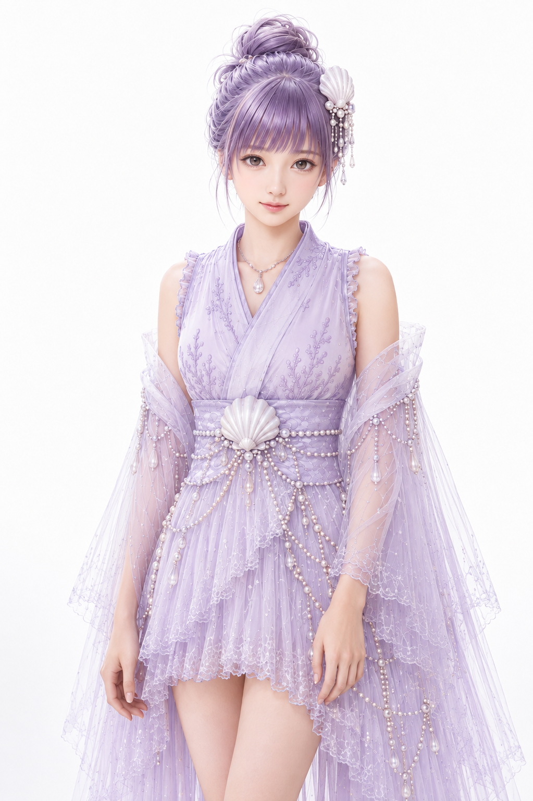
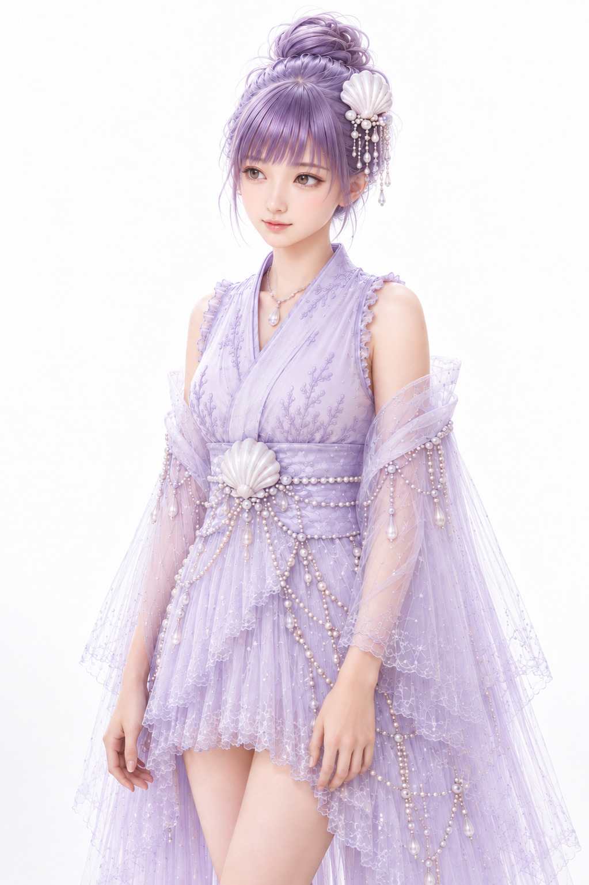
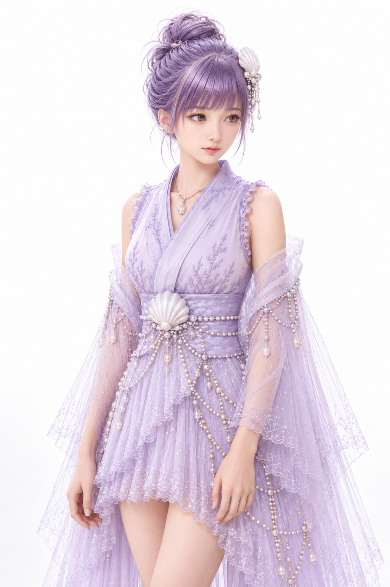
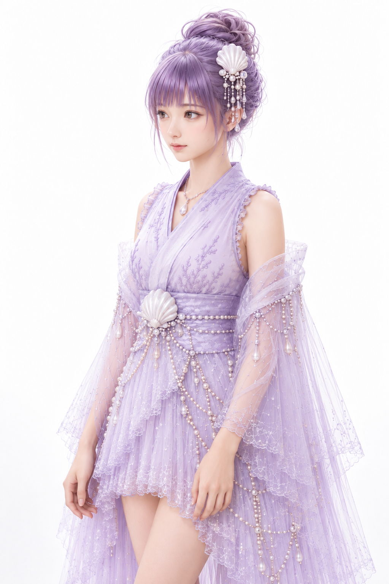
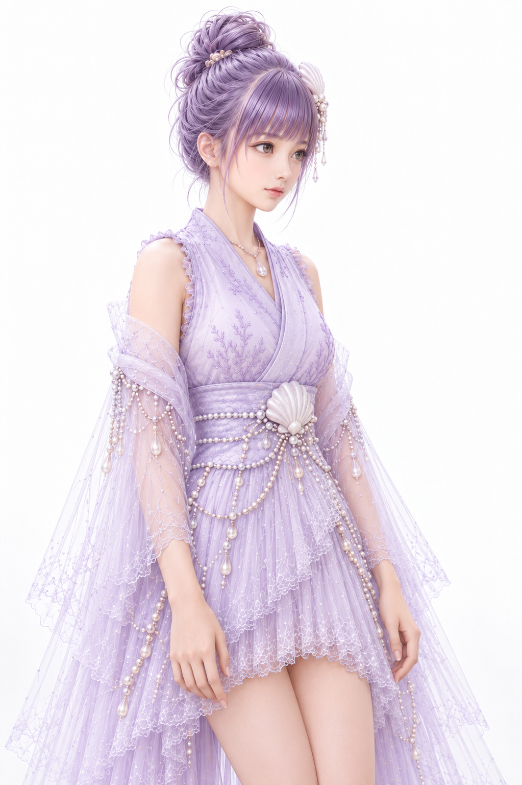
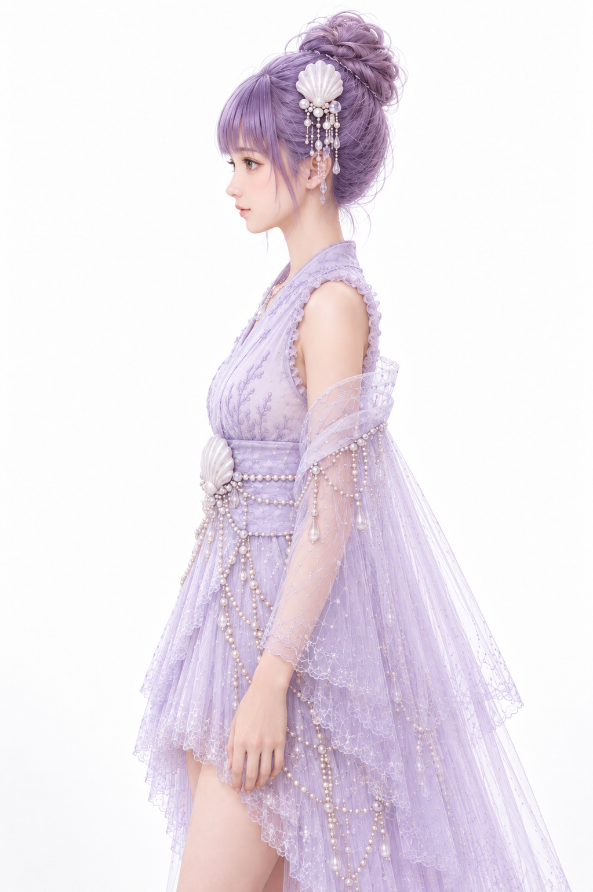
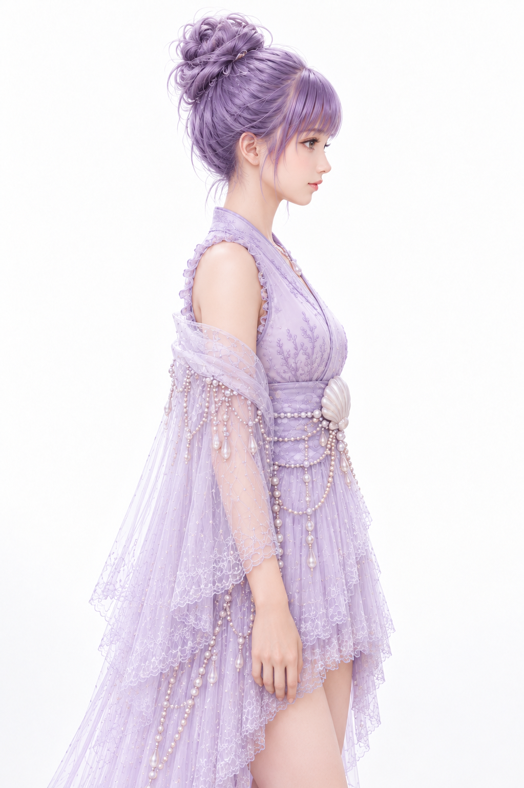
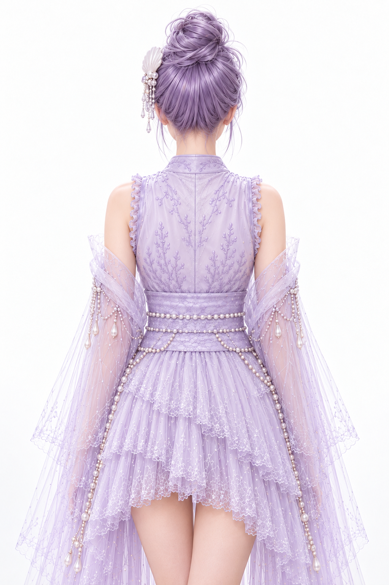

# 音姫 MIXXIA 多方向基準画制作仕様書 Ver0.1

## 1. 制作概要

2026年10月28日。正式採用前の試験制作版。元画像1枚を無変更で収録し、新規7枚を指定の4グループ順に生成・目視比較した。生成できたことと品質合格は別であり、新規画像はすべて未承認。NG候補も検証記録として収録する。

右・左は人物自身の回転方向。右は鼻先が画面左、左は画面右に向かう。本書の符号は今回の依頼に従う。一般の3Dソフトの座標系を保証しない。

## 2. 参照資料

1. 00_運用規約_Ver1.9(1).docx。正本・設定マスター・ドラフト運用を確認。既存資料は変更していない。
2. 竜宮六姫_MIXXIA_ビジュアル制作仕様書_Ver0.5.docx。第10.5の指定3項目、第4・6・7・8章を参照。
3. 絵画的リアリズム仕様書MarkDown転記モード_ver2.2.md。Geometry・Facial Construction・固有色とRenderingの分離、Loop Lighting定義を参照。
4. 添付音姫画像 f0e0590b-3ee9-44fb-bc4b-9cb956b4164e(20261028-094721).png。全7回で唯一の直接画像入力に使用。原画（兄絵）は未添付なので一致は未検証。

MIXXIAはファイル名がVer0.5だが、本文内の文書管理表にVer1.0とDraft／Review／Approvedのテンプレート表記が残る。版の不一致を解消したとは扱わない。参照元は今回添付のVer0.5ファイルとして特定する。10.5.7の項番重複は修正しない。

海姫の埋め込み画像を直接確認した。10.5.6後の正面相当画像（imaged.png）、右90°記録後の側面画像（imagee.png）、右45°記録後の斜め画像（imagef.png）を方法・完成状態の参考とした。外観や画像を音姫生成の入力には使用していない。

## 3. 海姫3方向制作仕様からの適用規則

| 抽出項目 | 参照元 | 確認できた規則 |
|---|---|---|
| 正面Geometry Reference | 10.5.7 右90°基準画の制作仕様／第7章 正面基準画の制作仕様 | 正面は美化ポートレートではなく、後続回転・横向き・全身・映像化へ構造を継承する基準。 |
| IdentityとGeometryの関係 | 第4章 兄絵からPencil Renderingを作成する工程 入力 Identity Source／第7章 | 原画はIdentityの起点。正面画像は後工程のGeometry Reference。今回の添付は直接外観基準であり、原画の地位を変更しない。 |
| Lighting Rendering | 10.5.6 海姫Lighting Rendering Loop Lightingの画像を作成する／第6章 | 人物・構図・表情・ポーズ・衣装・背景・カメラ等を維持し、光を表現層として設計。85mm F1.4。 |
| Loop Lighting | 10.5.6／第6章 Lighting／絵画的リアリズムver2.2 ② Loop Lighting | 鼻横に小さなループシャドウを作る自然な立体感。細かな灯体位置や数値は当該実例に未記載。 |
| 右90°制作 | 10.5.7 右90°基準画の制作仕様／8.2.1 標準角度 | 正面基準を確定後、上半身の右90°を入力指定して制作。実例は依頼記録であり、完全な生成プロンプトは本文にない。 |
| 右45°制作 | 10.5.7 右45°基準画の制作仕様／第8章 | 同じ上半身正面を基に右45°を制作。10.5.7の重複は依頼どおり保存し、独自に改番しない。 |
| Rigid Body Y-Axis Rotation | 第8章 回転原則 Rigid Body Y-Axis Rotation | 胴体・胸郭・骨盤・肩・首・頭蓋・顔を同方向同角度に回す。頭の元の相対角度を維持。顔や視線だけをカメラへ戻さない。 |
| 顔骨格 | 第7章 Geometry Lock／第8章 Identity Geometry継承・Facial Construction | 顔高・頬骨幅・下顎・眼鼻口位置を維持。一般的な美少女比率や横顔への置換は禁止。 |
| 身体Geometry | 第8章 Identity Geometry継承 | 首長・肩幅・胸郭・骨盤・腕長・頭身を維持。見かけの投影変化と身体構造の改変を分ける。 |
| 髪 衣装 装飾 | 第8章 衣装 髪型 装飾 三次元構造としての継承 | 人物と同じ三次元構造として継承。遮蔽は許可。不明部分を新規の確定デザインにしない。 |
| 品質確認 | 第8章 多方向基準画の判定 Geometry確認 | 単体の美しさより角度間の連続性。顔高、顔部位、後頭部、首の接続、肩・胸郭・骨盤、髪衣装装飾を比較。 |

**正式規則と今回の応用の区別。** 上表は参照文書に記載された規則と実例。添付音姫画像から直接回転制作へ入ること、右左の符号、4グループ順、白背景と元画像に近い倍率、背面180°とその暫定構造、8項目のOK／NG／要確認判定は今回の依頼条件・応用である。兄絵→Pencil→COPIC→Lightingの各工程を今回再実行したとは扱わない。

照明のみを変える第6章の固定比較条件と、第8章の人物回転条件は別工程。今回はLighting完成像を基に回転するため、向きの変更だけを許可して適用する。指定3項目だけに詳しい剛体回転や検査基準がすべて書かれているとは報告しない。生成を妨げる重大な内容矛盾は確認しなかったが、上記の版表記不一致と原画欠落を留保する。

## 4. 音姫Identity・Geometry固定仕様

顔は卵形から細い顎へつながる輪郭、大きな灰褐色系の瞳、整った細い眉、小ぶりな鼻、軽く口角の上がった閉じた口が見える。若い印象を含めて元画像の顔を維持し、年齢を数値で設定しない。瞳色等は画像観察であり、新規の正式設定ではない。

髪はラベンダー紫、高いお団子、直線的な前髪と細い後れ毛。白い貝殻・真珠の垂れ飾りは人物自身の左側。衣装は淡ラベンダーの重ね襟、刺繍とレース、腰前面の大きな白い貝殻、複数の真珠列、両上腕から垂れる半透明ショール、首元の雫状飾りを持つ。左右非対称の配置を鏡像反転しない。

固定対象は顔の縦横・頬顎・眼鼻口の相対位置、頭と肩幅、首長、肩の傾き、胸郭、腰位置、腕長と太さ。今回は数値ランドマーク計測や色差測定を行っていない。鼻の突出量、頭蓋・胸郭の奥行き、耳と後頭部の詳細は正面だけで測定できず推定。厳密な三次元一致率や角度精度を提示しない。

85mm F1.4相当、Loop Lighting、白背景を生成時に指示。これはプロンプト条件であり、実カメラ情報や照明計測ではない。強い被写界深度ぼけを追加せず、人物・真珠・透ける生地の可読性を優先する。元の正面画像を照明補正していない。

## 5. 正面0°基準画



- 方向・角度：正面0°。
- 基準画像：images/OTO_00_Front.png。
- モデル：使用なし。原本を無変更でコピー。
- プロンプト：なし。
- 参照仕様：10.5.6、10.5.7「右90°」、10.5.7「右45°」、第7・8章。背面のみ今回の追加応用。
- 品質：Identity OK／Facial Geometry OK／Body Geometry OK／Hair OK／Costume OK／Rotation OK／Rendering OK／Composition OK。
- 不一致・未確定：元画像をバイト単位で複製。OKは元画像をそのまま採用したことを示す。照明や原画一致、実際の厳密0°を独立検証した判定ではない。
- 採用状態：ユーザー指定により正面原本を採用。

## 6. 右15° +15°基準画候補



- 方向・角度：右15° +15°。
- 基準画像：images/OTO_00_Front.png。
- モデル：ChatGPT組み込み image_gen。内部モデル識別名・版はツールから非開示。
- プロンプト：第15節 P-R15 に全文記録。
- 参照仕様：10.5.6、10.5.7「右90°」、10.5.7「右45°」、第7・8章。背面のみ今回の追加応用。
- 品質：Identity OK／Facial Geometry 要確認／Body Geometry 要確認／Hair OK／Costume 要確認／Rotation 要確認／Rendering 要確認／Composition OK。
- 不一致・未確定：微小回転は見えるが顔が肩より多く回ったように見える。厳密な15°と頭胴一致は要確認。真珠の個数・交点と刺繍を一粒単位で継承したとは確認できない。
- 採用状態：候補保存のみ。ユーザー承認待ち。

## 7. 左15° -15°基準画候補



- 方向・角度：左15° -15°。
- 基準画像：images/OTO_00_Front.png。
- モデル：ChatGPT組み込み image_gen。内部モデル識別名・版はツールから非開示。
- プロンプト：第15節 P-L15 に全文記録。
- 参照仕様：10.5.6、10.5.7「右90°」、10.5.7「右45°」、第7・8章。背面のみ今回の追加応用。
- 品質：Identity OK／Facial Geometry 要確認／Body Geometry 要確認／Hair OK／Costume 要確認／Rotation NG／Rendering 要確認／Composition OK。
- 不一致・未確定：鼻先は画面右へ向く一方、胸元と腰の投影が正面寄りで、顔と胴体の回転が揃っていない。RotationはNG、正式採用不可。
- 採用状態：NG候補として保留。正式基準に使用しない。

## 8. 右45° +45°基準画候補



- 方向・角度：右45° +45°。
- 基準画像：images/OTO_00_Front.png。
- モデル：ChatGPT組み込み image_gen。内部モデル識別名・版はツールから非開示。
- プロンプト：第15節 P-R45 に全文記録。
- 参照仕様：10.5.6、10.5.7「右90°」、10.5.7「右45°」、第7・8章。背面のみ今回の追加応用。
- 品質：Identity 要確認／Facial Geometry 要確認／Body Geometry 要確認／Hair OK／Costume 要確認／Rotation 要確認／Rendering 要確認／Composition OK。
- 不一致・未確定：顔と胴体は画面左の斜め方向。45°への到達および頭胴の角度一致は未計測。目の開き・顎先の印象と光沢差を要確認。真珠列は再配置の疑い。
- 採用状態：候補保存のみ。ユーザー承認待ち。

## 9. 左45° -45°基準画候補



- 方向・角度：左45° -45°。
- 基準画像：images/OTO_00_Front.png。
- モデル：ChatGPT組み込み image_gen。内部モデル識別名・版はツールから非開示。
- プロンプト：第15節 P-L45 に全文記録。
- 参照仕様：10.5.6、10.5.7「右90°」、10.5.7「右45°」、第7・8章。背面のみ今回の追加応用。
- 品質：Identity 要確認／Facial Geometry 要確認／Body Geometry 要確認／Hair OK／Costume NG／Rotation 要確認／Rendering 要確認／Composition OK。
- 不一致・未確定：襟の重なり方向が元画像と逆向きに再解釈されたように見える。左右の真珠列にも再構成がある。衣装固定に反するためCostumeはNG、正式採用不可。角度も厳密未計測。
- 採用状態：NG候補として保留。正式基準に使用しない。

## 10. 右90° +90°基準画候補



- 方向・角度：右90° +90°。
- 基準画像：images/OTO_00_Front.png。
- モデル：ChatGPT組み込み image_gen。内部モデル識別名・版はツールから非開示。
- プロンプト：第15節 P-R90 に全文記録。
- 参照仕様：10.5.6、10.5.7「右90°」、10.5.7「右45°」、第7・8章。背面のみ今回の追加応用。
- 品質：Identity 要確認／Facial Geometry 要確認／Body Geometry 要確認／Hair 要確認／Costume 要確認／Rotation OK／Rendering 要確認／Composition OK。
- 不一致・未確定：鼻先は画面左、片目の横顔と側面胴体は成立。鼻梁・口唇・顎・胸郭の奥行きと後頭部は単眼正面から未検証。髪飾りの側面形と真珠数も要確認。
- 採用状態：候補保存のみ。ユーザー承認待ち。

## 11. 左90° -90°基準画候補



- 方向・角度：左90° -90°。
- 基準画像：images/OTO_00_Front.png。
- モデル：ChatGPT組み込み image_gen。内部モデル識別名・版はツールから非開示。
- プロンプト：第15節 P-L90 に全文記録。
- 参照仕様：10.5.6、10.5.7「右90°」、10.5.7「右45°」、第7・8章。背面のみ今回の追加応用。
- 品質：Identity 要確認／Facial Geometry 要確認／Body Geometry 要確認／Hair 要確認／Costume 要確認／Rotation OK／Rendering 要確認／Composition OK。
- 不一致・未確定：鼻先は画面右、片目の横顔と側面胴体は成立。奥側の貝殻髪飾りが隠れたことは位置規則に整合。鼻先・顎と胸郭の厚み、髪の奥行きと真珠列は要確認。
- 採用状態：候補保存のみ。ユーザー承認待ち。

## 12. 背面180°基準画候補



- 方向・角度：背面180°。
- 基準画像：images/OTO_00_Front.png。
- モデル：ChatGPT組み込み image_gen。内部モデル識別名・版はツールから非開示。
- プロンプト：第15節 P-Back に全文記録。
- 参照仕様：10.5.6、10.5.7「右90°」、10.5.7「右45°」、第7・8章。背面のみ今回の追加応用。
- 品質：Identity 要確認／Facial Geometry 要確認／Body Geometry 要確認／Hair 要確認／Costume 要確認／Rotation OK／Rendering 要確認／Composition OK。
- 不一致・未確定：完全な後ろ向きで顔は見えない。後頭部の毛流れ、髪飾りの裏、背面襟と縫い目・刺繍、腰帯の真珠列、ショールの接続はすべて暫定案。元画像から正解判定できない。
- 採用状態：候補保存のみ。ユーザー承認待ち。

## 13. 品質検査結果

OK＝目視上大きな不一致なし、NG＝明確な不一致あり、要確認＝画像のみでは判断困難。すべてWorkの暫定評価。

| 方向 | Identity | Facial Geometry | Body Geometry | Hair | Costume | Rotation | Rendering | Composition | 総合・採用状態 |
|---|---|---|---|---|---|---|---|---|---|
| 正面0° | OK | OK | OK | OK | OK | OK | OK | OK | 元画像採用 |
| 右15° +15° | OK | 要確認 | 要確認 | OK | 要確認 | 要確認 | 要確認 | OK | 要確認・承認待ち |
| 左15° -15° | OK | 要確認 | 要確認 | OK | 要確認 | NG | 要確認 | OK | NG・保留 |
| 右45° +45° | 要確認 | 要確認 | 要確認 | OK | 要確認 | 要確認 | 要確認 | OK | 要確認・承認待ち |
| 左45° -45° | 要確認 | 要確認 | 要確認 | OK | NG | 要確認 | 要確認 | OK | NG・保留 |
| 右90° +90° | 要確認 | 要確認 | 要確認 | 要確認 | 要確認 | OK | 要確認 | OK | 要確認・承認待ち |
| 左90° -90° | 要確認 | 要確認 | 要確認 | 要確認 | 要確認 | OK | 要確認 | OK | 要確認・承認待ち |
| 背面180° | 要確認 | 要確認 | 要確認 | 要確認 | 要確認 | OK | 要確認 | OK | 要確認・承認待ち |

詳しい所見は各方向節およびQA_Report.mdを参照。肌・髪・衣装の質感は概ね近いが、鼻横の影が弱くLoop Lightingの成立を一律OKにはできない。

## 14. 未確定事項

背面はお団子への毛流れ、髪飾りの裏と留め具、襟の背面縫製・中心線・刺繍、帯の真珠列、ショールの背面接続が暫定。生成結果では背面生地の中心線と左右対称な刺繍・真珠列が提案されているが、正式デザインではない。原画および側面・背面の設計図が必要。左右45°の襟と真珠配置、15°の頭胴角度の揃いも未確定。正面の照明も再設計していない。

## 15. 使用プロンプト

各回、入力画像は元の音姫正面PNGのみ。海姫画像および生成済み別角度は入力していない。以下は実際に送信した全文。

### P-R15

```text
Use case: identity-preserve. 添付画像だけを音姫本人の直接Identity/Geometry/Rendering基準にする。単独の縦長人物基準画1枚。白背景、元画像と同様に頭頂から腰下・太腿上部まで、元の表示倍率と中央位置に近く。85mm F1.4相当の圧縮感、柔らかなLoop Lighting、小さな鼻横の影、肌と刺繍と真珠の精細さ、半透明ショールの透過感、元の絵画的リアリズムを維持。正面像の人物全体を一つの剛体としてY軸回転する。頭・顔・首・肩・胸郭・骨盤・腕は同じ角度、元の相対ポーズを維持。視線も回転に追従しカメラへ戻さない。元の顔高・骨格・目鼻口の比率・首長・肩幅・体型を美化補正しない。ラベンダー紫の高いお団子、直線的な前髪、後れ毛、人物自身の左側（元画像の画面右）の白い貝殻と垂れる真珠を同じ位置に固定。淡ラベンダーの重ね襟、細かい刺繍、レース、腰前面の白い貝殻と真珠の連なり、腕にかかる透けるショールを省略・置換しない。回転による自然な遮蔽だけを許す。海姫の外見を混ぜない。鏡像反転で作らない。文字・角度ラベル・複数人物・比較パネルなし。
今回の角度は人物自身の右へ15°（+15°）。鼻先は画面左へ少し移る。正面に近い微小回転で両目が見える。頭だけでなく両肩と胴体も右15°。
```

### P-L15

```text
Use case: identity-preserve. 添付画像だけを音姫本人の直接Identity/Geometry/Rendering基準にする。単独の縦長人物基準画1枚。白背景、元画像と同様に頭頂から腰下・太腿上部まで、元の表示倍率と中央位置に近く。85mm F1.4相当の圧縮感、柔らかなLoop Lighting、小さな鼻横の影、肌と刺繍と真珠の精細さ、半透明ショールの透過感、元の絵画的リアリズムを維持。正面像の人物全体を一つの剛体としてY軸回転する。頭・顔・首・肩・胸郭・骨盤・腕は同じ角度、元の相対ポーズを維持。視線も回転に追従しカメラへ戻さない。元の顔高・骨格・目鼻口の比率・首長・肩幅・体型を美化補正しない。ラベンダー紫の高いお団子、直線的な前髪、後れ毛、人物自身の左側（元画像の画面右）の白い貝殻と垂れる真珠を同じ位置に固定。淡ラベンダーの重ね襟、細かい刺繍、レース、腰前面の白い貝殻と真珠の連なり、腕にかかる透けるショールを省略・置換しない。回転による自然な遮蔽だけを許す。海姫の外見を混ぜない。鏡像反転で作らない。文字・角度ラベル・複数人物・比較パネルなし。
今回の角度は人物自身の左へ15°（-15°）。鼻先は画面右へ少し移る。正面に近い微小回転で両目が見える。頭だけでなく両肩と胴体も左15°。
```

### P-R45

```text
Use case: identity-preserve. 添付画像だけを音姫本人の直接Identity/Geometry/Rendering基準にする。単独の縦長人物基準画1枚。白背景、元画像と同様に頭頂から腰下・太腿上部まで、元の表示倍率と中央位置に近く。85mm F1.4相当の圧縮感、柔らかなLoop Lighting、小さな鼻横の影、肌と刺繍と真珠の精細さ、半透明ショールの透過感、元の絵画的リアリズムを維持。正面像の人物全体を一つの剛体としてY軸回転する。頭・顔・首・肩・胸郭・骨盤・腕は同じ角度、元の相対ポーズを維持。視線も回転に追従しカメラへ戻さない。元の顔高・骨格・目鼻口の比率・首長・肩幅・体型を美化補正しない。ラベンダー紫の高いお団子、直線的な前髪、後れ毛、人物自身の左側（元画像の画面右）の白い貝殻と垂れる真珠を同じ位置に固定。淡ラベンダーの重ね襟、細かい刺繍、レース、腰前面の白い貝殻と真珠の連なり、腕にかかる透けるショールを省略・置換しない。回転による自然な遮蔽だけを許す。海姫の外見を混ぜない。鏡像反転で作らない。文字・角度ラベル・複数人物・比較パネルなし。
人物自身の右45°（+45°）へ全身剛体回転。鼻先は画面左、顔と胸郭と腰は全て同じ45°。3/4ビュー。両肩の奥行き差を明瞭にする。顔をカメラへ戻さない。
```

### P-L45

```text
Use case: identity-preserve. 添付画像だけを音姫本人の直接Identity/Geometry/Rendering基準にする。単独の縦長人物基準画1枚。白背景、元画像と同様に頭頂から腰下・太腿上部まで、元の表示倍率と中央位置に近く。85mm F1.4相当の圧縮感、柔らかなLoop Lighting、小さな鼻横の影、肌と刺繍と真珠の精細さ、半透明ショールの透過感、元の絵画的リアリズムを維持。正面像の人物全体を一つの剛体としてY軸回転する。頭・顔・首・肩・胸郭・骨盤・腕は同じ角度、元の相対ポーズを維持。視線も回転に追従しカメラへ戻さない。元の顔高・骨格・目鼻口の比率・首長・肩幅・体型を美化補正しない。ラベンダー紫の高いお団子、直線的な前髪、後れ毛、人物自身の左側（元画像の画面右）の白い貝殻と垂れる真珠を同じ位置に固定。淡ラベンダーの重ね襟、細かい刺繍、レース、腰前面の白い貝殻と真珠の連なり、腕にかかる透けるショールを省略・置換しない。回転による自然な遮蔽だけを許す。海姫の外見を混ぜない。鏡像反転で作らない。文字・角度ラベル・複数人物・比較パネルなし。
人物自身の左45°（-45°）へ全身剛体回転。鼻先は画面右、顔と胸郭と腰は全て同じ45°。3/4ビュー。人物の右肩（画面左）が手前、左肩（画面右）が奥になる。肩・襟の重なり・腰前の貝殻も左45°へ回し、胴体を正面に残さない。顔をカメラへ戻さない。
```

### P-R90

```text
Use case: identity-preserve. 添付画像だけを音姫本人の直接Identity/Geometry/Rendering基準にする。単独の縦長人物基準画1枚。白背景、元画像と同様に頭頂から腰下・太腿上部まで、元の表示倍率と中央位置に近く。85mm F1.4相当の圧縮感、柔らかなLoop Lighting、小さな鼻横の影、肌と刺繍と真珠の精細さ、半透明ショールの透過感、元の絵画的リアリズムを維持。正面像の人物全体を一つの剛体としてY軸回転する。頭・顔・首・肩・胸郭・骨盤・腕は同じ角度、元の相対ポーズを維持。視線も回転に追従しカメラへ戻さない。元の顔高・骨格・目鼻口の比率・首長・肩幅・体型を美化補正しない。ラベンダー紫の高いお団子、直線的な前髪、後れ毛、人物自身の左側（元画像の画面右）の白い貝殻と垂れる真珠を同じ位置に固定。淡ラベンダーの重ね襟、細かい刺繍、レース、腰前面の白い貝殻と真珠の連なり、腕にかかる透けるショールを省略・置換しない。回転による自然な遮蔽だけを許す。海姫の外見を混ぜない。鏡像反転で作らない。文字・角度ラベル・複数人物・比較パネルなし。
人物自身の右90°（+90°）へ全身剛体回転。鼻先が画面左を向く厳密な真横プロフィール。顔の見える目は一つ、遠側の目は隠れる。頭・胸郭・腰・腕も真横、両肩は奥行き方向に重なる。正面へ顔や胸を戻さない。左側の貝殻髪飾りは手前側に自然に見える。鼻口顎と後頭部の未観測奥行きは正面と整合する控えめな推定。
```

### P-L90

```text
Use case: identity-preserve. 添付画像だけを音姫本人の直接Identity/Geometry/Rendering基準にする。単独の縦長人物基準画1枚。白背景、元画像と同様に頭頂から腰下・太腿上部まで、元の表示倍率と中央位置に近く。85mm F1.4相当の圧縮感、柔らかなLoop Lighting、小さな鼻横の影、肌と刺繍と真珠の精細さ、半透明ショールの透過感、元の絵画的リアリズムを維持。正面像の人物全体を一つの剛体としてY軸回転する。頭・顔・首・肩・胸郭・骨盤・腕は同じ角度、元の相対ポーズを維持。視線も回転に追従しカメラへ戻さない。元の顔高・骨格・目鼻口の比率・首長・肩幅・体型を美化補正しない。ラベンダー紫の高いお団子、直線的な前髪、後れ毛、人物自身の左側（元画像の画面右）の白い貝殻と垂れる真珠を同じ位置に固定。淡ラベンダーの重ね襟、細かい刺繍、レース、腰前面の白い貝殻と真珠の連なり、腕にかかる透けるショールを省略・置換しない。回転による自然な遮蔽だけを許す。海姫の外見を混ぜない。鏡像反転で作らない。文字・角度ラベル・複数人物・比較パネルなし。
人物自身の左90°（-90°）へ全身剛体回転。鼻先が画面右を向く厳密な真横プロフィール。見える目は一つ、遠側の目は隠れる。頭・胸郭・腰・腕も真横、両肩は奥行き方向に重なる。人物の右側が手前。人物自身の左側に付く白貝殻の髪飾りは奥側に回るので自然に隠し、手前側へ移設や複製しない。額鼻口顎と胸郭の奥行きは未観測なので控えめな推定に限る。
```

### P-Back

```text
Use case: identity-preserve. 添付画像だけを音姫本人の直接Identity/Geometry/Rendering基準にする。単独の縦長人物基準画1枚。白背景、元画像と同様に頭頂から腰下・太腿上部まで、元の表示倍率と中央位置に近く。85mm F1.4相当の圧縮感、柔らかなLoop Lighting、小さな鼻横の影、肌と刺繍と真珠の精細さ、半透明ショールの透過感、元の絵画的リアリズムを維持。正面像の人物全体を一つの剛体としてY軸回転する。頭・顔・首・肩・胸郭・骨盤・腕は同じ角度、元の相対ポーズを維持。視線も回転に追従しカメラへ戻さない。元の顔高・骨格・目鼻口の比率・首長・肩幅・体型を美化補正しない。ラベンダー紫の高いお団子、直線的な前髪、後れ毛、人物自身の左側（元画像の画面右）の白い貝殻と垂れる真珠を同じ位置に固定。淡ラベンダーの重ね襟、細かい刺繍、レース、腰前面の白い貝殻と真珠の連なり、腕にかかる透けるショールを省略・置換しない。回転による自然な遮蔽だけを許す。海姫の外見を混ぜない。鏡像反転で作らない。文字・角度ラベル・複数人物・比較パネルなし。
今回だけは完全な背面180°。後頭部・背中・腰・両腕を全てカメラに背け、顔や頬や鼻や目を一切見せない。白背景。原画像の高いお団子を後ろから見る。人物自身の左の貝殻髪飾りは背面画像では画面左側に回る。未確認の後頭部の髪の流れ・衣装の背面縫製・ショール背面連結・真珠の背面連続性は控えめな暫定案：後頭部の毛流れを既存の高いお団子へ集め、淡ラベンダーの刺繍生地で背中を覆い、腰帯を後方へ連続させる。白い大貝殻は腰の前側に留め、背中に複製しない。新しいリボン・新規紋章・露出の多い背面デザインを追加しない。ショールは両上腕の位置を保って背後に自然に垂れる。暫定構造は正式設定の確定ではない。
```

## 16. 使用モデル・制作履歴

ChatGPT組み込みimage_genを使用。内部モデル名・版・シード・実焦点距離・生成所要時間は取得できていないため未記録。公開APIやFlovaAI、別モデルへの切替は行っていない。2026年10月28日、R15→L15→グループ確認→R45→L45→グループ確認→R90→L90→グループ確認→180°→確認の順に各1回、合計7回生成。再生成は行わず、NGも試験履歴として残す。7枚の生成成功は7枚の合格を意味しない。

元画像はコピー前後のSHA-256が一致する。画像の画素編集、左右反転、トリミング、リサイズを成果物へ行っていない。画像ファイルの実寸とハッシュはQA_Report.mdに記録。

## 17. ユーザー承認欄

- 確認者：未記入
- 確認日：未記入
- 正式採用方向：未記入
- 修正対象：左15°の剛体回転、左45°の襟と装飾、その他要確認項目
- 背面暫定デザインの採否：未記入
- 結論：全生成画像は正式採用前。承認を推定しない。
