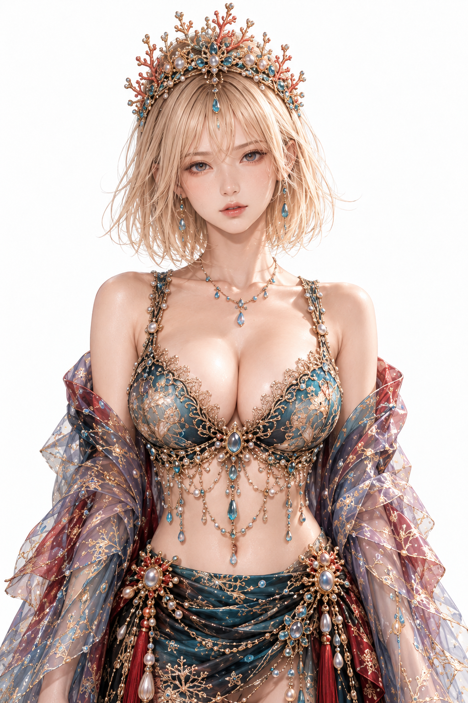
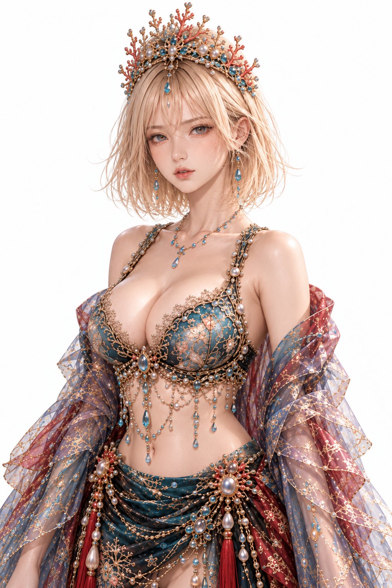
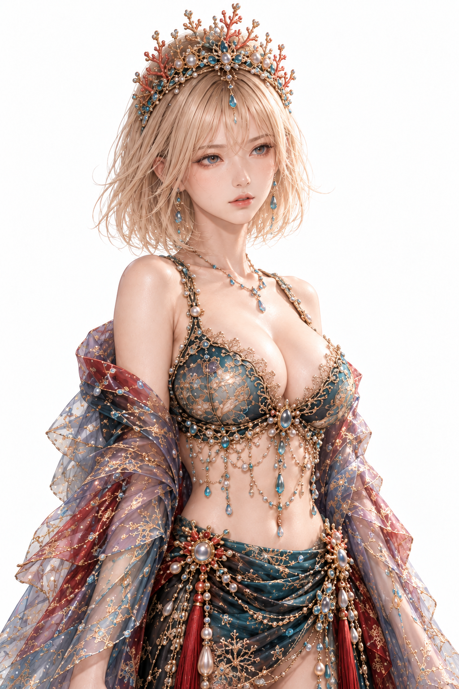
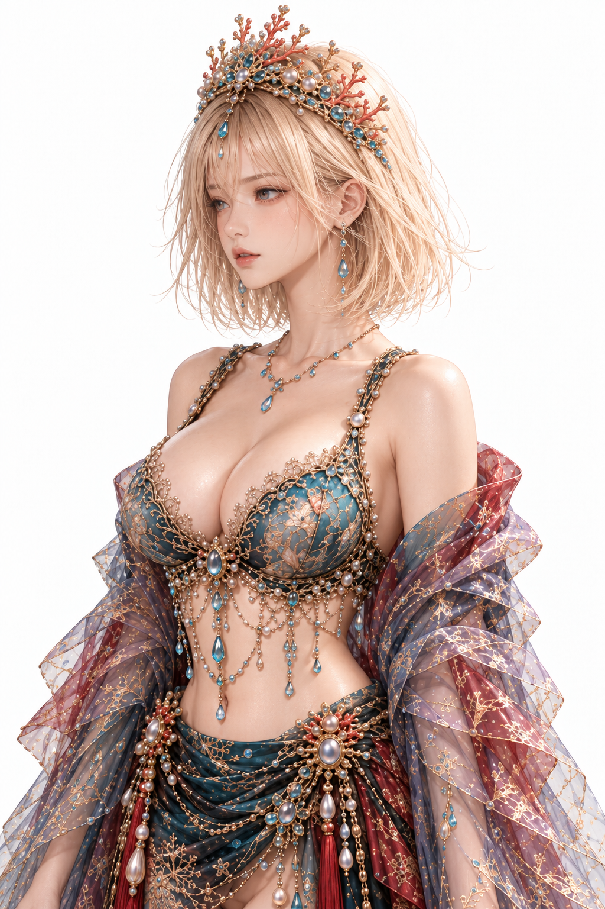
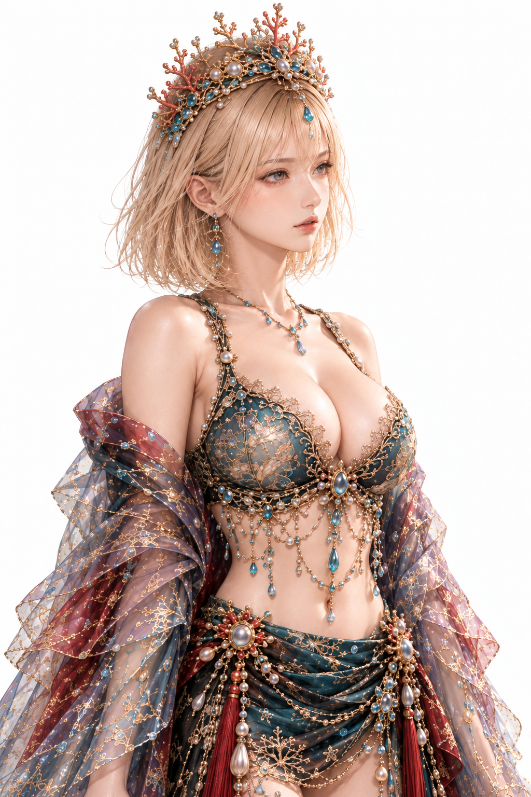
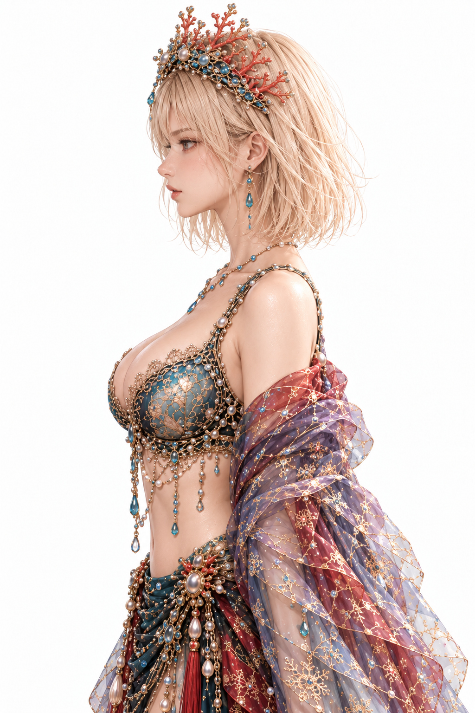
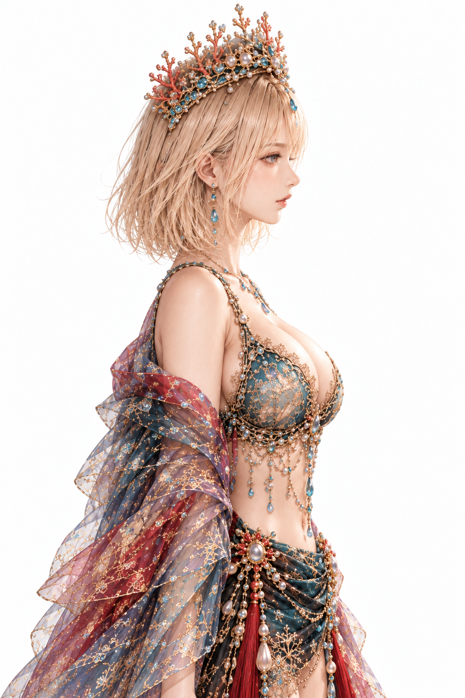
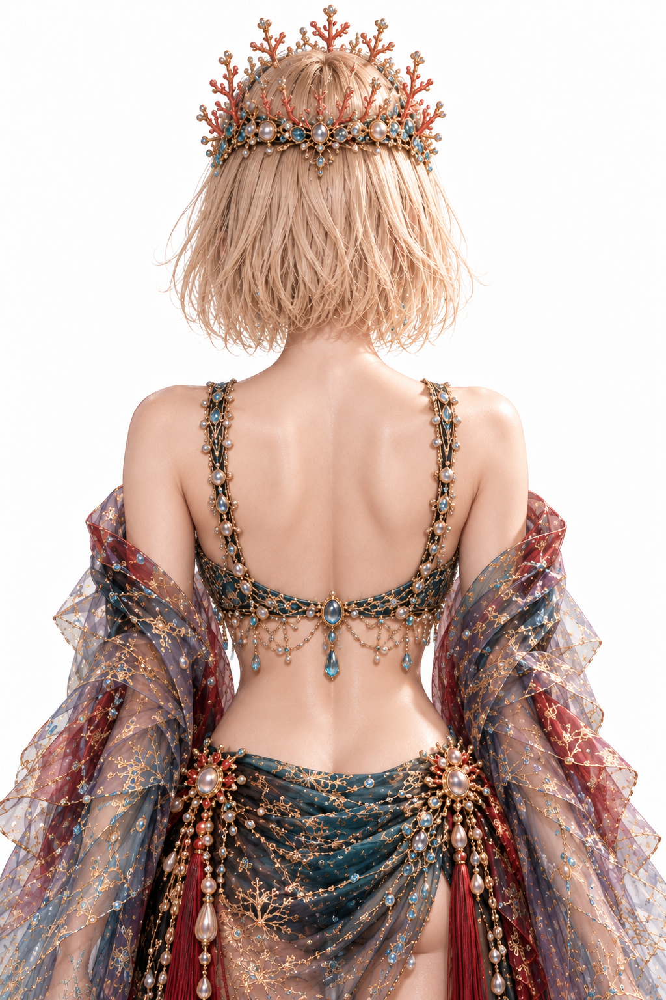

# 海姫 MIXXIA 多方向基準画制作仕様書 Ver0.1

## 1. 制作概要

2026年10月28日。正式採用前の試験制作版。同一依頼の再送に基づき、前回の未完成記録を更新した。今回は8回生成し8枚取得、7方向の候補を選定。正面原本1枚と生成7方向を収録する。前回の2回試行（成功1、拒否1）を合わせ、累計10回試行・画像取得9枚。生成できたことと品質合格は別であり、正式採用した生成画像は0枚。

全試行の人物画像入力は今回の海姫正面画像1枚のみ。他の六姫の画像・制作成果物・プロンプト、および別の海姫画像を入力していない。生成済み方向も補助入力に使っていない。

今回の再開時にはまず左15°を再試行し、第1グループの右15°を修正。その後右45°→左45°、右90°→左90°、背面180°の順に生成・検査した。最後に左90°の構図修正を1回行った。再開時の順序は初回指定の右15°→左15°とは異なるため、実施順を第16節に明記する。

## 2. 参照資料

1. 00_運用規約_Ver1.9(1).docx。正本・設定マスター・ドラフトを区別し、既存本文を変更しない。
2. 01_竜宮プロトコル創世記_正式設定_Ⅰ章_Ver2.8_正式Word版(1).docx。海姫の欲望・本音に向き合う人格設定を参照。外観を新規定義する根拠には使わない。
3. 02_竜宮プロトコル創世記_世界設定_Ver1.83.docx。海姫の欲望・本音という役割を確認。
4. 04_竜宮プロトコル創世記_創世カノンΩΩΩ_Ver1.2.docx。C001の作品思想を参照。先頭本文は「創生カノンΩ Ω Ω」と表記されファイル名と差があるが独自修正しない。
5. 竜宮六姫_MIXXIA_ビジュアル制作仕様書_Ver0.5.docx。指定3項目と第4・6・7・8章の一般規則を文章で参照。ファイル名Ver0.5に対し本文管理表にVer1.0が残る。版の不一致を統合せず留保する。
6. 絵画的リアリズム仕様書MarkDown転記モード_ver2.2.md。GeometryとRenderingの分離、Loop Lightingを参照。
7. 入力画像A：94b7b828-85e8-455e-a302-536512d47c05(20261028-104811).png。唯一の直接Identity・Geometry・Rendering基準。原画（兄絵）は未添付、原画一致は未検証。

指定資料の関連本文を参照できた。海姫の実例は文章のみ使用し、仕様書内の人物図版を今回の生成入力には用いていない。

## 3. 海姫3方向制作仕様からの適用規則

|抽出項目|参照元|確認した規則|
|---|---|---|
| 正面Geometry Reference | 10.5.7 右90°基準画の制作仕様／第7章 | 正面を美化ポートレートでなく、回転・横向き・全身・映像へ構造を継承する基準とする。 |
| Identity Referenceとの関係 | 第4章 入力 Identity Source／第7章 | 兄絵はIdentityの起点。正面は後工程のGeometry Reference。添付画像の直接基準指定は兄絵の地位を変更しない。 |
| Lighting Rendering | 10.5.6／第6章 | 人物・構図・表情・ポーズ・衣装・背景・カメラ等を固定し光のみを表現層として設計。85mm F1.4。 |
| Loop Lighting | 10.5.6／第6章／絵画的リアリズムver2.2 ② Loop Lighting | 鼻横に小さなループシャドウを作る自然な照明。具体的な灯体配置数値は指定3項目に未記載。 |
| 右90° | 10.5.7 右90°基準画の制作仕様／8.2.1 標準角度 | 上半身正面を基に90°へ展開する依頼記録。実例本文に完全な生成プロンプトはない。 |
| 右45° | 10.5.7 右45°基準画の制作仕様 | 同じ上半身正面から右45°へ展開する依頼記録。項番重複は修正しない。 |
| Rigid Body Y-Axis Rotation | 第8章 回転原則 | 頭蓋・顔・首・肩・胸郭・胴体・骨盤を同方向同角度に回す。顔と視線だけをカメラへ戻さない。 |
| 顔骨格 | 第7章 Geometry Lock／第8章 Facial Construction | 顔高・頬顎・目鼻口位置と比率を継承し、美少女比率や別の横顔へ置換しない。 |
| 身体Geometry | 第8章 Identity Geometry継承 | 首長・肩幅・胸郭・骨盤・腕長・頭身を維持し自然な透視変形のみ許可。 |
| 髪型 衣装 装飾 | 第8章 衣装 髪型 装飾 | 三次元的に継承し自然に遮蔽。不明構造を独自の正式デザインにしない。 |
| 品質確認 | 第8章 多方向基準画の判定 | 単体の美しさより方向間の顔高・顔部位・頭蓋・首接続・身体・髪衣装装飾の連続性を優先。 |

10.5.7の重複は原文どおり保持する。指定3項目は依頼記録が中心のため、詳細な剛体回転や検査規則は第8章から補って区別した。上表が参照文書の規則であり、今回の8方向・人物自身の左右の符号・白背景・10検査項目・背面180°は依頼に基づく応用条件。

第6章の照明だけを変える比較条件と、第8章の人物回転を別工程として扱う。今回は完成済み正面画像から回転工程に入るため、兄絵→Pencil→COPIC→Lightingを再実行したとは扱わない。

## 4. 海姫Identity・Geometry固定仕様

顔は細い卵形輪郭と小ぶりな顎、灰青色系に見える瞳、細い眉、小ぶりな鼻、わずかに開いた唇。顔の縦横、額頬顎、眼鼻口の相対位置、年齢印象と表情を元画像基準で固定。年齢や瞳色の正式設定を新たに確定しない。

髪は明るい金髪の肩付近のボブ。前髪の分かれ方、自然な内外への毛先、細い毛束とボリュームを継承。冠は赤橙の枝珊瑚、金属の曲線構造、青緑宝石と真珠、額中央の垂れ石を持つ。冠を単純化せず、枝分岐・個数・接続位置を検査対象にする。

衣装は青緑と金刺繍、胸中央の雫宝石、胸下から腹部へ垂れる真珠・金属鎖・青緑石、腰の宝飾と赤い房。ショールは赤・青・紫灰の多色半透明生地と金刺繍。元の開口・形状・肌の見え方を固定し、布やインナーを追加する指定はしていない。

頭と肩幅、首長、肩傾斜、胸郭・腰と腕の比率を維持する。正面から測れない鼻・頭蓋・胸郭の奥行き、冠と衣装の背面は推定。ランドマークや色差、角度を数値測定していないため一致率や精度を示さない。

生成条件は85mm F1.4相当、Loop Lighting、白背景。これらはプロンプト条件であり実カメラ値の検証結果ではない。右は人物自身の右、鼻先が画面左。左は鼻先が画面右。冠から腰下までの構図を指示した。正面は再生成・補正しない。


## 5. 正面0°基準画



- 方向・角度：正面0°
- 基準画像：入力画像A images/UMI_00_Front.pngのみ
- 使用モデル：なし 原本をコピー
- 使用プロンプト：なし
- 参照MIXXIA仕様：10.5.6／10.5.7 右90°／10.5.7 右45°／第7・8章。背面は今回の応用方向
- 生成回数：累計0回
- 検査：Identity OK／Facial Geometry OK／Body Geometry OK／Hair OK／Crown OK／Costume OK／Jewelry OK／Rotation OK／Rendering OK／Composition OK
- 不一致・未確定事項：無変更の原本コピー。OKは基準そのものとしての判定。実際の0°、照明、原画一致を独立に保証するものではない。
- 採用状態：元画像として採用

## 6. 右15° +15°基準画候補



- 方向・角度：右15° +15°
- 基準画像：入力画像A images/UMI_00_Front.pngのみ
- 使用モデル：ChatGPT組み込みimage_gen 内部モデル名・版は非開示
- 使用プロンプト：第15節 今回 P-R15
- 参照MIXXIA仕様：10.5.6／10.5.7 右90°／10.5.7 右45°／第7・8章。背面は今回の応用方向
- 生成回数：累計2回
- 検査：Identity 要確認／Facial Geometry 要確認／Body Geometry 要確認／Hair OK／Crown 要確認／Costume 要確認／Jewelry 要確認／Rotation NG／Rendering 要確認／Composition OK
- 不一致・未確定事項：前回画像の逆向きの捻りは改善。しかし胴体に対し顔と視線がカメラへ戻っており剛体回転の条件を満たさないためRotation NG。15°より大きい回転の可能性もある。冠の石と枝、刺繍と鎖の細部は再構成の疑い。
- 採用状態：NG候補として保留 正式採用不可

## 7. 左15° -15°基準画候補



- 方向・角度：左15° -15°
- 基準画像：入力画像A images/UMI_00_Front.pngのみ
- 使用モデル：ChatGPT組み込みimage_gen 内部モデル名・版は非開示
- 使用プロンプト：第15節 今回 P-L15
- 参照MIXXIA仕様：10.5.6／10.5.7 右90°／10.5.7 右45°／第7・8章。背面は今回の応用方向
- 生成回数：累計2回（前回拒否1回を含む）
- 検査：Identity 要確認／Facial Geometry 要確認／Body Geometry 要確認／Hair OK／Crown 要確認／Costume 要確認／Jewelry 要確認／Rotation 要確認／Rendering 要確認／Composition OK
- 不一致・未確定事項：顔と胴体は画面右へ向く。顔と胴体の角度差、指定15°への到達は未測定。冠・腹部鎖・垂れ石・ショール刺繍は同一の個数や接続を確認できず要確認。
- 採用状態：試験候補のみ ユーザー承認待ち

## 8. 右45° +45°基準画候補



- 方向・角度：右45° +45°
- 基準画像：入力画像A images/UMI_00_Front.pngのみ
- 使用モデル：ChatGPT組み込みimage_gen 内部モデル名・版は非開示
- 使用プロンプト：第15節 今回 P-R45
- 参照MIXXIA仕様：10.5.6／10.5.7 右90°／10.5.7 右45°／第7・8章。背面は今回の応用方向
- 生成回数：累計1回
- 検査：Identity 要確認／Facial Geometry 要確認／Body Geometry 要確認／Hair OK／Crown 要確認／Costume 要確認／Jewelry 要確認／Rotation 要確認／Rendering 要確認／Composition OK
- 不一致・未確定事項：顔と胴体は画面左の3/4方向。厳密45°と首の元の相対角度は未測定。目・顎の印象、冠の枝分岐と宝石、衣装刺繍や鎖の細部に再解釈の疑いがある。
- 採用状態：試験候補のみ ユーザー承認待ち

## 9. 左45° -45°基準画候補



- 方向・角度：左45° -45°
- 基準画像：入力画像A images/UMI_00_Front.pngのみ
- 使用モデル：ChatGPT組み込みimage_gen 内部モデル名・版は非開示
- 使用プロンプト：第15節 今回 P-L45
- 参照MIXXIA仕様：10.5.6／10.5.7 右90°／10.5.7 右45°／第7・8章。背面は今回の応用方向
- 生成回数：累計1回
- 検査：Identity 要確認／Facial Geometry 要確認／Body Geometry 要確認／Hair OK／Crown 要確認／Costume 要確認／Jewelry 要確認／Rotation 要確認／Rendering 要確認／Composition OK
- 不一致・未確定事項：顔と胴体は画面右の3/4方向。45°の厳密性は未測定。髪型と大きな衣装形状は近いが、冠と金刺繍、首・腹部宝飾の配列の一致は要確認。
- 採用状態：試験候補のみ ユーザー承認待ち

## 10. 右90° +90°基準画候補



- 方向・角度：右90° +90°
- 基準画像：入力画像A images/UMI_00_Front.pngのみ
- 使用モデル：ChatGPT組み込みimage_gen 内部モデル名・版は非開示
- 使用プロンプト：第15節 今回 P-R90
- 参照MIXXIA仕様：10.5.6／10.5.7 右90°／10.5.7 右45°／第7・8章。背面は今回の応用方向
- 生成回数：累計1回
- 検査：Identity 要確認／Facial Geometry 要確認／Body Geometry 要確認／Hair 要確認／Crown 要確認／Costume 要確認／Jewelry 要確認／Rotation OK／Rendering 要確認／Composition OK
- 不一致・未確定事項：片目の横顔と胴体側面が成立。鼻・唇・顎・頭蓋・胸郭の奥行きは単一正面から検証できない。冠側面の枝と宝石配置、衣装の側面留め具、鎖は推定を含む。
- 採用状態：試験候補のみ ユーザー承認待ち

## 11. 左90° -90°基準画候補



- 方向・角度：左90° -90°
- 基準画像：入力画像A images/UMI_00_Front.pngのみ
- 使用モデル：ChatGPT組み込みimage_gen 内部モデル名・版は非開示
- 使用プロンプト：第15節 今回 P-L90_retry
- 参照MIXXIA仕様：10.5.6／10.5.7 右90°／10.5.7 右45°／第7・8章。背面は今回の応用方向
- 生成回数：累計2回
- 検査：Identity 要確認／Facial Geometry 要確認／Body Geometry 要確認／Hair 要確認／Crown 要確認／Costume 要確認／Jewelry 要確認／Rotation OK／Rendering 要確認／Composition 要確認
- 不一致・未確定事項：初回は冠上端の切れの疑いでComposition NG。余白を指定して1回再生成し、収録版は枝先が入る状態へ改善。ただし指定した約8%の上余白は満たしていると確認できず、表示倍率も変化しているためCompositionは要確認。横向きは成立、奥行き・冠側面は推定。
- 採用状態：試験候補のみ ユーザー承認待ち

## 12. 背面180°基準画候補



- 方向・角度：背面180°
- 基準画像：入力画像A images/UMI_00_Front.pngのみ
- 使用モデル：ChatGPT組み込みimage_gen 内部モデル名・版は非開示
- 使用プロンプト：第15節 今回 P-Back
- 参照MIXXIA仕様：10.5.6／10.5.7 右90°／10.5.7 右45°／第7・8章。背面は今回の応用方向
- 生成回数：累計1回
- 検査：Identity 要確認／Facial Geometry 要確認／Body Geometry 要確認／Hair 要確認／Crown 要確認／Costume 要確認／Jewelry NG／Rotation OK／Rendering 要確認／Composition OK
- 不一致・未確定事項：完全な後ろ向きが成立。冠の背面帯・枝、ボブ背面の毛流れ、肩紐と背中の留め具、ショールと腰飾りは暫定デザイン。胸中央宝石を背中へ複製しないという指示に対し、背中中央へ類似した雫宝石と垂れ鎖が出現したためJewelry NG。背面の正解として採用しない。
- 採用状態：NG候補として保留 正式採用不可

## 13. 品質検査結果

OK＝目視上大きな不一致なし、NG＝明確な不一致あり、要確認＝画像だけでは判断困難。すべてWorkの暫定評価で、採否はユーザーが判断する。

|方向|Identity|Facial Geometry|Body Geometry|Hair|Crown|Costume|Jewelry|Rotation|Rendering|Composition|総合と採用状態|
|---|---|---|---|---|---|---|---|---|---|---|---|
|正面0°|OK|OK|OK|OK|OK|OK|OK|OK|OK|OK|原本採用|
|右15° +15°|要確認|要確認|要確認|OK|要確認|要確認|要確認|NG|要確認|OK|NG・保留|
|左15° -15°|要確認|要確認|要確認|OK|要確認|要確認|要確認|要確認|要確認|OK|要確認・承認待ち|
|右45° +45°|要確認|要確認|要確認|OK|要確認|要確認|要確認|要確認|要確認|OK|要確認・承認待ち|
|左45° -45°|要確認|要確認|要確認|OK|要確認|要確認|要確認|要確認|要確認|OK|要確認・承認待ち|
|右90° +90°|要確認|要確認|要確認|要確認|要確認|要確認|要確認|OK|要確認|OK|要確認・承認待ち|
|左90° -90°|要確認|要確認|要確認|要確認|要確認|要確認|要確認|OK|要確認|要確認|要確認・承認待ち|
|背面180°|要確認|要確認|要確認|要確認|要確認|要確認|NG|OK|要確認|OK|NG・保留|

原本以外の7枚を無条件合格としない。冠は珊瑚・金属・宝石・真珠の主要モチーフを保持して見えるが、枝分岐・個数・配列は未検証。宝飾と刺繍は生成による再構成が見られる。Loop Lightingの鼻影と厳密な固有色は照明条件下で測定していないため要確認。

## 14. 未確定事項

側面の鼻・顎・頭蓋・胸郭厚み、冠の背面枝と固定位置、背面髪の流れ、肩紐の接続、背面衣装・ショールの配置、腰飾りの連続性は推定。背面中央の宝石は今回の指示と不一致であり、正式設定にも暫定の正解にも採用しない。元画像から見えない形状を正式設定として確定しない。原画との一致、正確な角度、一粒単位の宝飾位置は未検証。

## 15. 使用プロンプト

以下は実際に送信した全文。前回の長い固定条件の指示2回と、今回の人物設定資料の回転へ絞った指示8回を区別する。人物入力はいずれも元画像1枚。

### 前回 P-R15

```text
Use case: identity-preserve. 添付の海姫正面画像1枚だけを唯一のIdentity・Geometry・Rendering基準にする。単独人物の縦長基準画、白背景、文字や比較パネルなし。冠の最上端から腰下までを元画像と近い倍率・中央配置で収め、冠の先を切らない。元人物全体をそのままY軸で剛体回転する。顔・頭蓋・首・肩・胸郭・腰・腕・衣装・冠を同方向同角度で回し、頭と胴体の元の相対姿勢は維持。顔や視線だけをカメラへ戻さない。美化、小顔化、目の拡大、体型補正、新しいポーズは行わない。明るい金髪の肩付近のボブ、元の前髪の分け方と毛束・毛先を固定。元の顔骨格、目鼻口比率とわずかに開いた唇の表情を維持。赤橙色の枝珊瑚と金色金属の複雑な冠、青緑宝石と白真珠、額中央に垂れる青緑の雫を元の位置と枝分かれで継承。単純なティアラへ置換しない。青緑の衣装と金の刺繍、元の胸元の開口と胸中央の雫宝石、腹部に垂れる真珠と鎖と雫、腰の真珠金具・赤い房・青緑布、赤青紫灰の多色半透明ショールと金刺繍を省略・複製・再設計しない。首の雫ネックレスと青緑の耳飾りも保持。布やインナーを追加して元の衣装の開口を覆わない。装飾を人体位置に固定し遮蔽だけ自然に許す。左右反転で作らない。他人物の外見を混ぜない。85mm F1.4相当、自然なLoop Lightingで鼻横の小さな影。元の絵画的リアリズム、肌・金髪・金属反射・透明宝石・真珠光沢・透ける多色布の質感を保つ。
今回の角度：人物自身の右15° +15°。鼻先・胸中央・腹と腰の前面が揃って画面左へわずかに向く。人物の左肩（画面右）が少し手前、右肩（画面左）が少し奥。冠も同じ15°。両目は見える浅い回転、視線も顔と共に画面左へ従う。
```

### 前回 P-L15

```text
Use case: identity-preserve. 添付の海姫正面画像1枚だけを唯一のIdentity・Geometry・Rendering基準にする。単独人物の縦長基準画、白背景、文字や比較パネルなし。冠の最上端から腰下までを元画像と近い倍率・中央配置で収め、冠の先を切らない。元人物全体をそのままY軸で剛体回転する。顔・頭蓋・首・肩・胸郭・腰・腕・衣装・冠を同方向同角度で回し、頭と胴体の元の相対姿勢は維持。顔や視線だけをカメラへ戻さない。美化、小顔化、目の拡大、体型補正、新しいポーズは行わない。明るい金髪の肩付近のボブ、元の前髪の分け方と毛束・毛先を固定。元の顔骨格、目鼻口比率とわずかに開いた唇の表情を維持。赤橙色の枝珊瑚と金色金属の複雑な冠、青緑宝石と白真珠、額中央に垂れる青緑の雫を元の位置と枝分かれで継承。単純なティアラへ置換しない。青緑の衣装と金の刺繍、元の胸元の開口と胸中央の雫宝石、腹部に垂れる真珠と鎖と雫、腰の真珠金具・赤い房・青緑布、赤青紫灰の多色半透明ショールと金刺繍を省略・複製・再設計しない。首の雫ネックレスと青緑の耳飾りも保持。布やインナーを追加して元の衣装の開口を覆わない。装飾を人体位置に固定し遮蔽だけ自然に許す。左右反転で作らない。他人物の外見を混ぜない。85mm F1.4相当、自然なLoop Lightingで鼻横の小さな影。元の絵画的リアリズム、肌・金髪・金属反射・透明宝石・真珠光沢・透ける多色布の質感を保つ。
今回の角度：人物自身の左15° -15°。鼻先・胸中央宝石・腹と腰の前面は全て画面右へ少し向く。人物の右肩（画面左）が少し手前、左肩（画面右）が少し奥。頭と胸と骨盤の正面ベクトルを一致させる。15°なので両目は見える浅い回転。瞳は顔と一緒に画面右へ向き、カメラを見返さない。
```

### 今回 P-L15

```text
添付の海姫画像1枚を基準とした、ファンタジー衣装の人物設定資料用の回転ビュー。白背景、単独人物、文字なし。元画像の顔立ち・表情・身体比率・金髪ボブ・珊瑚と宝石の冠・衣装・多色ショール・宝飾をそのまま継承し、新しいデザインやポーズにしない。頭頂の冠から腰下まで、元と同じ程度の表示倍率。85mm F1.4相当、Loop Lighting、元の絵画的リアリズムと素材感を維持。人物全体を垂直Y軸で回転し、頭・肩・胸郭・腰と冠を同じ方向へ向ける。視線も顔の方向に追従。元画像以外の人物は使わない。今回の方向は人物自身の左15°、鼻先と身体前面が画面右へわずかに向く。両目が見える浅い回転。右肩が手前、左肩が奥。
```

### 今回 P-R15

```text
添付の海姫画像1枚を基準とした、ファンタジー衣装の人物設定資料用の回転ビュー。白背景、単独人物、文字なし。元画像の顔立ち・表情・身体比率・金髪ボブ・珊瑚と宝石の冠・衣装・多色ショール・宝飾をそのまま継承し、新しいデザインやポーズにしない。頭頂の冠から腰下まで、元と同じ程度の表示倍率。85mm F1.4相当、Loop Lighting、元の絵画的リアリズムと素材感を維持。人物全体を垂直Y軸で回転し、頭・肩・胸郭・腰と冠を同じ方向へ向ける。視線も顔の方向に追従。元画像以外の人物は使わない。今回の方向は人物自身の右15°、鼻先と胸中央宝石と腰の前面が全て画面左へ少し向く。左肩（画面右）が手前、右肩（画面左）が奥。頭と胴体を捻らない。浅い回転で両目が見える。冠の元の相対傾きも維持。
```

### 今回 P-R45

```text
添付の海姫画像1枚を基準とした、ファンタジー衣装の人物設定資料用の回転ビュー。白背景、単独人物、文字なし。元画像の顔立ち・表情・身体比率・金髪ボブ・珊瑚と宝石の冠・衣装・多色ショール・宝飾をそのまま継承し、新しいデザインやポーズにしない。頭頂の冠から腰下まで、元と同じ程度の表示倍率。85mm F1.4相当、Loop Lighting、元の絵画的リアリズムと素材感を維持。人物全体を垂直Y軸で回転し、頭・肩・胸郭・腰と冠を同じ方向へ向ける。視線も顔の方向に追従。元画像以外の人物は使わない。人物自身の右45°。顔・両肩・胸郭・腰を同じ45°に回し、鼻先と胸中央と腰前面が画面左へ向く3/4ビュー。左肩が手前。瞳も顔と共に画面左へ向き、カメラを見返さない。首を逆に捻らない。冠と額中央の飾りも頭と一体で回転。
```

### 今回 P-L45

```text
添付の海姫画像1枚を基準とした、ファンタジー衣装の人物設定資料用の回転ビュー。白背景、単独人物、文字なし。元画像の顔立ち・表情・身体比率・金髪ボブ・珊瑚と宝石の冠・衣装・多色ショール・宝飾をそのまま継承し、新しいデザインやポーズにしない。頭頂の冠から腰下まで、元と同じ程度の表示倍率。85mm F1.4相当、Loop Lighting、元の絵画的リアリズムと素材感を維持。人物全体を垂直Y軸で回転し、頭・肩・胸郭・腰と冠を同じ方向へ向ける。視線も顔の方向に追従。元画像以外の人物は使わない。人物自身の左45°。鼻先・胸中央・腰前面が全て画面右へ向く3/4ビュー。右肩が手前、左肩が奥。頭と肩と胸郭と腰を同じ角度へ向け、顔や瞳をカメラへ戻さない。冠の額中央宝石は顔と共に画面右側へ回る。
```

### 今回 P-R90

```text
添付の海姫画像1枚を基準とした、ファンタジー衣装の人物設定資料用の回転ビュー。白背景、単独人物、文字なし。元画像の顔立ち・表情・身体比率・金髪ボブ・珊瑚と宝石の冠・衣装・多色ショール・宝飾をそのまま継承し、新しいデザインやポーズにしない。頭頂の冠から腰下まで、元と同じ程度の表示倍率。85mm F1.4相当、Loop Lighting、元の絵画的リアリズムと素材感を維持。人物全体を垂直Y軸で回転し、頭・肩・胸郭・腰と冠を同じ方向へ向ける。視線も顔の方向に追従。元画像以外の人物は使わない。人物自身の右90°。鼻先が画面左を向く真横プロフィール。見える目は一つ、遠側の目は完全に隠れる。顔・肩・胸郭・腰は全て真横で肩が奥行き方向に重なる。顔も胸もカメラへ戻さない。冠も同じ90°で側面を見せ、額の宝石は前面側へ回る。側面の不可視だった奥行きは元の意匠に整合する控えめな推定とする。
```

### 今回 P-L90

```text
添付の海姫画像1枚を基準とした、ファンタジー衣装の人物設定資料用の回転ビュー。白背景、単独人物、文字なし。元画像の顔立ち・表情・身体比率・金髪ボブ・珊瑚と宝石の冠・衣装・多色ショール・宝飾をそのまま継承し、新しいデザインやポーズにしない。頭頂の冠から腰下まで、元と同じ程度の表示倍率。85mm F1.4相当、Loop Lighting、元の絵画的リアリズムと素材感を維持。人物全体を垂直Y軸で回転し、頭・肩・胸郭・腰と冠を同じ方向へ向ける。視線も顔の方向に追従。元画像以外の人物は使わない。人物自身の左90°。鼻先が画面右を向く完全な横顔。見える目は一つ、遠側の目は隠れる。頭・肩・胸郭・腰は全て真横。右肩が手前で左肩は奥に重なる。冠も頭と一体で回転する。顔や視線をカメラへ戻さない。元画像で見えない側面構造だけを控えめに推定。
```

### 今回 P-Back

```text
添付の海姫画像1枚を基準とした、ファンタジー衣装の人物設定資料用の回転ビュー。白背景、単独人物、文字なし。元画像の顔立ち・表情・身体比率・金髪ボブ・珊瑚と宝石の冠・衣装・多色ショール・宝飾をそのまま継承し、新しいデザインやポーズにしない。頭頂の冠から腰下まで、元と同じ程度の表示倍率。85mm F1.4相当、Loop Lighting、元の絵画的リアリズムと素材感を維持。人物全体を垂直Y軸で回転し、頭・肩・胸郭・腰と冠を同じ方向へ向ける。視線も顔の方向に追従。元画像以外の人物は使わない。完全な背面180°。後頭部・背中・肩・腰は全て後ろ向きで、顔や目や鼻を見せない。元の金髪ボブを後ろから見る。冠の赤橙の珊瑚枝と金属・青緑石・真珠を連続した帯構造として暫定的に後ろへ回す。額中央の垂れ石や胸の中央宝石を後頭部・背中に複製しない。見えない背面留め具・衣装背面・ショールの背面配置は元の意匠と整合する控えめな暫定構造。新しいリボンや新規紋章は追加しない。冠先端の上に十分な白余白を取り、冠を切らない。
```

### 今回 P-L90_retry

```text
添付の海姫画像1枚を基準とした、ファンタジー衣装の人物設定資料用の回転ビュー。白背景、単独人物、文字なし。元画像の顔立ち・表情・身体比率・金髪ボブ・珊瑚と宝石の冠・衣装・多色ショール・宝飾をそのまま継承し、新しいデザインやポーズにしない。頭頂の冠から腰下まで、元と同じ程度の表示倍率。85mm F1.4相当、Loop Lighting、元の絵画的リアリズムと素材感を維持。人物全体を垂直Y軸で回転し、頭・肩・胸郭・腰と冠を同じ方向へ向ける。視線も顔の方向に追従。元画像以外の人物は使わない。左90°の構図修正版。鼻先が画面右、片目だけ見える完全横顔。顔・肩・胸郭・腰の向きは真横で一致。冠全体の上に画面高さの約8%の白い余白を設ける。冠の最上端から腰下まで入るよう、必要なら人物全体を少し小さく収める。人物の体型や頭身は変えない。冠の先端を画面端で切らない。
```

## 16. 使用モデル・制作履歴

ChatGPT組み込みimage_gen。内部モデル名・版・シード、実際の焦点距離は取得できず不明。CLI/APIや別モデルへの切替なし。2026年10月28日に実行。

|実施順|方向|結果と変更|
|---|---|---|
|前回1|右15°|生成成功 頭胴方向不一致でNG 今回差替え|
|前回2|左15°|出力安全判定moderation_blocked sexual HTTP400で拒否 画像なし|
|今回1|左15°|再送依頼に基づき、人物回転と設定資料の目的に絞った指示で取得成功|
|今回2|右15°|肩・胸中央・腰の向きを明示して再生成 顔の正面戻りは残りNG|
|今回3|右45°|取得成功|
|今回4|左45°|取得成功 第2グループを比較|
|今回5|右90°|取得成功|
|今回6|左90°|取得成功 冠上端の切れの疑いでComposition NG|
|今回7|背面180°|取得成功 背面中央への宝石複製がありJewelry NG|
|今回8|左90°|上余白と構図の修正を1回 指示した余白量は未達疑い 冠は収まった候補を保存|

累計10回試行、取得9枚、最終候補7枚。今回の成功は前回の安全判定が誤りだったことや、今後の生成可否を保証しない。前回の拒否記録は保存し、安全判定を迂回するモデル切替等は行っていない。

採用前の比較候補から外した画像：前回右15° exec-6ff79dfe-a0c1-4445-84df-c6930c5ba1cc.png、今回左90°初回 exec-f6da4245-fa25-4cf6-93e0-c1c5c3de1c03.png。これらは最終セットに収録しない。前回の拒否IDは38c62056-cbdb-425f-a46d-4a3ab98bbf69。

正面原本のバイト一致、8画像の読込、相対リンク8本、ZIP CRCを検査。画素の加工・左右反転・トリミングはしていない。実寸と保全ハッシュはQA_Report.mdに記録。

## 17. ユーザー承認欄

- 確認者：未記入
- 確認日：未記入
- 正式採用方向：未記入
- 右15°：Rotation NG 保留
- 背面180°：Jewelry NG 保留
- その他生成方向：要確認 承認待ち
- 原画一致と冠・宝飾の詳細：未検証
- 状態：生成7画像は正式採用前の試験候補
